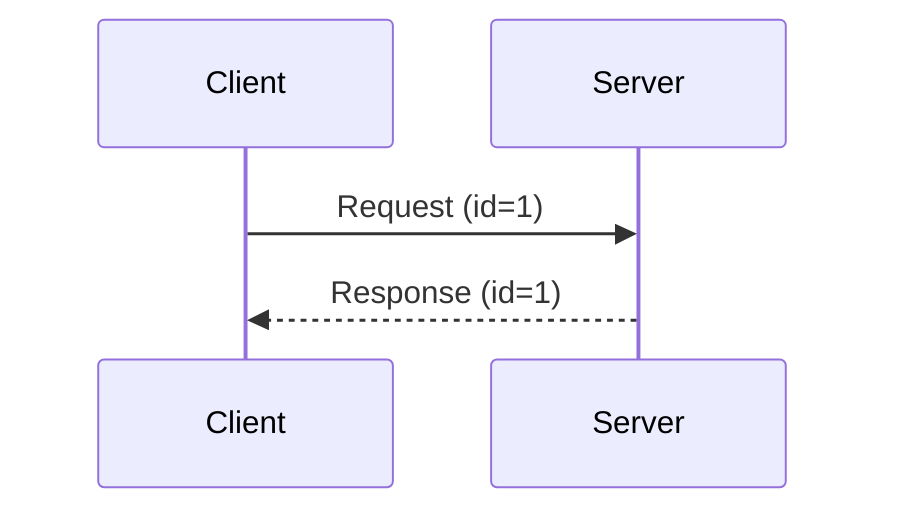
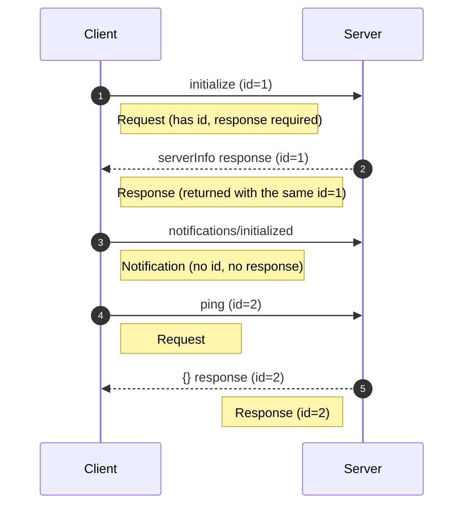
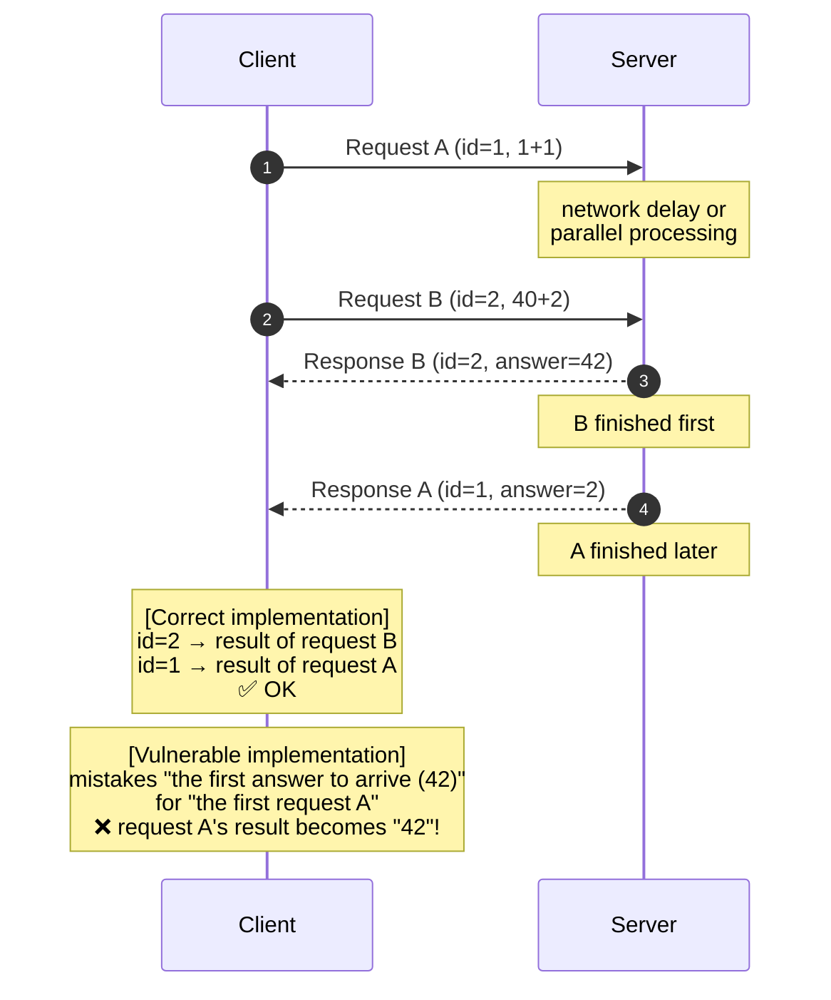
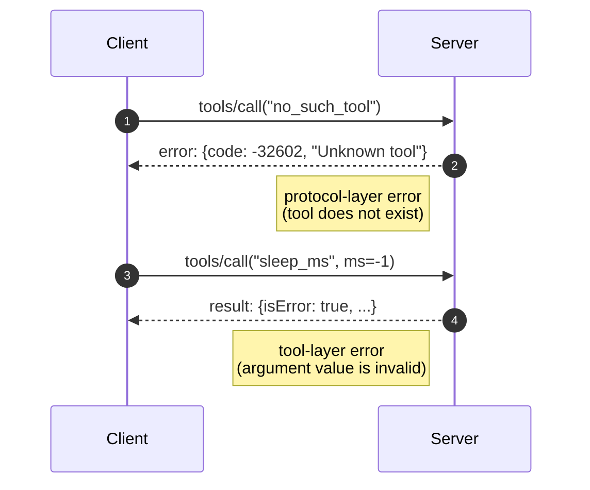
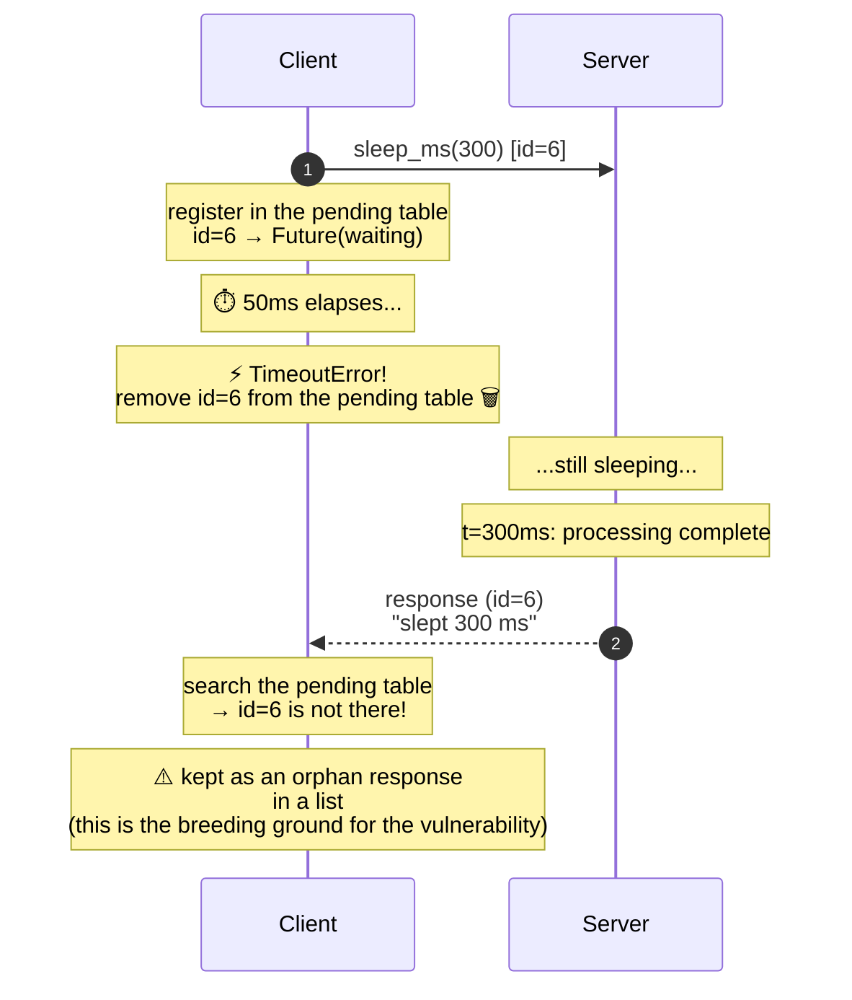
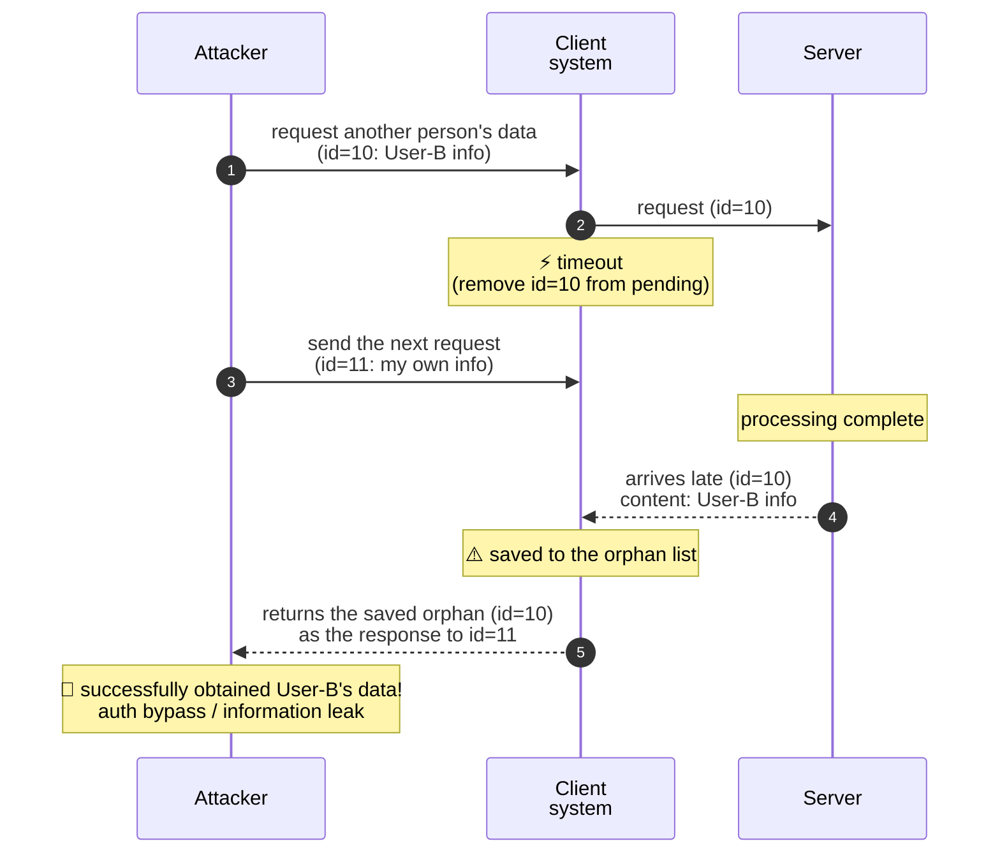
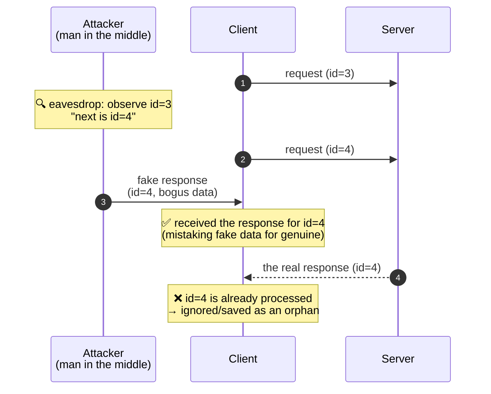
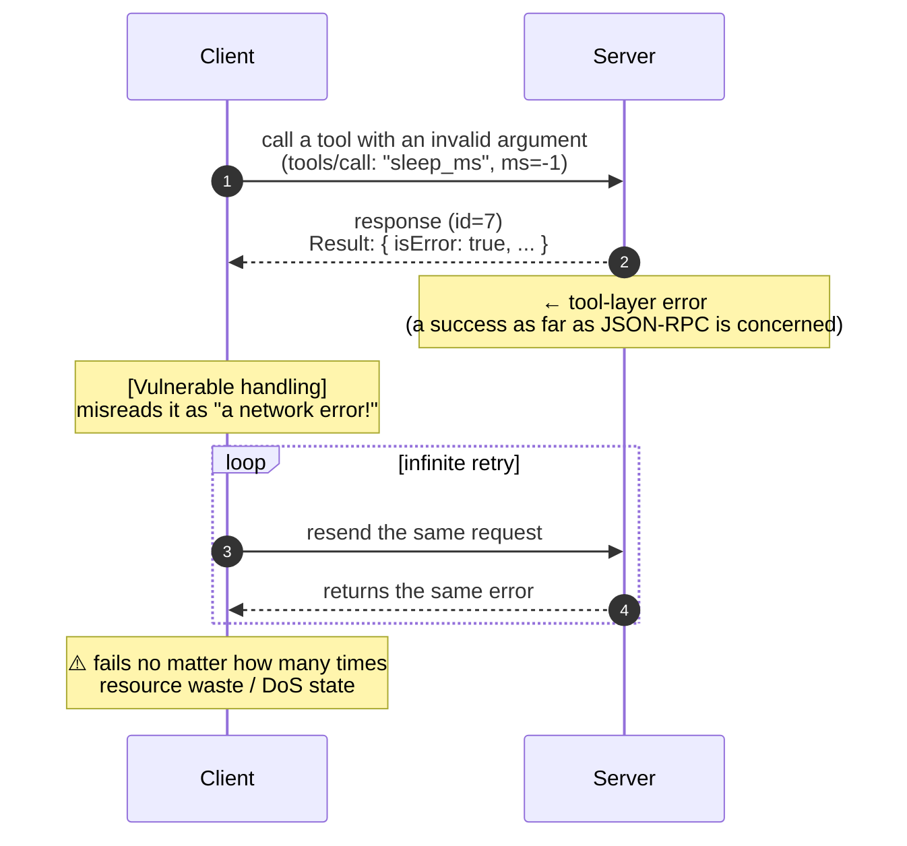

[日本語](README.md) | **English**

# Async RPC Failure Simulator – Failure Mode Simulator for Asynchronous RPC Designs

[](https://github.com/ipusiron/async-rpc-failure-simulator)


**Day112 - Security Tools 200 Built with Generative AI**

**Async RPC Failure Simulator** reproduces, as repeatable experiments, the design-level failure modes that are common in asynchronous RPC clients: **timeouts, late (orphan) responses, and request/response mismatches**.

This repository uses the stdio transport of MCP (Model Context Protocol) as its subject, but the failure modes themselves are **common to asynchronous RPC in general**.

---

## What it does

With this tool you can reproduce and observe the following phenomena.

- **Out-of-order request / response** in asynchronous RPC
- **Late responses (orphan responses)** that arrive after a timeout
- Cleanup of the pending table on timeout, and its side effects
- The difference between a **protocol-layer error (`-32602`)** from an unknown tool and a **tool-layer error (`result.isError`)** from an invalid argument
- Distinguishing protocol-layer errors from application-layer errors

Note: this is not an attack tool. It is teaching material for learning **the boundary where a design mistake turns into a security incident**.

---

## 📸 Screenshots

> 
>
> *Execution result of the test program `scenarios_test.py`*

> 
>
> *Web UI comparing "retain for observation vs discard"*

---

## Intended readers

- Engineers unfamiliar with asynchronous processing
- Developers working with MCP / Agents / tool calling
- Beginner to intermediate security learners
- Anyone interested in "designs that are dangerous even though they are not attacks"

---

## 📚 Learning guide for when you get stuck

If the tool or this README does not click, we recommend learning the following prerequisites in order.

### 1. Basics of asynchronous processing (most important)

The core of this tool is "asynchrony". Understand the following concepts.

| Concept | Description |
|------|------|
| Sync vs async | "Wait for the result before moving on" vs "move on without waiting" |
| Future/Promise | "An object representing a result that has not arrived yet" |
| Timeout | "Give up if the result does not arrive within a set time" |

**Learning resources:**
- Python docs: [concurrent.futures](https://docs.python.org/3/library/concurrent.futures.html)
- Keywords: "Python asynchronous programming introduction", "Python Future usage"

### 2. The client/server model

Understand the basic pattern of "send a request, receive a response".



**Key points:**
- Requests and responses are correlated by `id`
- If you send multiple requests at once, the order of responses is not guaranteed

**Learning resources:**
- Keywords: "how HTTP request/response works", "WebSocket introduction"

### 3. Basics of multithreading

In this tool the "main thread" and the "reader thread" run at the same time.

| Thread | Role |
|---------|------|
| Main thread | Sends requests and waits for results |
| Reader thread | Continuously watches for responses from the server and, on receipt, sets the result on the matching Future |

**Learning resources:**
- Python docs: [threading](https://docs.python.org/3/library/threading.html)
- Keywords: "Python threading introduction", "multithreading mutual exclusion"

### 4. JSON-RPC 2.0 (a light touch is enough)

This is the protocol MCP adopts. The following is all you need.

| Item | Description |
|------|------|
| `id` field | The identifier that ties a request to its response |
| Request | Has `id` → a response is required |
| Notification | No `id` → no response needed |

**Learning resources:**
- [JSON-RPC 2.0 specification](https://www.jsonrpc.org/specification) (in English, but short)

### 5. MCP (Model Context Protocol)

This is the protocol the tool is built around. It is drawing attention as a communication standard between AI agents and tools.

| Concept | Description |
|------|------|
| stdio transport | A communication style using standard input/output (stdin/stdout) |
| `initialize` | The handshake that starts a client/server connection |
| `tools/call` | The method that calls a tool the server provides |
| MCP Inspector | A GUI tool for testing MCP servers |

**Learning resources:**
- [MCP official documentation](https://modelcontextprotocol.io/)
- [MCP Transport specification (relationship to JSON-RPC)](https://modelcontextprotocol.io/specification/2025-11-25/basic/transports)
- Keywords: "MCP Model Context Protocol introduction", "Claude MCP"

### Learning order

```
1. Async  ─→  2. Client/Server  ─→  3. Multithreading  ─→  4. JSON-RPC  ─→  5. MCP
     ↓                ↓                      ↓                   ↓             ↓
 Future/timeout    match by id        reader thread       protocol base   this tool's subject
```

### Concepts you learn with this tool

Building on the prerequisites above, this tool lets you learn the following concepts hands-on.

| Term | Description |
|------|------|
| orphan response | A "nobody's" response that arrives after a timeout. Because it comes from the server after the client gave up waiting, no matching request is found |
| demux (demultiplexing) | Dispatching multiple responses to the correct request by id. The mechanism that keeps out-of-order responses from being mismatched |
| pending table | A dictionary that manages the ids and Futures of "sent, awaiting response" requests. Removing an entry on timeout is what produces an orphan |
| TOCTOU | Time Of Check to Time Of Use. A timing gap between the moment of checking and the moment of using |

Once you understand these, "why orphan responses occur" and "why predictable ids are dangerous" should become clear.

---

## Prerequisites

- Python 3.9 or later
- Standard library only (no extra libraries)
- Node.js / npx if you use MCP Inspector

---

## Setup (venv)

Here we use the venv's Python by absolute path, without activating the venv.

```
ipusiron@MHL:~/async-rpc-failure-simulator$ pwd
/home/ipusiron/async-rpc-failure-simulator
ipusiron@MHL:~/async-rpc-failure-simulator$ python3 -m venv venv
ipusiron@MHL:~/async-rpc-failure-simulator$ ls -l ./venv/bin/python
lrwxrwxrwx 1 ipusiron ipusiron 7 Jan 29 02:46 ./venv/bin/python -> python3
ipusiron@MHL:~/async-rpc-failure-simulator$ ./venv/bin/python --version
Python 3.10.12
```

---

## Setup (uv)

[uv](https://docs.astral.sh/uv/) is a fast Python package manager and virtual-environment tool. To use uv instead of venv, set up as follows.

### Installing uv

```bash
# macOS / Linux
curl -LsSf https://astral.sh/uv/install.sh | sh

# Windows (PowerShell)
powershell -ExecutionPolicy ByPass -c "irm https://astral.sh/uv/install.ps1 | iex"
```

### Creating and running the virtual environment

```
ipusiron@MHL:~/async-rpc-failure-simulator$ uv venv
Using CPython 3.10.12
Creating virtual environment at: .venv
Activate with: source .venv/bin/activate

ipusiron@MHL:~/async-rpc-failure-simulator$ uv run python --version
Python 3.10.12
```

### Running the tests

With uv, use `uv run python` instead of `./venv/bin/python`.

```bash
# Start the MCP server
uv run python ./mcp/demo_server.py

# Failure-mode reproduction test (retain/observe policy)
uv run python mcp/scenarios_test.py

# Discard-policy test
uv run python mcp/scenarios_test_secure.py

# Exploit integration test (vulnerable success / secure fail)
uv run python challenges/challenge1_orphan_hijack/integration_test.py

# Start the Web UI
uv run python web/server.py
```

> **Note**: This project uses the standard library only, so `uv pip install` to install dependencies is unnecessary.

> **Windows**: If Japanese output is garbled, set `set PYTHONIOENCODING=utf-8` (PowerShell: `$env:PYTHONIOENCODING="utf-8"`) before running. To make the console itself UTF-8, `chcp 65001` also helps.

> **venv vs uv**: Because this project is "standard library only", uv's main strength (fast dependency resolution) does not come into play. There is little practical difference either way, so if you are already used to uv, use `uv run python`; otherwise `venv` is enough.

---

## Unit-testing the MCP server

The MCP server is specified as follows.

- stdout: nothing is printed (JSON only)
- stderr: startup logs appear
- Stop with [Ctrl]+[C]

```
ipusiron@MHL:~/async-rpc-failure-simulator$ ./venv/bin/python ./mcp/demo_server.py
MCP demo server started (stdio transport)
```

When you run the MCP server, the startup log "MCP demo server started (stdio transport)" appears.

The question is whether this output goes to stderr rather than stdout. Under the stdio transport, "stdout is JSON only" is an absolute rule.

If this passes, you have cleared the first gate for Inspector compatibility.

### Test 1 — checking that stdout is not polluted

Redirect stdout to `/tmp/mcp_stdout.txt` as follows.

```
ipusiron@MHL:~/async-rpc-failure-simulator$ ./venv/bin/python ./mcp/demo_server.py > /tmp/mcp_stdout.txt
MCP demo server started (stdio transport)
^C
Traceback (most recent call last):
  File "/home/ipusiron/async-rpc-failure-simulator/./mcp/demo_server.py", line 236, in <module>
    main()
  File "/home/ipusiron/async-rpc-failure-simulator/./mcp/demo_server.py", line 218, in main
    for line in sys.stdin:
KeyboardInterrupt

ipusiron@MHL:~/async-rpc-failure-simulator$ ls -l /tmp/mcp_stdout.txt
-rw-r--r-- 1 ipusiron ipusiron 0 Jan 29 02:55 /tmp/mcp_stdout.txt
ipusiron@MHL:~/async-rpc-failure-simulator$ wc -c /tmp/mcp_stdout.txt
0 /tmp/mcp_stdout.txt
```

Stop the server (or from another terminal) and check the size of `/tmp/mcp_stdout.txt`. If it is 0 bytes, it is empty, so the startup log is indeed going to stderr.

### Test 2 — one manual round trip (ping)

Because stdio needs the input sent to the same process's stdin, the simplest way is to do it in one command.

Check stdout only.

```
ipusiron@MHL:~/async-rpc-failure-simulator$ printf '%s\n' '{"jsonrpc":"2.0","id":1,"method":"ping"}' | ./venv/bin/python mcp/demo_server.py 2>/dev/null
{"jsonrpc": "2.0", "id": 1, "result": {}}
```

Check stderr only.

```
ipusiron@MHL:~/async-rpc-failure-simulator$ printf '%s\n' '{"jsonrpc":"2.0","id":1,"method":"ping"}' | ./venv/bin/python mcp/demo_server.py 1>/dev/null
MCP demo server started (stdio transport)
```

---

## Connecting to the MCP server with Inspector

Connect to the MCP server from Inspector (a pseudo MCP client + UI) with the following command.

```
ipusiron@MHL:~/async-rpc-failure-simulator$ npx -y @modelcontextprotocol/inspector@0.19.0 --   ./venv/bin/python ./mcp/demo_server.py
```

Check Inspector's Resources/Tools tabs.

> 
>
> *Inspector Resources tab*

> 
>
> *Inspector Tools tab*

In Inspector you can confirm the following.

- initialize
- resources/list (empty array)
- resources/templates/list (empty array)
- tools/list
- tools/call(add_numbers)
- tools/call(sleep_ms)

---

## Failure-mode reproduction test (main)

`mcp/scenarios_test.py` is a test MCP client that reproduces the failure cases.

```
$ ./venv/bin/python mcp/scenarios_test.py
[PASS] initialize
[PASS] ping
[PASS] request ID correlation
[PASS] results: 3, 42
[PASS] completed requests removed from pending
[PASS] unknown tool: protocol error -32602
[PASS] invalid tool value: result.isError
[PASS] late response arrived
[PASS] one timeout
[PASS] one orphan response
[PASS] orphan retained only for observation
[PASS] timed-out request removed from pending
STATS {'requests_sent': 7, 'responses_received': 6, 'orphans_observed': 1, 'orphans_discarded': 0, 'timeouts': 1, 'invalid_messages': 0}
```

The output is deliberately terse for verification, and each `[PASS]` line maps to a scenario explained below. Detailed visualization of ids and statistics is available in the Web UI. Note that `no_such_tool` returns a protocol-layer error (`-32602`) and an invalid argument to `sleep_ms` (`ms=-1`) returns a tool-layer error (`result.isError`); the two kinds of error are distinguished.

### Detailed explanation of each scenario

---

#### SCENARIO 1: Handshake (the MCP protocol initialization sequence)



**What is happening:**
1. `initialize`: the client starts the connection. The server returns `serverInfo` (name, version)
2. `notifications/initialized`: the client notifies that initialization is complete. **Because a notification has no `id`, the server does not respond**
3. `ping`: a liveness check. If an empty object `{}` comes back, the round trip works

**Learning points:**
- In JSON-RPC, a message with an `id` is a "request"; one without is a "notification"
- Returning a response to a notification risks becoming an "orphan response" on the client side

---

#### SCENARIO 2: Asynchronous demux (multiplexing and out-of-order responses)

In asynchronous communication, the request order and the response order do not necessarily match. If matching by id (demux) is not done correctly, a mix-up occurs.



**A real-world example of the vulnerable case (HTTP desync):**
When a reverse proxy reuses connections, responses get mixed in and another user's response is shown to a different user — this has actually happened (HTTP desync, response queue poisoning).

**What is happening:**
1. The client sends two requests back to back **without waiting** (fire-and-forget)
2. The server processes them in order and returns responses
3. The client **collects the results in reverse order (id=4 first, id=3 later)**
4. Because it still matches by `id`, it does not mix up the results

**The relevant test code:**
```python
# Deliberately wait in reverse order (the point is that out-of-order does not cause a mix-up)
resp2 = fut2.result(timeout=5)  # wait for id=4 first
resp1 = fut1.result(timeout=5)  # wait for id=3 later
```

**Learning points:**
- In asynchronous RPC the response order is not guaranteed (network delay, in-server parallelism, etc. can reorder it)
- **If demultiplexing by `id` is not implemented correctly, responses get mismatched**
- This test confirms that "a correct implementation does not mix them up"

---

#### SCENARIO 3: Distinguishing protocol-layer errors from tool-layer errors



**What is happening:**
1. Calling the nonexistent tool `no_such_tool` makes the server return a **JSON-RPC error field** (`code: -32602`). This is a protocol-layer error
2. Passing an invalid argument (`ms=-1`) to the existing tool `sleep_ms` makes the server return **`result.isError`**. This is a tool-layer (application-layer) error

**Response shapes:**

Nonexistent tool → protocol-layer error
```json
{"jsonrpc": "2.0", "id": 6, "error": {"code": -32602, "message": "Unknown tool"}}
```

Invalid argument value → tool-layer error
```json
{"jsonrpc": "2.0", "id": 7, "result": {"isError": true, "content": [{"type": "text", "text": "Invalid arguments"}]}}
```

**Learning points:**
- MCP distinguishes "protocol-layer errors" from "tool-layer errors"
- **Protocol-layer error** (JSON-RPC level): shape `{"error": {"code": ...}}`. In this tool, calling a nonexistent tool returns `-32602`
- **Tool-layer error** (MCP/application level): shape `{"result": {"isError": true, ...}}`. In this tool it is returned when the argument value is invalid
- Confusing the two breaks error handling (e.g., retrying forever because a tool-layer error is mistaken for a protocol-layer one)

---

#### SCENARIO 4: Timeout → observing the late (orphan) response

This is the **core scenario** of this simulator.



**Key point:**
- At `t=50ms` the client forgets the id, but at `t=300ms` the server's reply for that id arrives
- This is called an "orphan"
- **Vulnerable implementation:** if you keep the arriving orphan in a list instead of discarding it, it leads to an attack

**What is happening (step by step):**

1. **t=0ms**: the client sends `sleep_ms(300)`. It registers `id=6` in the pending table
2. **t=0–50ms**: the client waits for a response with `timeout=0.05s`
3. **t=50ms**: timeout. It raises `TimeoutError` and **removes id=6 from the pending table**
4. **t=50–300ms**: the server is still in `sleep(300ms)`. It does not know the client timed out
5. **t=300ms**: the server completes and returns a response with `id=6`
6. **t=300ms+α**: the client's reader thread receives the response, but `id=6` is not in the pending table
7. **Result**: this response is stored in the `orphan_responses` list as an **orphan response**

**The relevant test code:**
```python
# In the reader thread
if fut is None:
    # not in the table -> orphan (e.g. a late response after a timeout)
    self.orphan_responses.append(data)
```

**Why this can be a problem:**
- If you **reuse or cache** an orphan response, it may be mismatched with a later request
- Example: the orphan of id=6 is mistaken for the response to the next request, id=7
- This is a "design mistake"; a correct implementation **discards the orphan or logs it explicitly**

---

### This is not an anomaly

The orphan-response phenomenon above is **not a bug; it is something that can always occur by design in asynchronous RPC**.

- The server does not know the client's timeout setting
- Even if the client gives up, the server keeps processing (unless there is a cancellation mechanism)
- The delayed response will always come back

**What matters is whether the design anticipates this phenomenon.**

---

## 🔓 Visualizing attack scenarios

Here we show, with Mermaid diagrams, how the failure modes observed above can develop into actual attacks.

### Attack 1: Orphan Response Hijacking (response mix-up attack)

An attack scenario that arises when an orphan response is reused instead of being properly discarded. The attacker manipulates timing to obtain another person's data.



**Conditions for the attack:**
- The client saves orphan responses in a list instead of discarding them
- The attacker tunes timing so that another user's response becomes an "orphan"
- The saved orphan is mistakenly returned as the response to the next request

**Risk:** auth bypass, leakage of personal data, session hijacking

---

### Attack 2: Fake-response injection by id prediction

If you use sequential ids (1, 2, 3...) for request ids, an attacker can predict the next id and impersonate the server.



**Conditions for the attack:**
- Ids are generated by a simple increment such as `self._next_id += 1`
- The attacker can sniff packets on the network (man in the middle)
- The attacker's response reaches the client before the server's

**Countermeasure (robust implementation):** generate ids with a cryptographically secure random source such as `secrets.token_hex(16)` to make them unpredictable

---

### Attack 3: Confusing tool-layer and protocol-layer errors

A design mistake where mistaking the kind of error leads to retrying errors that should not be retried (or vice versa).



**Why the distinction matters:**
| Error kind | Shape | Should you retry? |
|-----------|------|-----------------|
| Protocol layer (JSON-RPC) | `{"error": {"code": -32601, ...}}` | Depends (OK if it is a transient failure) |
| Tool layer (MCP/app) | `{"result": {"isError": true, ...}}` | Generally no (a logic error) |

---

### Security implications

| Problem pattern | Risk | Countermeasure |
|-------------|--------|------|
| Reusing orphan responses | Response mix-up (possible auth bypass, etc.) | Discard orphans immediately, or log them strictly |
| Not ignoring unknown-id responses | An attacker can inject fake responses | Log a warning for unknown ids and discard |
| Confusing tool-layer and protocol-layer errors | Failure of appropriate retry/fallback handling | Separate error kinds clearly |
| Holding resources after a timeout | DoS (resource exhaustion) | Remove reliably from the table on timeout |

---

## 🛡️ Experiments with scenarios_test_secure.py

### Roles of the files

| File | Role |
|---------|------|
| `client.py` | The shared base (`StdioClient`). The `discard_orphans` flag switches id generation and orphan handling |
| `scenarios_test.py` | Scenario test with `discard_orphans=False` (retain/observe) |
| `secure_client.py` | A thin wrapper with `discard_orphans=True` (discard + random ids) (`SecureStdioMcpClient`). Adds a timeout-range warning |
| `scenarios_test_secure.py` | Scenario test using `SecureStdioMcpClient` |

The point is not that the vulnerable and robust versions are separate implementations, but that **the same `client.py` is switched by a flag**.

### Core of client.py (the parts switched by the flag)

```python
# Id generation: cryptographic random under the discard policy, sequential otherwise
def _issue_id(self):
    if self.discard_orphans:
        return secrets.token_hex(16)   # unpredictable
    self._next_id += 1
    return self._next_id               # 1, 2, 3... (predictable)

# On receipt: if there is no matching waiter, treat it as an orphan
def _accept(self, data):
    ...
    future = self._pending.pop(response_id, None)
    if future is None or future.done():
        self.stats["orphans_observed"] += 1
        if self.discard_orphans:
            self.stats["orphans_discarded"] += 1   # record the count only, discard
        else:
            self.orphan_responses.append(data)      # keep for observation (reusable and dangerous)
        self.orphan_event.set()
        return
    ...

# Synchronous request: validate the timeout and always remove from the table in finally (TOCTOU defense)
def request(self, method, params, timeout=5.0):
    if ...timeout is not finite and positive...:
        raise ValueError("Timeout must be finite and greater than zero")
    request_id, future = self.send_request(method, params)
    try:
        return future.result(timeout=timeout)
    finally:
        self._remove_pending(request_id, future)
```

**Three things the flag switches:**
1. **Id generation**: `secrets.token_hex(16)` (unpredictable) when `discard_orphans`, sequential otherwise
2. **Orphan handling**: record the count only and discard when `discard_orphans`, otherwise save to `orphan_responses` (reusable and dangerous)
3. **Table cleanup**: `request()` always calls `_remove_pending` in `finally`, so nothing is left dangling on a timeout

### Core of secure_client.py

```python
class SecureStdioMcpClient(StdioClient):
    def __init__(self, python_exe, server_script):
        super().__init__(python_exe, server_script, discard_orphans=True)

    def request(self, method, params, timeout=None):
        if timeout is None:
            timeout = DEFAULT_TIMEOUT
        # out of range -> warn only (does not force the value)
        if type(timeout) in (int, float) and (timeout < MIN_TIMEOUT or timeout > MAX_TIMEOUT):
            log_security("WARN", "Timeout is outside the recommended 0.1-30 s range; not clamped.")
        return super().request(method, params, timeout)
```

`secure_client.py` sets `discard_orphans=True` and is a thin wrapper that only warns when the timeout is outside the recommended range (0.1–30 s). The warning does not change the value.

### Core of scenarios_test_secure.py

It runs the same scenario functions as `scenarios_test.py` with `SecureStdioMcpClient`. In the timeout → orphan scenario, since the policy is discard, it confirms that `orphans_discarded` increases and nothing remains in `orphan_responses`.

```python
# The relevant assertions in scenarios_test.py (excerpt)
if client.discard_orphans:
    check(not client.orphan_responses and after["orphans_discarded"] == 1,
          "orphan payload discarded")
else:
    check(len(client.orphan_responses) == 1,
          "orphan retained only for observation")
```

**Difference by policy:**
- Retain/observe (`discard_orphans=False`): saved to `orphan_responses` → reusable and dangerous
- Discard (`discard_orphans=True`): only the count in `orphans_discarded` → not reusable

### How to run

With the MCP server `demo_server.py` running, run `scenarios_test_secure.py` with the command below. `secure_client.py` must also be in place.

```
$ ./venv/bin/python mcp/scenarios_test_secure.py
[WARN] Timeout is outside the recommended 0.1-30 s range; not clamped.
[PASS] initialize
[PASS] ping
[PASS] request ID correlation
[PASS] results: 3, 42
[PASS] completed requests removed from pending
[PASS] unknown tool: protocol error -32602
[PASS] invalid tool value: result.isError
[PASS] late response arrived
[PASS] one timeout
[PASS] one orphan response
[PASS] orphan payload discarded
[PASS] timed-out request removed from pending
STATS {'requests_sent': 7, 'responses_received': 6, 'orphans_observed': 1, 'orphans_discarded': 1, 'timeouts': 1, 'invalid_messages': 0}
Random IDs are not authentication. Timeout warnings do not prevent DoS.
```

The difference from the retain version is concentrated at the end. The retain version shows `orphan retained only for observation` (`orphans_discarded: 0`); the discard version shows `orphan payload discarded` (`orphans_discarded: 1`). An out-of-range timeout is `not clamped` — a warning only, with the value unchanged. As the final line states, random ids are not a substitute for authentication, and timeout warnings do not prevent DoS (a design lesson, not an actual mitigation). The contrast between the two is easiest to see visually in the Web UI.

### How the robust implementation relates to the CVEs / attack scenarios

This section explains how far `secure_client.py` works as a defense against the CVE cases introduced here. We separate what a client-side implementation can prevent (response mix-ups, id guessing) from what can only be mitigated server-side (resource-exhaustion DoS).

---

#### Relationship to CVE-2023-44487 (HTTP/2 Rapid Reset)

**Nature of the vulnerability**: even if the client cancels with RST_STREAM right after sending a request, the server keeps processing asynchronously and consuming resources. Repeating this at scale exhausts the server's resources — a server-side DoS.

What this simulator reproduces is only the client-side symptom. The asynchronous property "the server keeps working even after the client timed out" (SCENARIO 4) has the same structure, but the resource exhaustion itself happens on the server. Therefore the client-side timeout-range check is not a mitigation for this attack.

```python
# secure_client.py: out of range -> warn only (does not force the value)
if type(timeout) in (int, float) and (timeout < MIN_TIMEOUT or timeout > MAX_TIMEOUT):
    log_security("WARN", "Timeout is outside the recommended 0.1-30 s range; not clamped.")
```

| Category | Content |
|------|------|
| Similar design lesson | Extreme timeout values can be a sign of an operational anomaly, so make them noticeable with a warning log |
| What the implementation actually does | Does not clamp out-of-range values. It only warns and processing continues as is |
| Actual mitigation (server side) | Done with server-side resource management: limits on concurrent streams, rate-limiting RST_STREAM, aborting in-flight requests, etc. |

**Correspondence with the experiment:**
```
[WARN] Timeout is outside the recommended 0.1-30 s range; not clamped.
```
→ It warns on a timeout outside the recommended range (0.1–30 s). This is an operational marker to notice an abnormal value, not a feature that stops the Rapid Reset attack itself.

---

#### Countermeasure for response mix-ups (HTTP desync)

**Nature of the vulnerability**: when a reverse proxy or backend connection is reused, an error-handling or parsing slip breaks the request/response correspondence and the previous response bleeds into the next request. It leads to an information leak where another user's response is returned. This is a class of bug known as HTTP request/response smuggling (desync, response queue poisoning).

**Countermeasure in the robust implementation:**

```python
# client.py _accept: with discard_orphans=True, record the count only instead of saving
if future is None or future.done():
    self.stats["orphans_observed"] += 1
    if self.discard_orphans:
        self.stats["orphans_discarded"] += 1   # ← do not save (not reusable)
    else:
        self.orphan_responses.append(data)      # ← keep for observation (reusable and dangerous)
    self.orphan_event.set()
    return
```

| Countermeasure point | Effect |
|-------------|------|
| Do not save orphans | Fundamentally prevents the "previous response bleeds into the next request" situation |
| The `orphans_observed` / `orphans_discarded` stats | Lets you monitor whether orphans occur at an abnormal rate |
| Record the count only | No payload is kept, so it cannot be reused |

**Correspondence with the experiment:**
```
[PASS] orphan payload discarded
STATS {... 'orphans_discarded': 1 ...}
```
→ The count of orphans is kept in the stats, but nothing is stored in a reusable list. The "response bleed-through" that is the problem in desync cannot occur structurally.

---

#### Countermeasure for the CryptoNote Wallet JSON-RPC vulnerability

**Nature of the vulnerability**: a predictable request_id lets an attacker inject fake responses.

**Countermeasure in the robust implementation:**

```python
# client.py _issue_id: cryptographic random when discard_orphans, sequential otherwise
def _issue_id(self):
    if self.discard_orphans:
        return secrets.token_hex(16)  # 128-bit unpredictable id
    self._next_id += 1
    return self._next_id              # sequential (predictable)
```

| Countermeasure point | Effect |
|-------------|------|
| `secrets.token_hex(16)` | 128-bit (16-byte) cryptographic random, unpredictable |
| String-typed id | No worry about integer overflow |
| Collision probability 2^-128 | Id duplication/collision essentially never occurs |

→ With sequential ids, an attacker can guess "the next id is 7" and inject a fake response; cryptographic-random ids cannot be guessed. The CLI test output is terse and does not show id values, but the Web UI shows both side by side for visual comparison.

---

#### Countermeasure for the Juniper Junos RPC Race Condition (CVE-2016-1267)

**Nature of the vulnerability**: there is a timing gap between the permission check and the actual operation, and the state can be changed in between (a TOCTOU attack).

**Countermeasure in the robust implementation:**

```python
# client.py request: always remove from the table in finally, regardless of success/failure
def request(self, method, params, timeout=5.0):
    ...
    request_id, future = self.send_request(method, params)
    try:
        return future.result(timeout=timeout)
    finally:
        self._remove_pending(request_id, future)  # ← always remove from the table
```

| Countermeasure point | Effect |
|-------------|------|
| Reliable removal in `finally` | Removes from the table reliably even on exception/timeout |
| Use of a lock (`self._lock`) | Keeps consistency under concurrent access from multiple threads |
| Removal in the completed Future's callback too | Calls `_remove_pending` from `add_done_callback` to avoid misses |

**Resistance to TOCTOU attacks:**
- Under either policy (retain or discard), `request()` removes the id from the table on timeout → minimizing the window in which it is "dangling"

---

#### Countermeasure for Orange Tsai's Confusion Attacks

**Nature of the vulnerability**: components interpret semantics differently, which is abused for auth bypass.

**Countermeasure in the robust implementation:**

```python
# secure_client.py sends security logs to stderr so as not to pollute stdout
def log_security(level, message):
    print(f"[{level}] {message}", file=sys.stderr)
```

| Countermeasure point | Effect |
|-------------|------|
| Log to stderr | Does not pollute stdout (JSON only) |
| Level-tagged (`[WARN]`, etc.) | Lets you distinguish ordinary logs from security notices |
| Distinguish protocol- and tool-layer errors | As in SCENARIO 3, errors by layer are not confused |

**From the Confusion-Attacks-prevention angle:**
- Handling "what happened at which layer" distinctly avoids confusing semantics
- Example: nonexistent tool → protocol-layer error (`-32602`), invalid argument value → tool-layer error (`result.isError`)

---

#### Summary of countermeasure effects

| CVE/attack scenario | Problem in the vulnerable version | Countermeasure in the robust version | Confirmation in the experiment |
|-----------------|-------------------|-------------------|-------------|
| HTTP/2 Rapid Reset | No timeout limit | Out-of-range warning only (mitigation is server-side) | `[WARN] Timeout is outside the recommended 0.1-30 s range; not clamped.` |
| Response mix-up (HTTP desync) | Saves orphans to a list | Records the count only instead of saving | `orphans_discarded: 1` (`[PASS] orphan payload discarded`) |
| CryptoNote id prediction | Sequential ids (1,2,3...) | Cryptographic-random ids | `secrets.token_hex(16)` (visualized in the Web UI) |
| Juniper TOCTOU | Unreliable table removal | finally + lock | `[PASS] timed-out request removed from pending` |
| Confusion Attacks | Logs mixed into stdout | Level-tagged logs to stderr | The error-layer distinction in SCENARIO 3 |

---

## ⚠️ Problems caused by design mistakes

What problems do the failure modes reproduced here cause in real systems? We explain from three angles: performance, operations, and security.

### Performance impact

| Design mistake | Problem | Concrete example |
|---------|------|--------|
| Keeping the pending table after a timeout | **Memory leak** | The pending table grows over long operation and crashes with OOM (Out of Memory) |
| Buffering orphan responses without limit | **Memory exhaustion** | Hoarding late responses instead of discarding them pressures the heap |
| A design that waits synchronously for responses | **Lower throughput** | Waiting per request prevents parallelism |
| Lock contention in demux processing | **Higher latency** | Lock waits when multiple threads access the pending table |

### Operational trouble

| Design mistake | Problem | Concrete example |
|---------|------|--------|
| No logging of orphan responses | **Hard to find the cause of an incident** | For a report of "responses somehow never come back", you cannot tell whether the cause is a timeout or a communication error |
| Confusing error kinds (protocol vs tool layer) | **Wrong retry handling** | A tool error (business-logic failure) is mistaken for a protocol error (transient failure) and retried forever |
| Duplicate/exhausted request_ids | **Response mix-up** | A 32-bit integer id overflows and collides with a past id |
| Lack of a server-side cancellation mechanism | **Resource waste** | Even if the client times out, the server keeps processing and wastes CPU and DB connections |

### Security risks (most important)

| Design mistake | Attack scenario | Severity |
|---------|-------------|--------|
| **Reusing orphan responses** | The attacker tunes timing to tie another user's response to their own request | **Critical** - auth bypass, info leak |
| **Accepting unknown-id responses** | The attacker injects a fake response (arbitrary id) and makes the client return a wrong result | **High** - data tampering, logic manipulation |
| **Predictable request_id** | Guessing a sequential or time-based id and swapping the response in a man-in-the-middle attack | **High** - session hijacking |
| **Excessive information disclosure in error messages** | Including stack traces or internal paths in tool errors | **Medium** - a foothold for reconnaissance |
| **External control of the timeout value** | Letting user input set an extremely long timeout to occupy resources | **Medium** - DoS |

### A real-incident example (fictional scenario)

```
[Situation]
- An MCP-based AI agent implements a tool that calls an external API
- The design reuses post-timeout orphan responses as a "cache"

[Attack]
1. Attacker A sends a request to "get User B's personal data"
2. While the server is processing, attacker A causes a timeout
3. The orphan response (User B's personal data) remains in the cache
4. Attacker A sends the next request
5. The orphan response is returned from the cache, obtaining User B's data

[Root cause]
- A design mistake: reusing orphan responses without discarding them
- Insufficient binding between request_id and the user session
```

### Correct design guidelines

| Principle | How to implement |
|------|----------|
| **Discard orphans immediately** | For a response whose id is not in the table, record only the count and drop the payload |
| **request_id is cryptographic random** | Generate with UUID v4 or a CSPRNG to make it unpredictable |
| **Timeout is a fixed value** | Do not let external input change the timeout value |
| **Separate error kinds clearly** | Retry protocol errors; notify the user of tool errors |
| **Implement a cancellation mechanism** | Send a cancellation notice to the server on client timeout |

---

### Vulnerable vs robust implementation (code comparison)

This repository switches the same `client.py` with the `discard_orphans` flag, so you can try both the retain/observe policy and the discard policy.

#### How to run

```bash
# Vulnerable (observe the failure modes)
./venv/bin/python mcp/scenarios_test.py

# Robust (confirm the correct design)
./venv/bin/python mcp/scenarios_test_secure.py
```

#### Code differences

| Aspect | Retain/observe (`discard_orphans=False`) | Discard (`discard_orphans=True`) |
|------|----------------------------------|----------------------------------|
| **request_id generation** | `self._next_id += 1` (sequential) | `secrets.token_hex(16)` (cryptographic random) |
| **orphan response** | `self.orphan_responses.append(data)` (save) | `stats["orphans_discarded"] += 1` (discard) |
| **Timeout** | `client.py` validates a finite, positive value | `secure_client.py` warns out-of-range (does not change the value) |
| **Statistics** | Obtained via `get_stats()` | Obtained via `get_stats()` (`orphans_discarded` increases) |

#### Id-generation comparison

```python
# client.py _issue_id: one flag switches sequential/random
def _issue_id(self):
    if self.discard_orphans:
        return secrets.token_hex(16)  # → "a3f8c9e1..." (unpredictable)
    self._next_id += 1
    return self._next_id              # → 1, 2, 3... (predictable)
```

#### Orphan-handling comparison

```python
# client.py _accept: the flag switches save/discard
if future is None or future.done():
    self.stats["orphans_observed"] += 1
    if self.discard_orphans:
        self.stats["orphans_discarded"] += 1   # ← record the count only (not reusable)
    else:
        self.orphan_responses.append(data)      # ← save (reusable and dangerous)
```

#### Example output of the robust implementation

```
$ ./venv/bin/python mcp/scenarios_test_secure.py
[WARN] Timeout is outside the recommended 0.1-30 s range; not clamped.
...(the [PASS] lines for SCENARIO 1-4 follow)
[PASS] orphan payload discarded
[PASS] timed-out request removed from pending
STATS {'requests_sent': 7, 'responses_received': 6, 'orphans_observed': 1, 'orphans_discarded': 1, 'timeouts': 1, 'invalid_messages': 0}
Random IDs are not authentication. Timeout warnings do not prevent DoS.
```
The robust version shows `orphan payload discarded` and `orphans_discarded` increases to 1 (the vulnerable version stays at `orphan retained only for observation` with 0).

---

### Real-world security cases / CVEs

The failure modes this simulator deals with have been reported as serious vulnerabilities in real products.

#### 1. HTTP/2 Rapid Reset Attack (CVE-2023-44487)

**Related failure mode**: stream multiplexing (demux) and resource management

| Item | Content |
|------|------|
| **CVSS** | 7.5 (High) |
| **Impact** | Abused for the **largest DDoS attacks on record** at major clouds such as Google, Cloudflare, and AWS |
| **Cause** | Abuses HTTP/2's stream reset. When the client sends a cancel (RST_STREAM) right after a request, the server considers "the stream is closed" but **the backend keeps processing asynchronously**. Repeating this at scale exhausts resources |
| **Relevance to this simulator** | The same structure as SCENARIO 4's "the server keeps processing even after the timeout" |

> Reference: [Cloudflare - HTTP/2 Rapid Reset Attack](https://blog.cloudflare.com/technical-breakdown-http2-rapid-reset-ddos-attack/)

---

#### 2. Response mix-up (HTTP desync / response queue poisoning)

**Related failure mode**: response mix-up (demux failure)

| Item | Content |
|------|------|
| **Impact** | An information leak where **another user's response is returned** through a reverse proxy |
| **Cause** | The front end and back end interpret request boundaries differently (desync), and when the connection is reused **the previous response bleeds into the next request** |
| **Relevance to this simulator** | A real-world example of SCENARIO 2's "if demux by id is not implemented correctly, responses get mixed up" |

> Reference: [PortSwigger - HTTP request smuggling](https://portswigger.net/web-security/request-smuggling)

---

#### 3. Bugzilla JSON-RPC CSRF (CVE-2012-0440)

**Related failure mode**: security design of JSON-RPC

| Item | Content |
|------|------|
| **Impact** | **Any JSON-RPC API could be executed** via an authenticated user's browser. Admin privilege takeover and access to security bugs |
| **Cause** | The JSON-RPC endpoint allowed bypassing the CSRF token check. `Content-Type: application/json` was not enforced, so an ordinary form submission could attack it |
| **Relevance to this simulator** | SCENARIO 3's "confusing protocol- and tool-layer errors" — ambiguous authentication/authorization layers get abused |

> Reference: [Bugzilla Bug 718319](https://bugzilla.mozilla.org/show_bug.cgi?id=718319)

---

#### 4. Juniper Junos RPC Race Condition (CVE-2016-1267)

**Related failure mode**: a race condition in asynchronous processing

| Item | Content |
|------|------|
| **Impact** | An authenticated user could **take ownership of an arbitrary file** and escalate to root |
| **Cause** | A "lazy race condition" in RPC — there is a timing gap between the permission check and the actual operation, and the state can be changed in between |
| **Relevance to this simulator** | A time-gap attack similar to the "dangling state" that arises between a timeout and the orphan response |

> Reference: [Juniper Security Bulletin JSA10730](https://kb.juniper.net/InfoCenter/index?page=content&id=JSA10730)

---

#### 5. CryptoNote Wallet JSON-RPC unauthenticated vulnerability

**Related failure mode**: authentication design of JSON-RPC

| Item | Content |
|------|------|
| **Impact** | **Funds could be stolen** from a cryptocurrency wallet |
| **Cause** | The JSON-RPC server ran on localhost without authentication. When the user opened a malicious web page, the wallet API was called via the browser (DNS rebinding / CSRF) |
| **Relevance to this simulator** | It is easy to assume an MCP server is "safe because it is stdio", but depending on the IPC path it can become a target |

> Reference: [CryptoNote Unauthenticated JSON-RPC](https://www.ayrx.me/cryptonote-unauthenticated-json-rpc/)

---

#### 6. Orange Tsai's Confusion Attacks (presented at Black Hat 2024)

**Related failure mode**: confusion of semantics

| Item | Content |
|------|------|
| **Impact** | On Apache HTTP Server, **access-control/auth bypass, access to the whole filesystem, and escalation from XSS to RCE** |
| **Cause** | `r->filename` is interpreted differently by different modules (file path vs URL). This **semantic inconsistency** leads directly to auth bypass |
| **Relevance to this simulator** | SCENARIO 3's "confusing tool-layer and protocol-layer errors" — when semantics per layer are ambiguous, features get invoked via unexpected paths |

> Reference: [Confusion Attacks - Orange Tsai](https://blog.orange.tw/posts/2024-08-confusion-attacks-en/)

---

#### Summary: why these vulnerabilities arise

| Root cause | Relevant CVE/case |
|---------|-------------|
| Insufficient resource lifecycle management in asynchronous processing | HTTP/2 Rapid Reset |
| Incomplete binding (demux) of responses to requests | Response mix-up (HTTP desync) |
| Ambiguous authentication/authorization layers | Bugzilla JSON-RPC CSRF, CryptoNote |
| Not accounting for time gaps (TOCTOU) | Juniper RPC race condition |
| Semantic inconsistency between components | Confusion Attacks |

**All of these stem from "oversights at the design stage", and this simulator is a tool to experience them beforehand.**

---

## 🌐 Understand it visually in the Web UI

A Web UI lets you compare the two policies, "retain for observation" and "discard", side by side in the browser. You can switch between Japanese and English.

> **Note**: This Web UI is a **replay of fixed teaching material**. It does not connect to a Python server or a network. Times, ids, and counts are model values, not measurements. To see real communication, run `scenarios_test.py` or `scenarios_test_secure.py` from the CLI.

### How to start

```bash
./venv/bin/python web/server.py
```

The browser opens `http://localhost:8080`. You can change the port with an argument (e.g. `web/server.py 8081`).

### Layout

- **Top**: the title and, at the top right, the language toggle (English / 日本語)
- **Buttons**: "Play: retain for observation", "Play: discard", "Stop and clear"
- **Left/right panels**: "retain for observation" and "discard" side by side. Each panel has two columns, Client and Server, and draws the exchange from 0ms to 1000ms as a timeline
- **Model counts**: below each panel, the counts of requests sent, responses matched to requests, timeouts, and late responses retained/discarded
- **Policies and limits**: a table of the two policies' differences (request id, unmatched response, Python wait timeout) and "What this teaching example does not guarantee"

> 

### Difference between the two policies

| Observation point | Retain for observation | Discard |
|-------------|------------|------|
| Request id | Sequential; correlate by matching id | Illustrative random id notation; not authentication |
| Unmatched response (orphan) | Retain up to 100 for observation; never reassign | Count without retaining the payload |
| Python wait timeout | A finite positive number | Warn outside 0.1–30 s (does not change the value) |

In the 1000ms row, retain shows "retain late response" and discard shows "discard late response". Both share the point "no matching pending request (orphan)".

### What this teaching example does not guarantee

As the Web UI also states, this material provides no sender authentication, access control, server-side cancellation, or general DoS protection. Random ids and separating logs to stderr alone do not prevent attacks. Retention alone does not necessarily leak information; exposing stored responses to other users, or reusing them for unrelated requests, is what creates the problem.

### Learning steps with the Web UI

1. Run "Play: retain for observation" and "Play: discard" and compare the left/right panels
2. Follow the flow where 0ms–700ms is identical for both, a timeout happens at 750ms, and the late response (orphan) arrives at 1000ms
3. In the 1000ms row, confirm that retain keeps the late response for observation while discard records only the count and drops the content
4. In "Policies and limits", confirm the difference between sequential and random ids, and that the wait timeout is warned only and not forced

### FAQ

**Q: Is it communicating with a real MCP server?**

A: **No, it is not.** The Web UI is a replay of fixed teaching material.

| Item | Web UI | CLI test |
|------|--------|----------|
| Start MCP server | No | Yes |
| Real communication | No | Yes |
| Data source | Fixed model values | Real requests/responses |
| Purpose | Visual understanding of concepts | Confirming real behavior |

To see real communication:
```bash
./venv/bin/python mcp/scenarios_test.py
./venv/bin/python mcp/scenarios_test_secure.py
```

**Q: What if port 8080 is unavailable?**

A: You can specify another port.

```bash
./venv/bin/python web/server.py 8081
```

**Q: Can I switch the display to English?**

A: Use the "English" button at the top right to switch between Japanese and English. Your chosen language is remembered in the browser.

---

## 🎯 CTF-style hands-on attack challenge

This tool includes a CTF (Capture The Flag) style challenge to put what you learned into practice.

### Challenge 1: Orphan Response Hijacking

**Difficulty**: ★★☆☆☆ (beginner to intermediate)

**Scenario**:
You are a security researcher. You received a report that an MCP server used in a company's internal system has a vulnerability. Multiple users access this server, and it manages each user's secret information. You can access as the "guest" user, and your goal is to obtain the "admin" user's secret (the FLAG).

**Goal**:
```
Obtain the admin user's secret (FLAG{...})
```

**Difficulty modes**:
| Mode | Description |
|--------|------|
| 🟢 Easy | Source reference OK; use a fill-in-the-blank template |
| 🟡 Normal | Do not look at the source; build the attack from behavior (practical) |
| 🔴 Hard | No hints; recon → analyze → attack entirely on your own |

**What you can learn**:
- What an orphan response is
- Why saving orphans is dangerous
- The basics of timing attacks
- Countermeasures (discard orphans, cryptographic-random ids)
- Vulnerability-finding techniques in black-box testing (Normal/Hard modes)

**File layout**:
```
challenges/challenge1_orphan_hijack/
├── README.md              # detailed instructions
├── vulnerable_server.py   # the vulnerable target server
├── exploit_template.py    # fill-in-the-blank exploit script (Easy mode)
├── hint1.txt              # hint 1: the direction of the attack
├── hint2.txt              # hint 2: concrete technique
├── hint_blackbox.txt      # black-box attack technique (Normal/Hard modes)
└── solution.py            # the model answer (last resort)
```

**How to run**:

```bash
# Terminal 1: start the vulnerable server
cd challenges/challenge1_orphan_hijack
../../venv/bin/python vulnerable_server.py

# Terminal 2: edit and run the exploit script
cd challenges/challenge1_orphan_hijack
# edit exploit_template.py to complete the attack
../../venv/bin/python exploit_template.py
```

**Example output on a successful attack** (from the model answer):
```
[*] Step 1: log in as guest
[+] login succeeded

[*] Step 2: trigger admin activity

[*] Step 3: waiting for an orphan to occur...

[*] Step 4: fetch the orphan response

[*] Step 5: extract the FLAG

[PASS] FLAG retrieved: FLAG{0rph4n_r3sp0ns3_h1j4ck3d_succ3ssfully}
```

You can pin this behavior with the integration test, which asserts that the exploit succeeds against the vulnerable server (exit 0 + FLAG) and fails against the discard policy (`--discard-orphans`, non-zero exit):

```bash
./venv/bin/python challenges/challenge1_orphan_hijack/integration_test.py
```

---

## 📁 Directory structure

```
async-rpc-failure-simulator/
├── README.md                      # Japanese documentation
├── README.en.md                   # this document (English)
├── CLAUDE.md                      # guide for Claude Code
├── LICENSE                        # MIT License
├── .gitignore
├── .nojekyll                      # for GitHub Pages (disables Jekyll)
│
├── .github/
│   └── workflows/
│       └── test.yml               # CI (runs the 3 tests on ubuntu/Python 3.11)
│
├── mcp/                           # MCP implementation (core)
│   ├── demo_server.py             #   MCP server (stdio transport, Inspector-compatible)
│   ├── client.py                  #   shared client (discard_orphans flag switches save/discard)
│   ├── scenarios_test.py          #   scenario test with the retain/observe policy
│   ├── secure_client.py           #   thin wrapper for the discard policy + timeout warning
│   └── scenarios_test_secure.py   #   scenario test with the discard policy
│
├── web/                           # Web UI (visualization tool)
│   ├── index.html                 #   main page (markup)
│   ├── style.css                  #   styles
│   ├── core.js                    #   scenario-replay logic
│   ├── messages.js                #   JA/EN message dictionary
│   ├── app.js                     #   rendering and language switching
│   └── server.py                  #   web server (standard library only)
│
├── challenges/                    # CTF-style hands-on attack challenge
│   └── challenge1_orphan_hijack/  #   Challenge 1: Orphan Response Hijacking
│       ├── README.md              #     detailed instructions
│       ├── vulnerable_server.py   #     the vulnerable target server
│       ├── exploit_template.py    #     fill-in-the-blank exploit script (Easy mode)
│       ├── solution.py            #     the model answer
│       ├── integration_test.py    #     integration test pinning vulnerable-success / secure-fail
│       ├── hint1.txt              #     hint 1: the direction of the attack
│       ├── hint2.txt              #     hint 2: concrete technique
│       └── hint_blackbox.txt      #     black-box attack technique
│
├── docs/                          # slides and reference material
│   └── Async_Failure_Simulator.pdf #   explanatory slides
│
└── assets/                        # documentation images
    ├── screenshot.png             #   test execution result
    ├── screenshot2.png            #   Web UI (retain vs discard), Japanese
    ├── screenshot2.en.png         #   Web UI (English)
    ├── screenshot_mobile.png      #   Web UI (mobile width)
    ├── inspector_demo_server.png  #   Inspector Resources tab
    └── inspector_demo_server2.png #   Inspector Tools tab
```

---

## 📄 License

- For the source-code license, see the `LICENSE` file.

---

## 🛠️ About this tool

This tool was developed as part of the "Security Tools 200 Built with Generative AI" project, an effort to build and publish a variety of security-related tools over 200 days with the help of AI.

For details of the project and other tools, see the page below.

🔗 [https://akademeia.info/?page_id=44607](https://akademeia.info/?page_id=44607)
