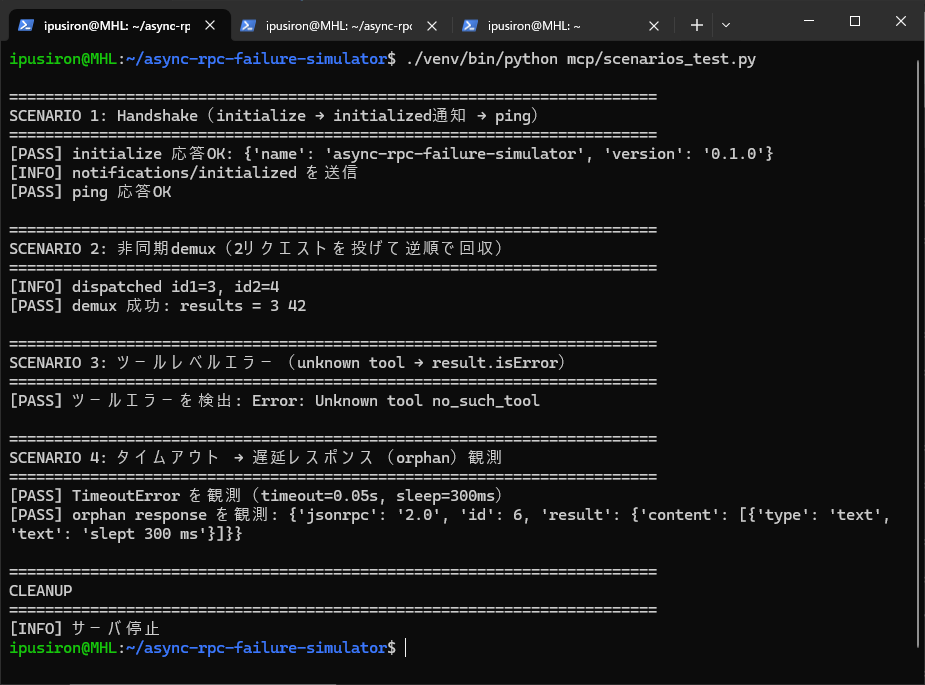
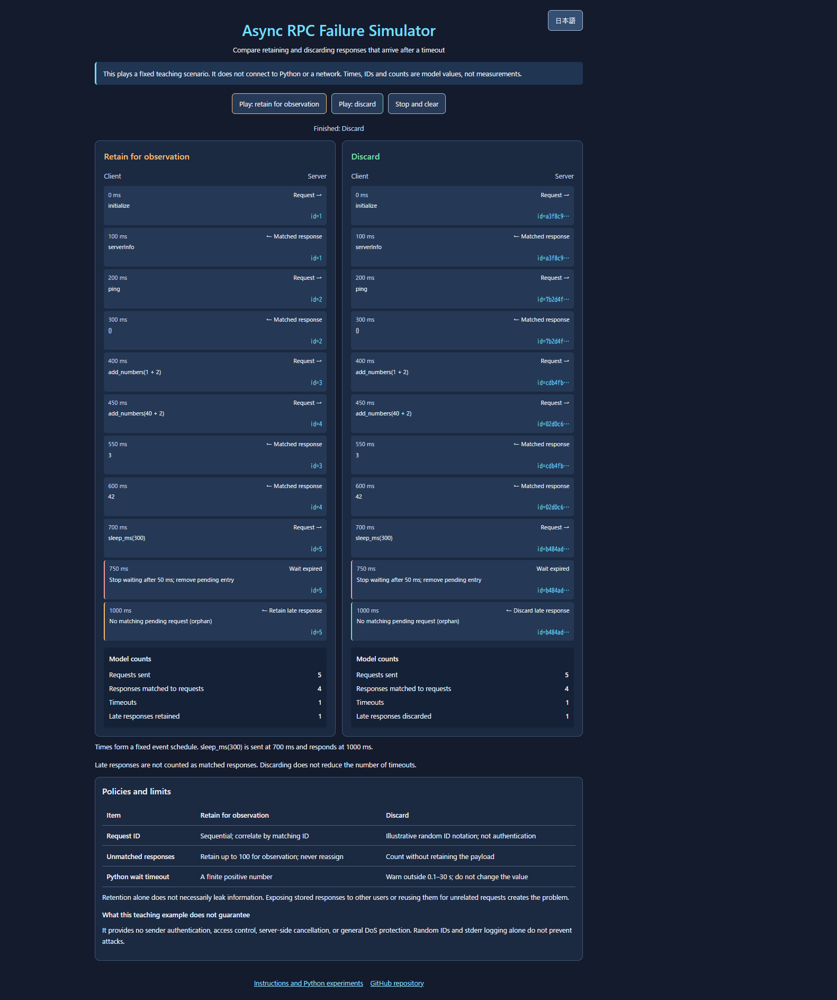

[日本語](README.md) | **English**

# Async RPC Failure Simulator – Failure Mode Simulator for Asynchronous RPC Designs

[](https://github.com/ipusiron/async-rpc-failure-simulator)


**Day112 - Security Tools 200 Built with Generative AI**

**Async RPC Failure Simulator** reproduces, as repeatable experiments, the design-level failure modes that are common in asynchronous RPC clients: **timeouts, late (orphan) responses, and request/response mismatches**.

This repository uses the stdio transport of MCP (Model Context Protocol) as its subject, but the failure modes themselves are **common to asynchronous RPC in general**.

---

## What it does

With this tool you can reproduce and observe the following phenomena.

- **Out-of-order request / response** in asynchronous RPC
- **Late responses (orphan responses)** that arrive after a timeout
- Cleanup of the pending table on timeout, and its side effects
- The difference between a **protocol-layer error (`-32602`)** from an unknown tool and a **tool-layer error (`result.isError`)** from an invalid argument
- Distinguishing protocol-layer errors from application-layer errors

Note: this is not an attack tool. It is teaching material for learning **the boundary where a design mistake turns into a security incident**.

---

## 📸 Screenshots

> 
>
> *Execution result of the test program `scenarios_test.py`*

> 
>
> *Web UI comparing "retain for observation vs discard"*

---

## Intended readers

- Engineers unfamiliar with asynchronous processing
- Developers working with MCP / Agents / tool calling
- Beginner to intermediate security learners
- Anyone interested in "designs that are dangerous even though they are not attacks"

---

## Quick start

- Python 3.9+ (standard library only, no extra installs)
- For detailed setup (venv/uv), unit tests, and Inspector, see [docs/en/tutorial.md](docs/en/tutorial.md)

```bash
# Failure-mode reproduction test
./venv/bin/python mcp/scenarios_test.py
# Robust (discard policy) test
./venv/bin/python mcp/scenarios_test_secure.py
# Web UI (browser: http://localhost:8080)
./venv/bin/python web/server.py
```

## 📚 Documentation

| Document | Contents |
|------|------|
| [tutorial.md](docs/en/tutorial.md) | Learning guide, setup, unit tests, Inspector |
| [scenarios.md](docs/en/scenarios.md) | Failure-mode reproduction (SCENARIO 1-4), attack scenarios, robust experiments |
| [security.md](docs/en/security.md) | Problems from design mistakes, code comparison, real CVE cases |
| [web-ui.md](docs/en/web-ui.md) | Using the Web UI, CTF challenge |

## 📁 Directory structure

```
async-rpc-failure-simulator/
├── README.md                      # Japanese documentation
├── README.en.md                   # this document (English)
├── CLAUDE.md                      # guide for Claude Code
├── LICENSE                        # MIT License
├── .gitignore
├── .nojekyll                      # for GitHub Pages (disables Jekyll)
│
├── .github/
│   └── workflows/
│       └── test.yml               # CI (runs the 3 tests on ubuntu/Python 3.11)
│
├── mcp/                           # MCP implementation (core)
│   ├── demo_server.py             #   MCP server (stdio transport, Inspector-compatible)
│   ├── client.py                  #   shared client (discard_orphans flag switches save/discard)
│   ├── scenarios_test.py          #   scenario test with the retain/observe policy
│   ├── secure_client.py           #   thin wrapper for the discard policy + timeout warning
│   └── scenarios_test_secure.py   #   scenario test with the discard policy
│
├── web/                           # Web UI (visualization tool)
│   ├── index.html                 #   main page (markup)
│   ├── style.css                  #   styles
│   ├── core.js                    #   scenario-replay logic
│   ├── messages.js                #   JA/EN message dictionary
│   ├── app.js                     #   rendering and language switching
│   └── server.py                  #   web server (standard library only)
│
├── challenges/                    # CTF-style hands-on attack challenge
│   └── challenge1_orphan_hijack/  #   Challenge 1: Orphan Response Hijacking
│       ├── README.md              #     detailed instructions
│       ├── vulnerable_server.py   #     the vulnerable target server
│       ├── exploit_template.py    #     fill-in-the-blank exploit script (Easy mode)
│       ├── solution.py            #     the model answer
│       ├── integration_test.py    #     integration test pinning vulnerable-success / secure-fail
│       ├── hint1.txt              #     hint 1: the direction of the attack
│       ├── hint2.txt              #     hint 2: concrete technique
│       └── hint_blackbox.txt      #     black-box attack technique
│
├── docs/                          # detailed docs (Japanese) + reference material
│   ├── tutorial.md                #   learning guide, setup, tests
│   ├── scenarios.md               #   failure-mode reproduction, attack scenarios, robust experiments
│   ├── security.md                #   design-mistake problems, code comparison, CVE cases
│   ├── web-ui.md                  #   Web UI, CTF challenge
│   ├── en/                        #   English versions of the above (tutorial/scenarios/security/web-ui)
│   └── Async_Failure_Simulator.pdf #   explanatory slides
│
└── assets/                        # documentation images
    ├── screenshot.png             #   test execution result
    ├── screenshot2.png            #   Web UI (retain vs discard), Japanese
    ├── screenshot2.en.png         #   Web UI (English)
    ├── screenshot_mobile.png      #   Web UI (mobile width)
    ├── inspector_demo_server.png  #   Inspector Resources tab
    └── inspector_demo_server2.png #   Inspector Tools tab
```

---

## 📄 License

- For the source-code license, see the `LICENSE` file.

---

## 🛠️ About this tool

This tool was developed as part of the "Security Tools 200 Built with Generative AI" project, an effort to build and publish a variety of security-related tools over 200 days with the help of AI.

For details of the project and other tools, see the page below.

🔗 [https://akademeia.info/?page_id=44607](https://akademeia.info/?page_id=44607)
