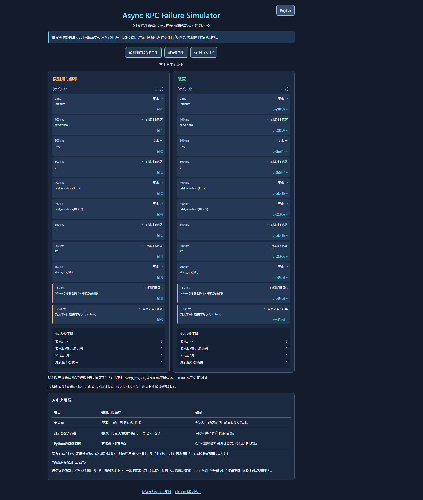
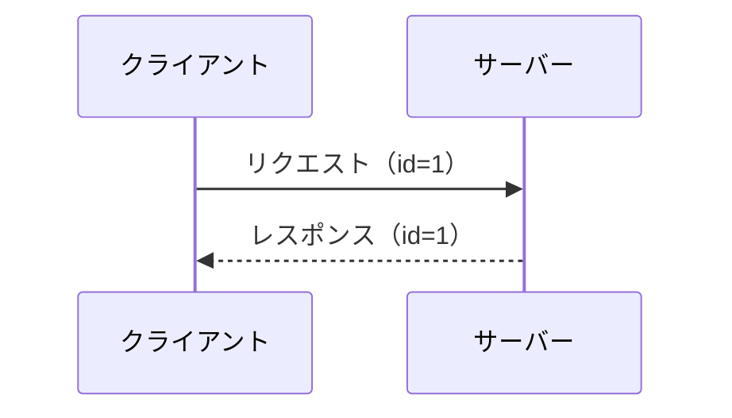
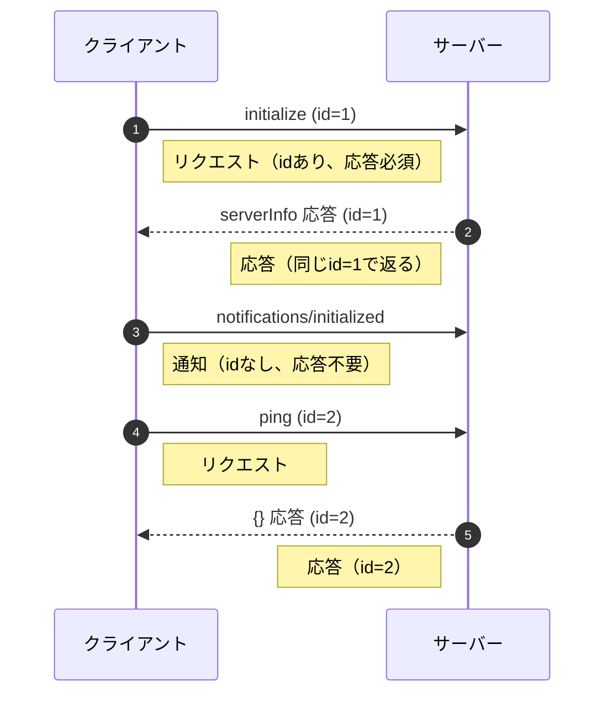
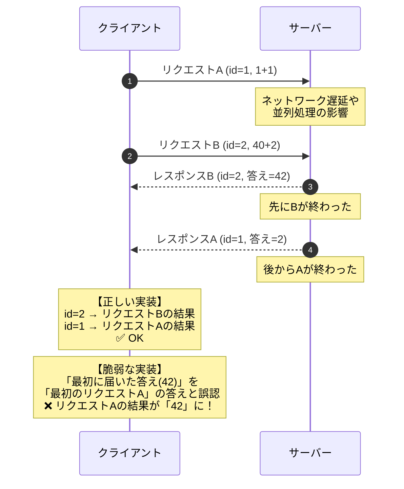
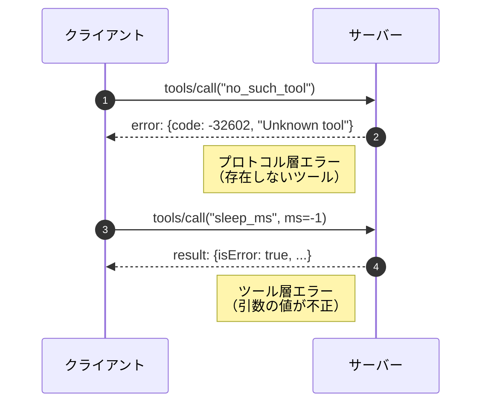
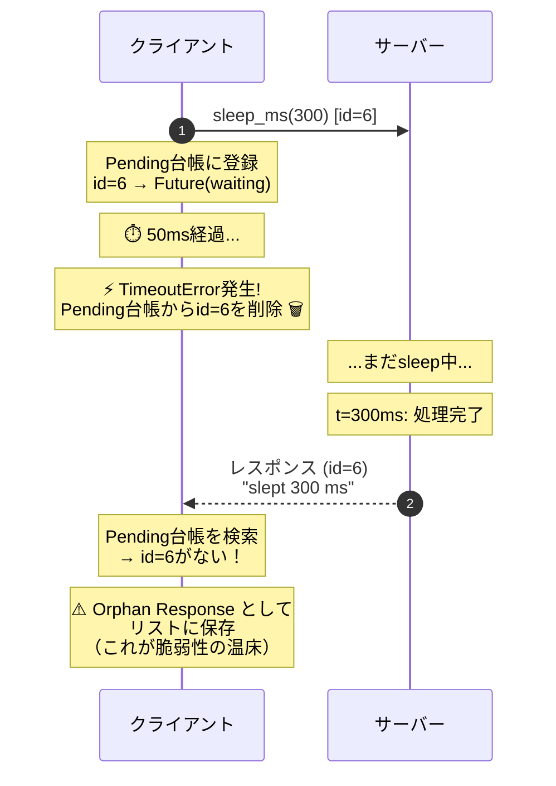
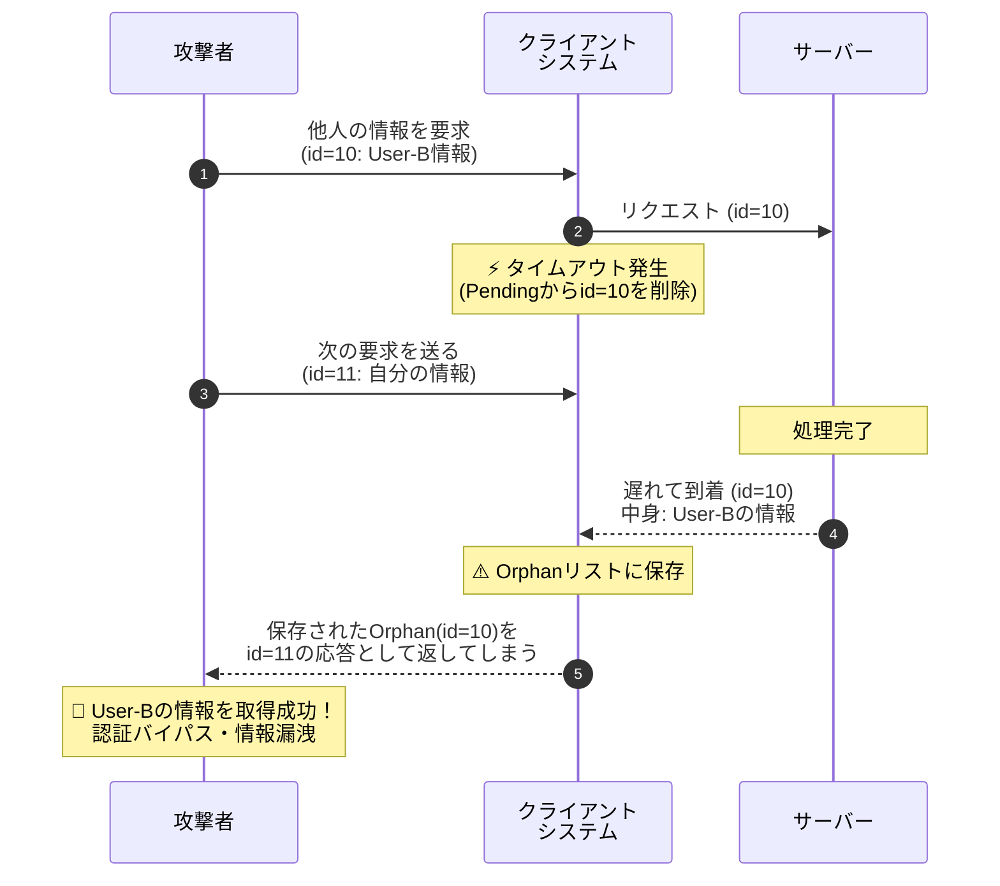
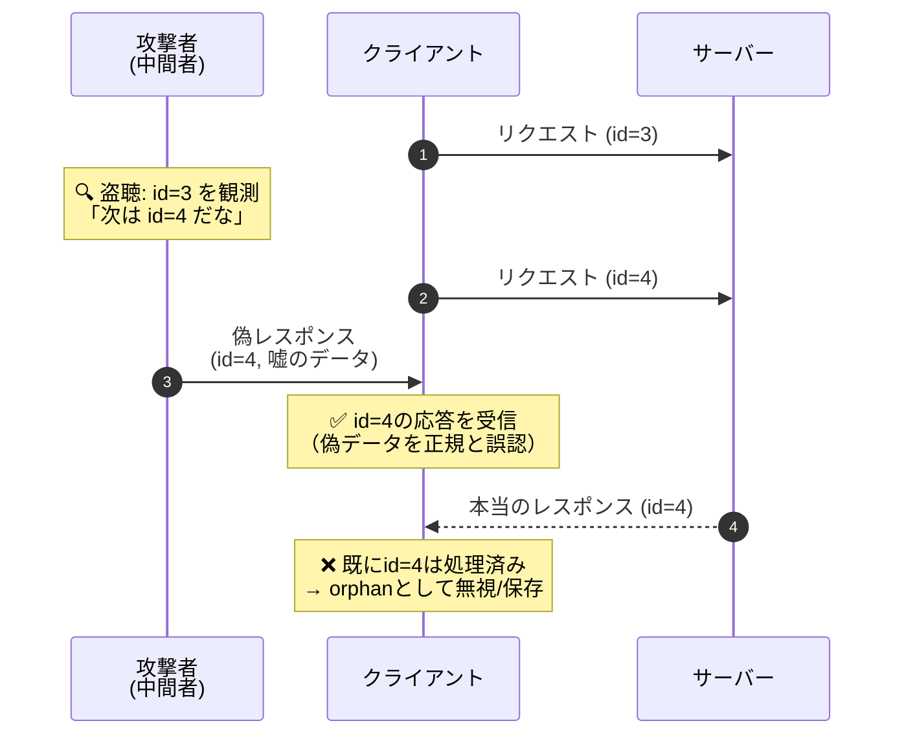
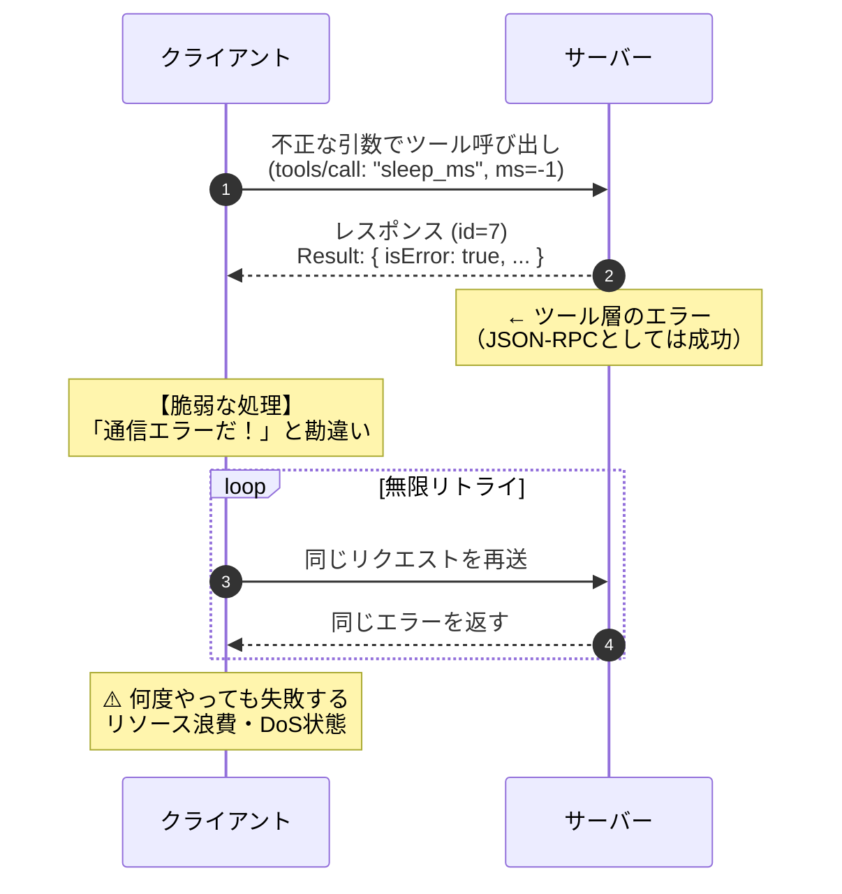

<!--
---
id: day112
slug: async-rpc-failure-simulator

title: "Async RPC Failure Simulator"

subtitle_ja: "非同期RPCにおける設計誤りの再現シミュレーター"
subtitle_en: "Failure Mode Simulator for Asynchronous RPC Designs"

description_ja: "非同期RPCにおけるタイムアウト・遅延レスポンス（orphan）・ID取り違えといった設計上の失敗モードを再現・観測する教育用シミュレーター。"
description_en: "An educational simulator that reproduces and observes failure modes in asynchronous RPC designs, including timeouts, orphan responses, and request/response mismatches."

category_ja:
  - 設計ミス可視化
  - 非同期セキュリティ
category_en:
  - Design Failure Visualization
  - Asynchronous Security

difficulty: 4

tags:
  - async
  - rpc
  - mcp
  - timeout
  - orphan-response
  - demultiplex
  - security-design

repo_url: "https://github.com/ipusiron/async-rpc-failure-simulator"

hub: true
---
-->

**日本語** | [English](README.en.md)

# Async RPC Failure Simulator – 非同期RPCにおける設計誤りの再現シミュレーター

[](https://github.com/ipusiron/async-rpc-failure-simulator)


**Day112 - 生成AIで作るセキュリティツール200**

**Async RPC Failure Simulator** は、非同期RPCクライアントにおいて発生しがちな**タイムアウト・遅延レスポンス（orphan response）・ID取り違え**といった設計上の失敗モードを、**再現可能な実験**として観測するためのシミュレーターです。

本リポジトリではMCP（Model Context Protocol）のstdio transportを題材にしていますが、扱っている失敗モード自体は **非同期RPC全般に共通**するものです。

---

## 何ができるか

このツールで次の現象を再現・観測できます。

- 非同期RPCにおける **request / response の順不同**
- タイムアウト後に返ってくる **遅延レスポンス（orphan response）**
- タイムアウトによるpending台帳掃除と、その副作用
- unknown toolによる **プロトコル層エラー（`-32602`）** と、不正な引数による **ツール層エラー（`result.isError`）** の違い
- プロトコル層エラーとアプリ層エラーの区別

※ 攻撃ツールではありません。**設計ミスがセキュリティ事故につながる境界**を学ぶための教材です。

---

## 📸 スクリーンショット

> 
>
> *テストプログラムである"scenarios_test.py"ファイルの実行結果*

> 
>
> *Web UIで「観測用に保存 vs 破棄」を比較*

---

## 想定読者

- 非同期処理に不慣れなエンジニア
- MCP/Agent/Tool callingを扱う開発者
- セキュリティ初学者〜中級者
- 「攻撃ではないが危険な設計」に関心のある人

---

## 📚 つまずいたときの学習ガイド

本ツールを使ったりREADMEを読んでもピンとこない場合、以下の前提知識を順番に学ぶことをおすすめします。

### 1. 非同期処理の基礎（最重要）

本ツールの核心は「非同期」です。以下の概念を理解しましょう。

| 概念 | 説明 |
|------|------|
| 同期 vs 非同期 | 「結果を待ってから次へ進む」vs「待たずに次へ進む」 |
| Future/Promise | 「まだ届いていない結果を表すオブジェクト」 |
| タイムアウト | 「一定時間待っても結果が来なければ諦める」 |

**学習リソース:**
- Python公式: [concurrent.futures](https://docs.python.org/ja/3/library/concurrent.futures.html)
- キーワード: 「Python 非同期処理 入門」「Python Future 使い方」

### 2. クライアント・サーバーモデル

「リクエストを送って、レスポンスを受け取る」という基本パターンを理解しましょう。



**ポイント:**
- リクエストとレスポンスは `id` で対応づける
- 複数のリクエストを同時に送ると、レスポンスの順番は保証されない

**学習リソース:**
- キーワード: 「HTTPリクエスト レスポンス 仕組み」「WebSocket 入門」

### 3. マルチスレッドの基礎

本ツールでは「メインスレッド」と「readerスレッド」が同時に動きます。

| スレッド | 役割 |
|---------|------|
| メインスレッド | リクエストを送信し、結果を待つ |
| readerスレッド | サーバーからの応答を常に監視し、受信したら対応するFutureに結果をセット |

**学習リソース:**
- Python公式: [threading](https://docs.python.org/ja/3/library/threading.html)
- キーワード: 「Python スレッド 入門」「マルチスレッド 排他制御」

### 4. JSON-RPC 2.0（軽めでOK）

MCPが採用しているプロトコルです。以下だけ押さえれば十分です。

| 項目 | 説明 |
|------|------|
| `id` フィールド | リクエストとレスポンスを紐づける識別子 |
| リクエスト | `id` あり → 応答が必要 |
| 通知（notification） | `id` なし → 応答不要 |

**学習リソース:**
- [JSON-RPC 2.0 仕様](https://www.jsonrpc.org/specification)（英語だが短い）

### 5. MCP（Model Context Protocol）

本ツールが題材としているプロトコルです。AIエージェントとツール間の通信規格として注目されています。

| 概念 | 説明 |
|------|------|
| stdio transport | 標準入出力（stdin/stdout）を使った通信方式 |
| `initialize` | クライアントとサーバーの接続開始ハンドシェイク |
| `tools/call` | サーバーが提供するツールを呼び出すメソッド |
| MCP Inspector | MCPサーバーをテストするためのGUIツール |

**学習リソース:**
- [MCP公式ドキュメント](https://modelcontextprotocol.io/)
- [MCP Transport仕様（JSON-RPCとの関係）](https://modelcontextprotocol.io/specification/2025-11-25/basic/transports)
- キーワード: 「MCP Model Context Protocol 入門」「Claude MCP」

### 学習の順番

```
1. 非同期処理 ─→ 2. クライアント・サーバー ─→ 3. マルチスレッド ─→ 4. JSON-RPC ─→ 5. MCP
     ↓                    ↓                        ↓                    ↓              ↓
  Future/timeout      id で突き合わせ         readerスレッド        プロトコル基盤    本ツールの題材
```

### 本ツールで学ぶ概念

上記の前提知識を踏まえた上で、本ツールでは以下の概念を体験的に学びます。

| 用語 | 説明 |
|------|------|
| orphan response | タイムアウト後に届いた「引き取り手のない」レスポンス。クライアントが待機を諦めた後にサーバーから届くため、対応するリクエストが見つからない |
| demux（多重分離） | 複数のレスポンスをIDで正しいリクエストに振り分ける処理。順不同で届くレスポンスを取り違えないための仕組み |
| pending台帳 | 「送信済み・応答待ち」のリクエストIDとFutureを管理する辞書。タイムアウト時にここから削除されることでorphanが発生する |
| TOCTOU | Time Of Check to Time Of Use。チェック時点と使用時点の間にタイミングギャップが生じる問題 |

これらを理解すると、「なぜorphan responseが発生するのか」「なぜIDの予測可能性が危険なのか」がクリアになるはずです。

---

## 前提条件

- Python 3.9以上
- 標準ライブラリのみ使用（追加ライブラリ不要）
- MCP Inspectorを使う場合はNode.js / npx

---

## セットアップ（venv）

今回はvenvを有効化せずに、絶対パスでvenvのPythonを使います。

```
ipusiron@MHL:~/async-rpc-failure-simulator$ pwd
/home/ipusiron/async-rpc-failure-simulator
ipusiron@MHL:~/async-rpc-failure-simulator$ python3 -m venv venv
ipusiron@MHL:~/async-rpc-failure-simulator$ ls -l ./venv/bin/python
lrwxrwxrwx 1 ipusiron ipusiron 7 Jan 29 02:46 ./venv/bin/python -> python3
ipusiron@MHL:~/async-rpc-failure-simulator$ ./venv/bin/python --version
Python 3.10.12
```

venvの環境構築ではまった場合は以下の記事を参考にしてください。

-[WSL2とvenvで分離するPython開発・実験環境設計【Windows編】](https://akademeia.info/?p=48605)

---

## セットアップ（uv）

[uv](https://docs.astral.sh/uv/)は高速なPythonパッケージマネージャー・仮想環境管理ツールです。venvの代わりにuvを使う場合は以下の手順で環境構築できます。

### uvのインストール

```bash
# macOS / Linux
curl -LsSf https://astral.sh/uv/install.sh | sh

# Windows (PowerShell)
powershell -ExecutionPolicy ByPass -c "irm https://astral.sh/uv/install.ps1 | iex"
```

### 仮想環境の作成と実行

```
ipusiron@MHL:~/async-rpc-failure-simulator$ uv venv
Using CPython 3.10.12
Creating virtual environment at: .venv
Activate with: source .venv/bin/activate

ipusiron@MHL:~/async-rpc-failure-simulator$ uv run python --version
Python 3.10.12
```

### テストの実行

uvを使う場合は、`./venv/bin/python`の代わりに`uv run python`を使用します。

```bash
# MCPサーバーの起動
uv run python ./mcp/demo_server.py

# 失敗モード再現テスト（脆弱な実装）
uv run python mcp/scenarios_test.py

# 堅牢な実装テスト
uv run python mcp/scenarios_test_secure.py

# 攻略コードの統合テスト（脆弱版success/安全版fail）
uv run python challenges/challenge1_orphan_hijack/integration_test.py

# Web UIの起動
uv run python web/server.py
```

> **Note**: 本プロジェクトは標準ライブラリのみを使用しているため、`uv pip install`による依存関係のインストールは不要です。

> **Windows**: 日本語の出力が文字化けする場合は、実行前に`set PYTHONIOENCODING=utf-8`（PowerShellは`$env:PYTHONIOENCODING="utf-8"`）を設定してください。コンソール自体をUTF-8にするには`chcp 65001`も有効です。

> **venv vs uv**: 本プロジェクトは「標準ライブラリのみ」という特殊な条件のため、uvの主な強み（高速な依存解決）が活きません。どちらを選んでも実用上の差はほとんどないため、既にuvを使い慣れているなら`uv run python`で統一し、そうでなければ`venv`で十分です。

---

## MCPサーバーの単体テスト

MCPサーバーは以下の仕様とします。

- stdout：何も出ない（JSON専用）
- stderr：起動ログが出る
- [Ctrl]＋[C]キーで停止

```
ipusiron@MHL:~/async-rpc-failure-simulator$ ./venv/bin/python ./mcp/demo_server.py
MCP デモサーバー起動（stdio transport）
```
MCPサーバーを実行すると起動ログ「MCP デモサーバー起動（stdio transport）」が出力します。

問題は、この出力がstdout（標準出力）ではなくstderr（標準エラー出力）に出ているかどうかでです。
stdio transportではstdoutはJSONのみが絶対ルールだからです。

これがクリアすれば、Inspector互換の第一関門クリアです。

### テスト1　＜stdoutが汚れていないかチェック＞

そこで、以下のようにstdoutを"/tmp/mcp_stdout.txt"ファイルに出力するようにします。

```
ipusiron@MHL:~/async-rpc-failure-simulator$ ./venv/bin/python ./mcp/demo_server.py > /tmp/mcp_stdout.txt
MCP デモサーバー起動（stdio transport）
^C
Traceback (most recent call last):
  File "/home/ipusiron/async-rpc-failure-simulator/./mcp/demo_server.py", line 236, in <module>
    main()
  File "/home/ipusiron/async-rpc-failure-simulator/./mcp/demo_server.py", line 218, in main
    for line in sys.stdin:
KeyboardInterrupt

ipusiron@MHL:~/async-rpc-failure-simulator$ ls -l /tmp/mcp_stdout.txt
-rw-r--r-- 1 ipusiron ipusiron 0 Jan 29 02:55 /tmp/mcp_stdout.txt
ipusiron@MHL:~/async-rpc-failure-simulator$ wc -c /tmp/mcp_stdout.txt
0 /tmp/mcp_stdout.txt
```

サーバーを止めて（あるいは別Terminalから）、"/tmp/mcp_stdout.txt"ファイルのファイル容量をチェックします。
0バイトであれば空なので、確かに起動ログは標準エラー出力に出ていると判断できます。

### テスト2　＜手動で1発疎通（ping）＞

stdioは同一プロセスのstdinに送る必要があるので、簡単にやるなら1コマンドでまとめてこうします。

stdoutだけ確認してみます。

```
ipusiron@MHL:~/async-rpc-failure-simulator$ printf '%s\n' '{"jsonrpc":"2.0","id":1,"method":"ping"}' | ./venv/bin/python mcp/demo_server.py 2>/dev/null
{"jsonrpc": "2.0", "id": 1, "result": {}}
```

stderrだけ確認してみます。

```
ipusiron@MHL:~/async-rpc-failure-simulator$ printf '%s\n' '{"jsonrpc":"2.0","id":1,"method":"ping"}' | ./venv/bin/python mcp/demo_server.py 1>/dev/null
MCP デモサーバー起動（stdio transport）
```

---

## InspectorでMCPサーバーに接続する

以下のコマンドでInspector（疑似MCPクライアント＋UI）からMCPサーバーに接続してみます。

```
ipusiron@MHL:~/async-rpc-failure-simulator$ npx -y @modelcontextprotocol/inspector@0.19.0 --   ./venv/bin/python ./mcp/demo_server.py
```

InspectorのResources/Toolsタブを確認します。

> 
>
> *InspectorのResourcesタブ*

> 
>
> *InspectorのToolsタブ*

Inspector上で以下が確認できます。

- initialize
- resources/list（空配列）
- resources/templates/list（空配列）
- tools/list
- tools/call(add_numbers)
- tools/call(sleep_ms)

Inspectorの環境構築ではまった場合は以下の記事を参考にしてください。

-[「ホストOS上のMCP Inspector操作UIページ」から「WSL上のMCPサーバー」にConnectできない問題を解決した記録](https://akademeia.info/?p=48678)

---

## 失敗モード再現テスト（本体）

"mcp/scenarios_test.py"ファイルは、失敗ケースを再現するテスト用のMCPクライアントです。

```
$ ./venv/bin/python mcp/scenarios_test.py
[PASS] initialize
[PASS] ping
[PASS] request ID correlation
[PASS] results: 3, 42
[PASS] completed requests removed from pending
[PASS] unknown tool: protocol error -32602
[PASS] invalid tool value: result.isError
[PASS] late response arrived
[PASS] one timeout
[PASS] one orphan response
[PASS] orphan retained only for observation
[PASS] timed-out request removed from pending
STATS {'requests_sent': 7, 'responses_received': 6, 'orphans_observed': 1, 'orphans_discarded': 0, 'timeouts': 1, 'invalid_messages': 0}
```

出力は検証用に簡潔化してあり、各`[PASS]`行が下記のシナリオ解説に対応します。IDや統計の詳しい可視化はWeb UIで確認できます。なお`no_such_tool`はプロトコル層エラー（`-32602`）、`sleep_ms`への不正な引数（`ms=-1`）はツール層エラー（`result.isError`）として返り、2種類のエラーを区別します。

### 各シナリオの詳細解説

---

#### SCENARIO 1: Handshake（MCPプロトコルの初期化シーケンス）



**何が起きているか:**
1. `initialize`：クライアントがサーバーに接続を開始。サーバーは`serverInfo`（名前・バージョン）を返す
2. `notifications/initialized`：クライアントが初期化完了を通知。**通知には`id`がないため、サーバーは応答しない**
3. `ping`：生存確認。空オブジェクト`{}`が返れば疎通OK

**学習ポイント:**
- JSON-RPCでは`id`があるメッセージは「リクエスト」、ないメッセージは「通知」
- 通知に応答を返すと、クライアント側で「orphan response」になる危険がある

---

#### SCENARIO 2: 非同期demux（多重化と順不同応答）

非同期通信では、リクエスト順とレスポンス順が一致するとは限りません。IDによる突き合わせ（Demux）が正しく行われないと、テレコ（取り違え）が発生します。



**脆弱な実装の実例（HTTP desync）:**
リバースプロキシが接続を使い回す際にレスポンスが混入し、別のユーザーに他人のレスポンスが表示される事故が実際に起きています（HTTP desync、response queue poisoning）。

**何が起きているか:**
1. クライアントは2つのリクエストを**待たずに**連続送信（fire-and-forget）
2. サーバーは順番に処理して応答を返す
3. クライアントは**逆順（id=4を先に、id=3を後に）で結果を取得**
4. それでも`id`で突き合わせるので、結果を取り違えない

**テストコードの該当箇所:**
```python
# わざと逆順で待つ（順不同でも取り違えないことが本質）
resp2 = fut2.result(timeout=5)  # id=4 を先に待つ
resp1 = fut1.result(timeout=5)  # id=3 を後に待つ
```

**学習ポイント:**
- 非同期RPCでは応答順序は保証されない（ネットワーク遅延、サーバー内並列処理などで逆転しうる）
- **`id`による多重分離（demultiplex）が正しく実装されていないと、レスポンスの取り違え事故が起きる**
- このテストは「正しい実装なら取り違えない」ことを確認している

---

#### SCENARIO 3: プロトコル層エラーとツール層エラーの区別



**何が起きているか:**
1. 存在しないツール`no_such_tool`を呼ぶと、サーバーは**JSON-RPCのerrorフィールド**（`code: -32602`）で返す。これはプロトコル層のエラーである
2. 存在するツール`sleep_ms`に不正な引数（`ms=-1`）を渡すと、サーバーは**`result.isError`**で返す。これはツール層（アプリ層）のエラーである

**応答の形式:**

存在しないツール → プロトコル層エラー
```json
{"jsonrpc": "2.0", "id": 6, "error": {"code": -32602, "message": "Unknown tool"}}
```

不正な引数の値 → ツール層エラー
```json
{"jsonrpc": "2.0", "id": 7, "result": {"isError": true, "content": [{"type": "text", "text": "Invalid arguments"}]}}
```

**学習ポイント:**
- MCPでは「プロトコル層エラー」と「ツール層エラー」を区別する
- **プロトコル層エラー**（JSON-RPCレベル）: `{"error": {"code": ...}}`の形式。本ツールでは存在しないツールの呼び出しが`-32602`で返る
- **ツール層エラー**（MCP/アプリレベル）: `{"result": {"isError": true, ...}}`の形式。本ツールでは引数の値が不正なときに返る
- この区別を誤ると、エラーハンドリングが破綻する（例：ツール層エラーをプロトコル層エラーと誤認してリトライし続ける）

---

#### SCENARIO 4: タイムアウト → 遅延レスポンス（orphan）観測

これが本シミュレーターの**核心シナリオ**です。



**重要な点:**
- `t=50ms`でクライアントはIDを忘れますが、`t=300ms`でサーバーからそのIDの返事が届きます
- これを「Orphan（孤児）」と呼びます
- **脆弱な実装:** 届いたOrphanを捨てずにリストへ保存してしまうと、攻撃につながります

**何が起きているか（ステップバイステップ）:**

1. **t=0ms**: クライアントが`sleep_ms(300)`を送信。`id=6`でpending台帳に登録
2. **t=0〜50ms**: クライアントは`timeout=0.05s`で応答を待機
3. **t=50ms**: タイムアウト発生。`TimeoutError`を投げ、**pending台帳からid=6を削除**
4. **t=50〜300ms**: サーバーはまだ`sleep(300ms)`の最中。クライアントのタイムアウトを知らない
5. **t=300ms**: サーバーが処理完了。`id=6`で応答を返す
6. **t=300ms+α**: クライアントのreaderスレッドが応答を受信。しかしpending台帳に`id=6`がない
7. **結果**: この応答は**orphan（孤児）response**として`orphan_responses`リストに格納

**テストコードの該当箇所:**
```python
# readerスレッドでの処理
if fut is None:
    # 台帳にない -> orphan（タイムアウト後の遅延レスポンス等）
    self.orphan_responses.append(data)
```

**なぜこれが問題になりうるか:**
- orphan responseを**再利用・キャッシュ**すると、後続リクエストと取り違える可能性がある
- 例：id=6のorphanを、次に発行したid=7のリクエストの応答として誤認識してしまう
- これは「設計ミス」であり、正しい実装では**orphanは破棄するか、明示的にログに記録する**

---

### これは異常ではない

上記のorphan response現象は**バグではなく、非同期RPCでは設計上必ず起こり得る現象**です。

- サーバーはクライアントのタイムアウト設定を知らない
- クライアントが諦めても、サーバーは処理を続ける（キャンセル機構がない限り）
- 遅延したレスポンスは必ず返ってくる

**重要なのは、この現象を想定した設計になっているかどうか**です。

---

## 🔓 攻撃シナリオの可視化

ここまでで観測した失敗モードが、実際にどのような攻撃に発展するかをMermaid図解で示します。

### 攻撃1: Orphan Response Hijacking（レスポンス取り違え攻撃）

Orphan Responseを適切に破棄せず再利用してしまうことで発生する攻撃シナリオです。攻撃者がタイミングを操作し、別人の情報を取得します。



**攻撃の成立条件:**
- クライアントがorphan responseを破棄せずリストに保存している
- 攻撃者がタイミングを調整し、別ユーザーのレスポンスが「orphan」になるよう仕向ける
- 保存されたorphanが次のリクエストの応答として誤って返される

**リスク:** 認証バイパス、個人情報の漏洩、セッションハイジャック

---

### 攻撃2: ID予測による偽レスポンス注入

リクエストIDに連番（1, 2, 3...）を使っていると、攻撃者が次のIDを予測してサーバーになりすますことができます。



**攻撃の成立条件:**
- `self._next_id += 1` のように単純なインクリメントでIDを生成
- 攻撃者がネットワーク上でパケットを盗聴可能（中間者攻撃）
- 攻撃者のレスポンスがサーバーより先にクライアントに到達

**対策（堅牢な実装）:** `secrets.token_hex(16)` などを用いて暗号論的乱数でIDを生成し、予測不可能にする

---

### 攻撃3: ツール層エラーとプロトコル層エラーの混同

エラーの種類を取り違えることで、本来リトライすべきでないエラーをリトライしたり、その逆の対応をしてしまう設計ミスです。



**区別の重要性:**
| エラー種別 | 形式 | リトライすべきか |
|-----------|------|-----------------|
| プロトコル層（JSON-RPC）| `{"error": {"code": -32601, ...}}` | 状況による（一時的障害なら可） |
| ツール層（MCP/アプリ） | `{"result": {"isError": true, ...}}` | 基本的に不可（ロジックエラー） |

---

### セキュリティ的な示唆

| 問題パターン | リスク | 対策 |
|-------------|--------|------|
| orphan responseを再利用 | レスポンスの取り違え（認証バイパス等の可能性） | orphanは即座に破棄、または厳格なログ記録 |
| unknown-idの応答を無視しない | 攻撃者が偽のレスポンスを注入可能 | unknown-idは警告ログ＋破棄 |
| ツール層エラーをプロトコル層エラーと混同 | 適切なリトライ・フォールバック処理の失敗 | エラー種別を明確に分離 |
| タイムアウト後もリソースを保持 | DoS（リソース枯渇） | タイムアウト時に台帳から確実に削除 |

---

## 🛡️ "scenarios_test_secure.py"プログラムによる実験

### 使用ファイルの役割

| ファイル | 役割 |
|---------|------|
| `client.py` | 共有の土台（`StdioClient`）。`discard_orphans`フラグで、ID生成とorphanの扱いを切り替える |
| `scenarios_test.py` | `discard_orphans=False`（観測・保存）でのテストシナリオ |
| `secure_client.py` | `discard_orphans=True`（破棄＋乱数ID）の薄いラッパー（`SecureStdioMcpClient`）。タイムアウト範囲の警告を加える |
| `scenarios_test_secure.py` | `SecureStdioMcpClient`を使ったテストシナリオ |

脆弱版と堅牢版で実装を分けているわけではなく、**同じ`client.py`をフラグで切り替えている**のが要点です。

### client.py のコア処理（フラグで切り替わる部分）

```python
# ID生成：破棄ポリシーなら暗号論的乱数、そうでなければ連番
def _issue_id(self):
    if self.discard_orphans:
        return secrets.token_hex(16)   # 予測不可能
    self._next_id += 1
    return self._next_id               # 1, 2, 3...（予測可能）

# 応答受信：対応する待機要求がなければ orphan として扱う
def _accept(self, data):
    ...
    future = self._pending.pop(response_id, None)
    if future is None or future.done():
        self.stats["orphans_observed"] += 1
        if self.discard_orphans:
            self.stats["orphans_discarded"] += 1   # 件数だけ記録して破棄
        else:
            self.orphan_responses.append(data)      # 観測用に保存（再利用可能で危険）
        self.orphan_event.set()
        return
    ...

# 同期リクエスト：タイムアウトを検証し、finally で必ず台帳から削除（TOCTOU対策）
def request(self, method, params, timeout=5.0):
    if ...timeout が有限かつ正でなければ...:
        raise ValueError("Timeout must be finite and greater than zero")
    request_id, future = self.send_request(method, params)
    try:
        return future.result(timeout=timeout)
    finally:
        self._remove_pending(request_id, future)
```

**フラグで切り替わる3点**:
1. **ID生成**: `discard_orphans`なら`secrets.token_hex(16)`で予測不可能、そうでなければ連番
2. **orphanの扱い**: `discard_orphans`なら件数だけ記録して破棄、そうでなければ`orphan_responses`に保存（再利用可能で危険）
3. **台帳の後始末**: `request()`は`finally`で必ず`_remove_pending`を呼び、タイムアウト時に宙に浮いた状態を残さない

### secure_client.py のコア処理

```python
class SecureStdioMcpClient(StdioClient):
    def __init__(self, python_exe, server_script):
        super().__init__(python_exe, server_script, discard_orphans=True)

    def request(self, method, params, timeout=None):
        if timeout is None:
            timeout = DEFAULT_TIMEOUT
        # 範囲外は警告だけ（値は強制しない）
        if type(timeout) in (int, float) and (timeout < MIN_TIMEOUT or timeout > MAX_TIMEOUT):
            log_security("WARN", "Timeout is outside the recommended 0.1-30 s range; not clamped.")
        return super().request(method, params, timeout)
```

`secure_client.py`は`discard_orphans=True`を指定し、タイムアウトが推奨範囲（0.1〜30秒）の外なら警告を出すだけの薄いラッパーです。警告は値を変更しません。

### scenarios_test_secure.py のコア処理

`scenarios_test.py`と同じシナリオ関数を`SecureStdioMcpClient`で実行します。タイムアウト→orphanのシナリオでは、破棄ポリシーなので`orphans_discarded`が増え、`orphan_responses`には何も残らないことを確認します。

```python
# scenarios_test.py の該当アサーション（抜粋）
if client.discard_orphans:
    check(not client.orphan_responses and after["orphans_discarded"] == 1,
          "orphan payload discarded")
else:
    check(len(client.orphan_responses) == 1,
          "orphan retained only for observation")
```

**方針による違い**:
- 観測・保存（`discard_orphans=False`）: `orphan_responses`に保存 → 再利用可能で危険
- 破棄（`discard_orphans=True`）: `orphans_discarded`で件数のみ → 再利用不可

### 実行方法

MCPサーバーである"demo_server.py"を起動した状態で、"scenarios_test_secure.py"ファイルを以下のコマンドで実行します。
ただし、"secure_client.py"ファイルも配置しておかなければなりません。

```
$ ./venv/bin/python mcp/scenarios_test_secure.py
[WARN] Timeout is outside the recommended 0.1-30 s range; not clamped.
[PASS] initialize
[PASS] ping
[PASS] request ID correlation
[PASS] results: 3, 42
[PASS] completed requests removed from pending
[PASS] unknown tool: protocol error -32602
[PASS] invalid tool value: result.isError
[PASS] late response arrived
[PASS] one timeout
[PASS] one orphan response
[PASS] orphan payload discarded
[PASS] timed-out request removed from pending
STATS {'requests_sent': 7, 'responses_received': 6, 'orphans_observed': 1, 'orphans_discarded': 1, 'timeouts': 1, 'invalid_messages': 0}
Random IDs are not authentication. Timeout warnings do not prevent DoS.
```

脆弱版との違いは最後に凝縮されます。脆弱版は`orphan retained only for observation`（`orphans_discarded: 0`）、堅牢版は`orphan payload discarded`（`orphans_discarded: 1`）です。範囲外のタイムアウトは`not clamped`＝警告だけで値は強制しません。末尾の一文のとおり、ランダムIDは認証の代わりにならず、タイムアウト警告はDoSを防ぎません（設計上の教訓であって、実際の緩和策ではない）。脆弱版と堅牢版の対比はWeb UIで視覚的に確認できます。

### 堅牢な実装とCVE・攻撃シナリオの関係

本セクションで紹介したCVE事例に対し、`secure_client.py`の実装がどこまで防御として機能するかを解説します。クライアント側の実装で防げるもの（レスポンスの取り違え、ID推測）と、サーバー側でしか緩和できないもの（資源枯渇型のDoS）を分けて扱います。

---

#### CVE-2023-44487（HTTP/2 Rapid Reset）との関係

**脆弱性の本質**: クライアントがリクエスト送信後すぐにRST_STREAMでキャンセルしても、サーバー側では非同期処理が継続してリソースを消費し続ける。これを大量に繰り返すとサーバーの資源が枯渇する、サーバー側のDoSです。

このシミュレーターが再現するのはクライアント側の症状だけです。「タイムアウトしたのにサーバーは処理を続ける」という非同期の性質（SCENARIO 4）は同じ構造ですが、資源枯渇の本体はサーバー側で起きます。そのため、クライアント側のタイムアウト範囲チェックはこの攻撃の緩和策にはなりません。

```python
# secure_client.py：範囲外は警告だけ（値は強制しない）
if type(timeout) in (int, float) and (timeout < MIN_TIMEOUT or timeout > MAX_TIMEOUT):
    log_security("WARN", "Timeout is outside the recommended 0.1-30 s range; not clamped.")
```

| 区分 | 内容 |
|------|------|
| 類似する設計上の教訓 | 極端なタイムアウト値は運用上の異常の兆候になりうるので、警告ログで気づけるようにしておく |
| 実装の実際の動作 | 範囲外でも値は強制（クランプ）しない。警告を出すだけで処理はそのまま続行する |
| 実際の緩和策（サーバー側） | 同時ストリーム数の上限、RST_STREAMのレート制限、処理中リクエストの打ち切りなど、サーバー側の資源管理で行う |

**実験結果との対応**:
```
[WARN] Timeout is outside the recommended 0.1-30 s range; not clamped.
```
→ 推奨範囲（0.1〜30秒）の外のタイムアウトに対して警告を出力します。これは異常値に気づくための運用上の目印であって、Rapid Reset攻撃そのものを止める機能ではありません。

---

#### レスポンスの取り違え（HTTP desync）への対策

**脆弱性の本質**: リバースプロキシやバックエンド接続を使い回す際に、エラー処理やパースのずれで応答の対応関係が崩れ、次のリクエストに前のレスポンスが紛れ込む。別ユーザーに他人のレスポンスが返る情報漏洩につながります。HTTPリクエスト／レスポンススマグリング（desync、response queue poisoning）として知られるクラスの不具合です。

**堅牢な実装での対策**:

```python
# client.py の _accept：discard_orphans=True なら保存せず件数だけ記録
if future is None or future.done():
    self.stats["orphans_observed"] += 1
    if self.discard_orphans:
        self.stats["orphans_discarded"] += 1   # ← 保存しない（再利用不可）
    else:
        self.orphan_responses.append(data)      # ← 観測用に保存（再利用可能で危険）
    self.orphan_event.set()
    return
```

| 対策ポイント | 効果 |
|-------------|------|
| orphanを保存しない | 「前のレスポンスが次のリクエストに紛れ込む」状況を根本的に防止 |
| `orphans_observed` / `orphans_discarded` の統計 | 異常な頻度でorphanが発生していないか監視可能 |
| 件数のみ記録 | ペイロードを残さないので再利用できない |

**実験結果との対応**:
```
[PASS] orphan payload discarded
STATS {... 'orphans_discarded': 1 ...}
```
→ orphanが発生した件数は統計に残しつつ、再利用可能なリストには保存しません。desyncで問題となる「レスポンスの紛れ込み」が構造的に発生しません。

---

#### CryptoNote Wallet JSON-RPC 脆弱性への対策

**脆弱性の本質**: 予測可能なrequest_idにより、攻撃者が偽のレスポンスを注入可能。

**堅牢な実装での対策**:

```python
# client.py の _issue_id：discard_orphans なら暗号論的乱数、そうでなければ連番
def _issue_id(self):
    if self.discard_orphans:
        return secrets.token_hex(16)  # 128ビットの予測不可能なID
    self._next_id += 1
    return self._next_id              # 連番（予測可能）
```

| 対策ポイント | 効果 |
|-------------|------|
| `secrets.token_hex(16)` | 128ビット（16バイト）の暗号論的乱数で予測不可能 |
| 文字列型ID | 整数オーバーフローの心配がない |
| 衝突確率 2^-128 | 実質的にIDの重複・衝突は発生しない |

→ 連番だと攻撃者が「次のIDは7だろう」と推測して偽レスポンスを注入できますが、暗号論的乱数のIDは推測できません。CLIのテスト出力は簡潔化してID値を表示しませんが、Web UIでは両者のIDを並べて視覚的に比較できます。

---

#### Juniper Junos RPC Race Condition（CVE-2016-1267）への対策

**脆弱性の本質**: 権限チェックと実際の操作の間にタイミングギャップがあり、その間に状態を変更可能（TOCTOU攻撃）。

**堅牢な実装での対策**:

```python
# client.py の request：成否にかかわらず finally で必ず台帳から削除
def request(self, method, params, timeout=5.0):
    ...
    request_id, future = self.send_request(method, params)
    try:
        return future.result(timeout=timeout)
    finally:
        self._remove_pending(request_id, future)  # ← 必ず台帳から削除
```

| 対策ポイント | 効果 |
|-------------|------|
| `finally`での確実な削除 | 例外・タイムアウト時も台帳から確実に削除 |
| ロック（`self._lock`）の使用 | 複数スレッドからの同時アクセスでも整合性を維持 |
| 完了したFutureのコールバックでも削除 | `add_done_callback`で`_remove_pending`を呼び、取りこぼしを防ぐ |

**TOCTOU攻撃への耐性**:
- 保存ポリシーでも破棄ポリシーでも、`request()`はタイムアウト時に台帳からIDを削除する → 「宙に浮いた状態」の時間を最小化する

---

#### Orange Tsai's Confusion Attacks への対策

**脆弱性の本質**: コンポーネント間でセマンティクス（意味の解釈）が異なり、認証バイパスに悪用される。

**堅牢な実装での対策**:

```python
# secure_client.py のセキュリティログは stdout を汚さず stderr へ出す
def log_security(level, message):
    print(f"[{level}] {message}", file=sys.stderr)
```

| 対策ポイント | 効果 |
|-------------|------|
| ログをstderrへ出力 | stdout（JSON専用）を汚染しない |
| レベル付き（`[WARN]`など） | 通常ログとセキュリティ上の注意を区別できる |
| プロトコル層とツール層のエラーを区別 | SCENARIO 3のとおり、層ごとのエラーを取り違えない |

**Confusion Attacks防止の観点**:
- 「どの層で何が起きたか」を区別して扱うことで、セマンティクスの混同を避けられる
- 例: 存在しないツール → プロトコル層エラー（`-32602`）、引数の値が不正 → ツール層エラー（`result.isError`）

---

#### 対策効果のまとめ

| CVE/攻撃シナリオ | 脆弱な実装での問題 | 堅牢な実装での対策 | 実験での確認 |
|-----------------|-------------------|-------------------|-------------|
| HTTP/2 Rapid Reset | タイムアウト制限なし | 範囲外を警告のみ（緩和はサーバー側） | `[WARN] Timeout is outside the recommended 0.1-30 s range; not clamped.` |
| レスポンス取り違え（HTTP desync） | orphanをリストに保存 | orphanを保存せず件数のみ記録 | `orphans_discarded: 1`（`[PASS] orphan payload discarded`） |
| CryptoNote ID予測 | 連番ID（1,2,3...） | 暗号論的乱数ID | `secrets.token_hex(16)`（Web UIで可視化） |
| Juniper TOCTOU | 台帳削除が不確実 | finally + lock | `[PASS] timed-out request removed from pending` |
| Confusion Attacks | ログがstdoutに混在 | レベル付きログをstderrへ | SCENARIO 3のエラー層の区別 |

---

## ⚠️ 設計ミスが引き起こす問題

本シミュレーターで再現した失敗モードは、実際のシステムでどのような問題を引き起こすのでしょうか。性能・運用・セキュリティの3つの観点から解説します。

### 性能への影響

| 設計ミス | 問題 | 具体例 |
|---------|------|--------|
| タイムアウト後もpending台帳を保持 | **メモリーリーク** | 長時間運用でpending台帳が肥大化し、OOM（Out of Memory）でクラッシュ |
| orphan responseを無限にバッファリング | **メモリー枯渇** | 遅延レスポンスを捨てずに溜め込み続けてヒープ領域を圧迫 |
| 同期的にレスポンスを待つ設計 | **スループット低下** | 1リクエストごとに待機するため、並列性が活かせない |
| demux処理のロック競合 | **レイテンシ増大** | 複数スレッドがpending台帳にアクセスする際のロック待ち |

### 運用トラブル

| 設計ミス | 問題 | 具体例 |
|---------|------|--------|
| orphan responseのログ出力がない | **障害原因の特定困難** | 「なぜかレスポンスが返ってこない」という報告に対し、原因がタイムアウトなのか通信エラーなのか判別できない |
| エラー種別（プロトコル層/ツール層）の混同 | **誤ったリトライ処理** | ツールエラー（業務ロジック失敗）をプロトコルエラー（一時的な障害）と誤認してリトライし続ける |
| request_idの重複・枯渇 | **レスポンス取り違え** | 32bit整数のIDがオーバーフローして過去のIDと衝突 |
| サーバー側キャンセル機構の欠如 | **リソース浪費** | クライアントがタイムアウトしてもサーバーは処理を続行し、CPU・DBコネクションを無駄に消費 |

### セキュリティリスク（最重要）

| 設計ミス | 攻撃シナリオ | 影響度 |
|---------|-------------|--------|
| **orphan responseの再利用** | 攻撃者がタイミングを調整し、別ユーザーのレスポンスを自分のリクエストに紐づける | **Critical** - 認証バイパス、情報漏洩 |
| **unknown-idレスポンスの受け入れ** | 攻撃者が偽のレスポンス（任意のid）を注入し、クライアントに誤った結果を返させる | **High** - データ改ざん、ロジック操作 |
| **予測可能なrequest_id** | 連番や時刻ベースのIDを推測し、中間者攻撃でレスポンスを差し替え | **High** - セッションハイジャック |
| **エラーメッセージの過剰な情報開示** | ツールエラーにスタックトレースや内部パスを含めてしまう | **Medium** - 情報収集の足がかり |
| **タイムアウト値の外部制御** | ユーザー入力でタイムアウトを極端に長く設定させ、リソースを占有 | **Medium** - DoS |

### 実際のインシデント例（架空シナリオ）

```
【状況】
- MCPベースのAIエージェントが、外部APIを呼び出すツールを実装
- タイムアウト後のorphan responseを「キャッシュ」として再利用する設計

【攻撃】
1. 攻撃者Aが「ユーザーBの個人情報を取得」リクエストを送信
2. サーバーが処理中、攻撃者Aはタイムアウトを発生させる
3. orphan response（ユーザーBの個人情報）がキャッシュに残る
4. 攻撃者Aが次のリクエストを送信
5. キャッシュからorphan responseが返され、ユーザーBの情報を取得

【根本原因】
- orphan responseを破棄せず再利用した設計ミス
- request_idとユーザーセッションの紐づけが不十分
```

### 正しい設計指針

| 原則 | 実装方法 |
|------|----------|
| **orphanは即座に破棄** | 台帳にないIDのレスポンスは件数だけ記録してペイロードは捨てる |
| **request_idは暗号論的乱数** | UUID v4やCSPRNGで生成し、予測不可能にする |
| **タイムアウトは固定値** | 外部入力でタイムアウト値を変更させない |
| **エラー種別を明確に分離** | プロトコルエラーはリトライ、ツールエラーはユーザーに通知 |
| **キャンセル機構の実装** | クライアントタイムアウト時にサーバーにキャンセル通知を送る |

---

### 脆弱な実装 vs 堅牢な実装（コード比較）

本リポジトリは同じ`client.py`を`discard_orphans`フラグで切り替え、観測・保存ポリシーと破棄ポリシーの両方を試せます。

#### 実行方法

```bash
# 脆弱な実装（失敗モードを観測）
./venv/bin/python mcp/scenarios_test.py

# 堅牢な実装（正しい設計を確認）
./venv/bin/python mcp/scenarios_test_secure.py
```

#### コード差分

| 観点 | 観測・保存（`discard_orphans=False`） | 破棄（`discard_orphans=True`） |
|------|----------------------------------|----------------------------------|
| **request_id生成** | `self._next_id += 1`（連番） | `secrets.token_hex(16)`（暗号論的乱数） |
| **orphan response** | `self.orphan_responses.append(data)`（保存） | `stats["orphans_discarded"] += 1`（破棄） |
| **タイムアウト** | `client.py`が有限・正の値を検証 | `secure_client.py`が範囲外を警告（値は変更しない） |
| **統計情報** | `get_stats()`で取得 | `get_stats()`で取得（`orphans_discarded`が増える） |

#### ID生成の比較

```python
# client.py の _issue_id：フラグ1つで連番/乱数を切り替える
def _issue_id(self):
    if self.discard_orphans:
        return secrets.token_hex(16)  # → "a3f8c9e1..."（予測不可能）
    self._next_id += 1
    return self._next_id              # → 1, 2, 3...（予測可能）
```

#### orphan処理の比較

```python
# client.py の _accept：フラグで保存/破棄を切り替える
if future is None or future.done():
    self.stats["orphans_observed"] += 1
    if self.discard_orphans:
        self.stats["orphans_discarded"] += 1   # ← 件数だけ記録（再利用不可）
    else:
        self.orphan_responses.append(data)      # ← 保存（再利用可能で危険）
```

#### 堅牢な実装の出力例

```
$ ./venv/bin/python mcp/scenarios_test_secure.py
[WARN] Timeout is outside the recommended 0.1-30 s range; not clamped.
...（SCENARIO 1〜4 の [PASS] が続く）
[PASS] orphan payload discarded
[PASS] timed-out request removed from pending
STATS {'requests_sent': 7, 'responses_received': 6, 'orphans_observed': 1, 'orphans_discarded': 1, 'timeouts': 1, 'invalid_messages': 0}
Random IDs are not authentication. Timeout warnings do not prevent DoS.
```
堅牢版では`orphan payload discarded`となり、`orphans_discarded`が1に増えます（脆弱版は`orphan retained only for observation`で0のまま）。

---

### 実際のセキュリティ事例・CVE

本シミュレーターで扱う失敗モードは、実際のプロダクトで深刻な脆弱性として報告されています。

#### 1. HTTP/2 Rapid Reset Attack（CVE-2023-44487）

**関連する失敗モード**: ストリーム多重化（demux）とリソース管理

| 項目 | 内容 |
|------|------|
| **CVSS** | 7.5（High） |
| **影響** | Google, Cloudflare, AWSなど主要クラウドで**史上最大規模のDDoS攻撃**に悪用 |
| **原因** | HTTP/2のストリームリセット機能を悪用。クライアントがリクエストを送信後すぐにキャンセル（RST_STREAM）を送ると、サーバー側では「ストリームはクローズ済み」と判断するが、**バックエンドでは非同期処理が継続**。これを大量に繰り返すことでリソース枯渇 |
| **本シミュレーターとの関連** | SCENARIO 4の「タイムアウト後もサーバーは処理を続ける」現象と同じ構造 |

> 参考: [Cloudflare - HTTP/2 Rapid Reset Attack](https://blog.cloudflare.com/technical-breakdown-http2-rapid-reset-ddos-attack/)

---

#### 2. レスポンスの取り違え（HTTP desync / response queue poisoning）

**関連する失敗モード**: レスポンスの取り違え（demux失敗）

| 項目 | 内容 |
|------|------|
| **影響** | リバースプロキシ経由で**別ユーザーのレスポンスが返される**情報漏洩 |
| **原因** | フロントエンドとバックエンドでリクエスト境界の解釈がずれ（desync）、接続を使い回す際に**次のリクエストに前のレスポンスが紛れ込む** |
| **本シミュレーターとの関連** | SCENARIO 2の「IDによるdemuxが正しく実装されていないとレスポンス取り違え」の実例 |

> 参考: [PortSwigger - HTTP request smuggling](https://portswigger.net/web-security/request-smuggling)

---

#### 3. Bugzilla JSON-RPC CSRF（CVE-2012-0440）

**関連する失敗モード**: JSON-RPCのセキュリティ設計

| 項目 | 内容 |
|------|------|
| **影響** | 認証済みユーザーのブラウザ経由で**任意のJSON-RPC APIを実行可能**。管理者権限奪取やセキュリティバグへのアクセス |
| **原因** | JSON-RPCエンドポイントがCSRFトークンチェックをバイパス可能だった。`Content-Type: application/json`の強制がなく、通常のフォーム送信で攻撃可能 |
| **本シミュレーターとの関連** | SCENARIO 3の「プロトコル層とツール層のエラー混同」—認証・認可チェックの層が曖昧だと悪用される |

> 参考: [Bugzilla Bug 718319](https://bugzilla.mozilla.org/show_bug.cgi?id=718319)

---

#### 4. Juniper Junos RPC Race Condition（CVE-2016-1267）

**関連する失敗モード**: 非同期処理のレースコンディション

| 項目 | 内容 |
|------|------|
| **影響** | 認証済みユーザーが**任意のファイルの所有権を奪取**し、root権限昇格 |
| **原因** | RPCにおける「lazy race condition」—権限チェックと実際の操作の間にタイミングギャップがあり、その間に状態を変更可能 |
| **本シミュレーターとの関連** | タイムアウトとorphan responseの間に「宙に浮いた状態」が生まれる問題と同様の時間差攻撃 |

> 参考: [Juniper Security Bulletin JSA10730](https://kb.juniper.net/InfoCenter/index?page=content&id=JSA10730)

---

#### 5. CryptoNote Wallet JSON-RPC 認証なし脆弱性

**関連する失敗モード**: JSON-RPCの認証設計

| 項目 | 内容 |
|------|------|
| **影響** | 暗号通貨ウォレットから**資金を窃取**可能 |
| **原因** | JSON-RPCサーバーがlocalhost上で認証なしで起動。ユーザーが悪意あるWebページを開くと、ブラウザ経由でウォレットAPIが呼び出される（DNS Rebinding / CSRF） |
| **本シミュレーターとの関連** | MCPサーバーも「stdioだから安全」と思い込みがちだが、プロセス間通信の経路によっては攻撃対象になりうる |

> 参考: [CryptoNote Unauthenticated JSON-RPC](https://www.ayrx.me/cryptonote-unauthenticated-json-rpc/)

---

#### 6. Orange Tsai's Confusion Attacks（2024年Black Hat発表）

**関連する失敗モード**: セマンティクスの混同

| 項目 | 内容 |
|------|------|
| **影響** | Apache HTTP Serverで**アクセス制御・認証バイパス、ファイルシステム全体へのアクセス、XSSからRCEへの昇格** |
| **原因** | `r->filename`の解釈がモジュールによって異なる（ファイルパス vs URL）。この**セマンティクスの不整合**が認証バイパスに直結 |
| **本シミュレーターとの関連** | SCENARIO 3の「ツール層エラーとプロトコル層エラーの混同」—層ごとのセマンティクスが曖昧だと、想定外の経路で機能が呼び出される |

> 参考: [Confusion Attacks - Orange Tsai](https://blog.orange.tw/posts/2024-08-confusion-attacks-en/)

---

#### まとめ：なぜこれらの脆弱性は生まれたか

| 根本原因 | 該当CVE/事例 |
|---------|-------------|
| 非同期処理でリソースのライフサイクル管理が不十分 | HTTP/2 Rapid Reset |
| レスポンスとリクエストの紐づけ（demux）が不完全 | レスポンス取り違え（HTTP desync） |
| 認証・認可チェックの層が曖昧 | Bugzilla JSON-RPC CSRF, CryptoNote |
| 時間差（TOCTOU）を考慮していない | Juniper RPC race condition |
| コンポーネント間のセマンティクス不整合 | Confusion Attacks |

**これらはすべて「設計段階での考慮漏れ」が原因であり、本シミュレーターはそれを事前に体験するためのツールです。**

---

## 🌐 Web UIで視覚的に理解する

ブラウザー上で「観測用に保存」と「破棄」の2つの方針を左右に並べて比較できるWeb UIを用意しています。日本語と英語を切り替えられます。

> **注意**: このWeb UIは**固定教材の再生**です。Pythonサーバーやネットワークには接続しません。時刻・ID・件数はモデル値で、実測値ではありません。実際の通信を確認したい場合は、CLIで`scenarios_test.py`または`scenarios_test_secure.py`を実行してください。

### 起動方法

```bash
./venv/bin/python web/server.py
```

ブラウザーで `http://localhost:8080` が開きます。ポートは引数で変更できます（例: `web/server.py 8081`）。

### 画面構成

- **上部**: タイトルと、右上の日英切り替えボタン（English / 日本語）
- **操作ボタン**: 「観測用に保存を再生」「破棄を再生」「停止してクリア」
- **左右のパネル**: 「観測用に保存」と「破棄」を並べて表示する。各パネルはクライアントとサーバーの2列で、0msから1000msまでのやり取りを時系列で描く
- **モデルの件数**: 各パネルの下に、要求送信・要求に対応した応答・タイムアウト・遅延応答の保存／破棄の件数を表示する
- **方針と限界**: 2つの方針の違い（要求ID・対応のない応答・Pythonの待機時間）の表と、「この教材が保証しないこと」

> 

### 2つの方針の違い

| 観察ポイント | 観測用に保存 | 破棄 |
|-------------|------------|------|
| 要求ID | 連番。IDの一致で対応づける | ランダムIDの表記例。認証にはならない |
| 対応のない応答（orphan） | 観測用に最大100件保存。再割当てしない | 内容を保持せず件数を記録 |
| Pythonの待機時間 | 有限の正数を指定 | 0.1〜30秒の範囲外は警告（値は変更しない） |

1000msの行で、保存は「遅延応答を保存」、破棄は「遅延応答を破棄」と表示されます。どちらも「対応する待機要求なし（orphan）」である点は同じです。

### この教材が保証しないこと

Web UIにも明記しているとおり、本教材は送信元の認証、アクセス制御、サーバー側の処理中止、一般的なDoS対策を提供しません。IDの乱数化やstderrへのログ分離だけで攻撃を防げるわけではありません。保存するだけで情報漏洩が起こるとは限らず、別の利用者へ公開したり別のリクエストに再利用したりする設計が問題になります。

### Web UIを使った学習ステップ

1. 「観測用に保存を再生」と「破棄を再生」をそれぞれ実行し、左右のパネルを見比べる
2. 0ms〜700msは両者が同じで、750msでタイムアウト、1000msで遅延応答（orphan）が届く流れを追う
3. 1000msの行で、保存は遅延応答を観測用にためること、破棄は件数だけ記録して中身を捨てることを確認する
4. 「方針と限界」で、連番IDとランダムIDの違い、待機時間が警告のみで強制されないことを確認する

### よくある質問

**Q: 実際のMCPサーバーと通信しているの？**

A: **いいえ、していません。** Web UIは固定教材の再生です。

| 項目 | Web UI | CLIテスト |
|------|--------|----------|
| MCPサーバー起動 | しない | する |
| 実際の通信 | しない | する |
| データソース | 固定のモデル値 | 実際のリクエスト/レスポンス |
| 用途 | 概念の視覚的理解 | 実際の動作確認 |

実際の通信を確認したい場合：
```bash
./venv/bin/python mcp/scenarios_test.py
./venv/bin/python mcp/scenarios_test_secure.py
```

**Q: ポート8080が使えない場合は？**

A: 別のポートを指定できます。

```bash
./venv/bin/python web/server.py 8081
```

**Q: 表示を英語にできる？**

A: 画面右上の「English」ボタンで日本語と英語を切り替えられます。選んだ言語はブラウザーに記憶されます。

---

## 🎯 CTF形式の攻撃体験チャレンジ

本ツールには、学んだ知識を実践するためのCTF（Capture The Flag）形式のチャレンジが含まれています。

### Challenge 1: Orphan Response Hijacking

**難易度**: ★★☆☆☆（初級〜中級）

**シナリオ**:
あなたはセキュリティ研究者です。とある企業の内部システムで使われているMCPサーバーに脆弱性があるという報告を受けました。このサーバーには複数のユーザーがアクセスしており、各ユーザーの秘密情報を管理しています。あなたは「guest」ユーザーとしてアクセスできますが、「admin」ユーザーの秘密情報（FLAG）を取得することが目標です。

**目標**:
```
admin ユーザーの秘密情報（FLAG{...}）を取得せよ
```

**難易度選択**:
| モード | 説明 |
|--------|------|
| 🟢 Easy | ソースコード参照OK、穴埋めテンプレート使用 |
| 🟡 Normal | ソースコードは見ない、挙動から攻撃を構築（実践的） |
| 🔴 Hard | ヒントなし、完全自力で偵察→分析→攻撃 |

**学習できること**:
- orphan responseとは何か
- なぜorphanを保存すると危険か
- タイミング攻撃の基本
- 対策方法（orphan破棄、暗号論的乱数ID）
- ブラックボックステストでの脆弱性発見手法（Normal/Hardモード）

**ファイル構成**:
```
challenges/challenge1_orphan_hijack/
├── README.md              # 詳細な説明書
├── vulnerable_server.py   # 攻撃対象の脆弱なサーバー
├── exploit_template.py    # 穴埋め式の攻撃スクリプト（Easyモード用）
├── hint1.txt              # ヒント1：攻撃の方向性
├── hint2.txt              # ヒント2：具体的なテクニック
├── hint_blackbox.txt      # ブラックボックス攻撃の手法（Normal/Hardモード用）
└── solution.py            # 模範解答（最後の手段）
```

**実行方法**:

```bash
# ターミナル1: 脆弱なサーバーを起動
cd challenges/challenge1_orphan_hijack
../../venv/bin/python vulnerable_server.py

# ターミナル2: 攻撃スクリプトを編集・実行
cd challenges/challenge1_orphan_hijack
# exploit_template.py を編集して攻撃を完成させる
../../venv/bin/python exploit_template.py
```

**攻撃成功時の出力例**:
```
============================================================
Challenge 1: Orphan Response Hijacking - 模範解答
============================================================

[*] ステップ1: guest としてログイン
[+] ログイン成功

[*] ステップ2: admin の活動をトリガー
[Admin] ログイン完了
[Admin] 秘密情報を取得中（2秒の遅延あり）...
[Admin] 待ちきれない！接続切断

[*] ステップ3: orphan が発生するのを待機中...

[*] ステップ4: orphan response を取得
[*] 取得した orphan 数: 1

[*] ステップ5: FLAG を抽出

============================================================
[+] FLAG 発見: FLAG{0rph4n_r3sp0ns3_h1j4ck3d_succ3ssfully}
============================================================

おめでとうございます！攻撃成功です。
```

---

## 📁 ディレクトリ構造

```
async-rpc-failure-simulator/
├── README.md                      # 本ドキュメント（日本語）
├── CLAUDE.md                      # Claude Code向けガイド
├── LICENSE                        # MITライセンス
├── .gitignore
├── .nojekyll                      # GitHub Pages用（Jekyll無効化）
│
├── .github/
│   └── workflows/
│       └── test.yml               # CI（3テストをubuntu/Python3.11で実行）
│
├── mcp/                           # MCP実装（本体）
│   ├── demo_server.py             #   MCPサーバー（stdio transport、Inspector互換）
│   ├── client.py                  #   共有クライアント（discard_orphansフラグで保存/破棄を切替）
│   ├── scenarios_test.py          #   観測・保存ポリシーでのシナリオテスト
│   ├── secure_client.py           #   破棄ポリシーの薄いラッパー＋タイムアウト警告
│   └── scenarios_test_secure.py   #   破棄ポリシーでのシナリオテスト
│
├── web/                           # Web UI（視覚化ツール）
│   ├── index.html                 #   メインページ（マークアップ）
│   ├── style.css                  #   スタイル
│   ├── core.js                    #   シナリオ再生のロジック
│   ├── messages.js                #   日英の文言辞書
│   ├── app.js                     #   画面描画と日英切り替え
│   └── server.py                  #   Webサーバー（標準ライブラリのみ）
│
├── challenges/                    # CTF形式の攻撃体験チャレンジ
│   └── challenge1_orphan_hijack/  #   Challenge 1: Orphan Response Hijacking
│       ├── README.md              #     詳細な説明書
│       ├── vulnerable_server.py   #     攻撃対象の脆弱なサーバー
│       ├── exploit_template.py    #     穴埋め式の攻撃スクリプト（Easyモード）
│       ├── solution.py            #     模範解答
│       ├── integration_test.py    #     脆弱版success/安全版failを固定する統合テスト
│       ├── hint1.txt              #     ヒント1：攻撃の方向性
│       ├── hint2.txt              #     ヒント2：具体的なテクニック
│       └── hint_blackbox.txt      #     ブラックボックス攻撃の手法
│
├── docs/                          # スライド・資料保管用
│   └── Async_Failure_Simulator.pdf #   解説スライド
│
└── assets/                        # ドキュメント用画像
    ├── screenshot.png             #   テスト実行結果
    ├── screenshot2.png            #   Web UI（観測用に保存 vs 破棄）日本語
    ├── screenshot2.en.png         #   Web UI（英語）
    ├── screenshot_mobile.png      #   Web UI（モバイル幅）
    ├── inspector_demo_server.png  #   InspectorのResourcesタブ
    └── inspector_demo_server2.png #   InspectorのToolsタブ
```

---

## 📄 ライセンス

- ソースコードのライセンスは `LICENSE` ファイルを参照してください。

---

## 🛠️ このツールについて

本ツールは、「生成AIで作るセキュリティツール200」プロジェクトの一環として開発されました。
このプロジェクトでは、AIの支援を活用しながら、セキュリティに関連するさまざまなツールを200日間にわたり制作・公開していく取り組みを行っています。

プロジェクトの詳細や他のツールについては、以下のページをご覧ください。

🔗 [https://akademeia.info/?page_id=44607](https://akademeia.info/?page_id=44607)