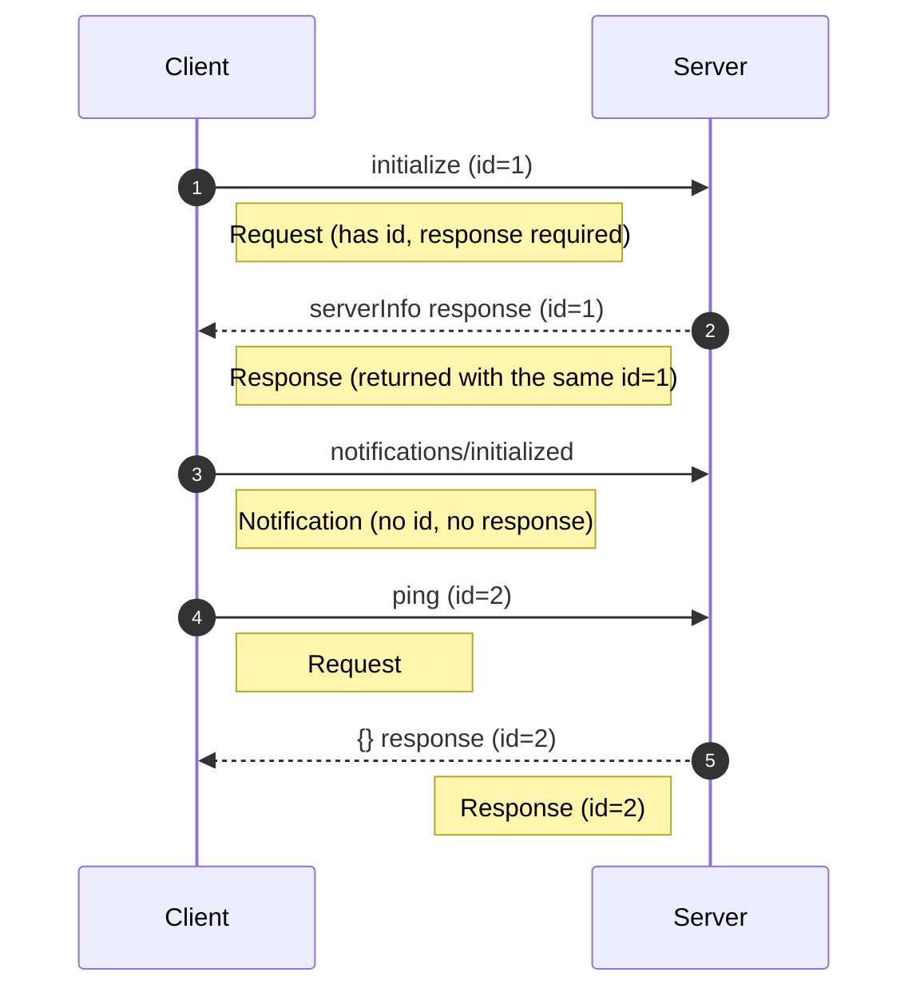
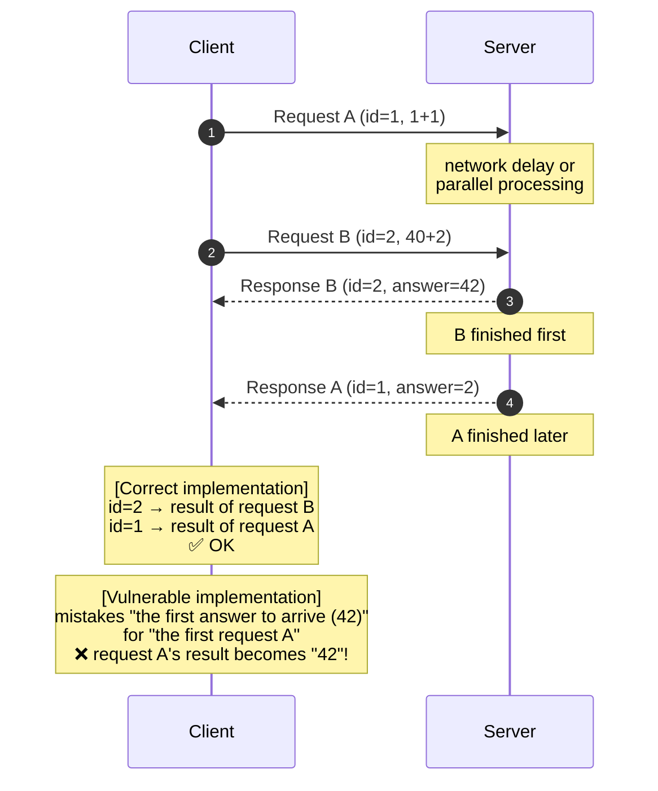
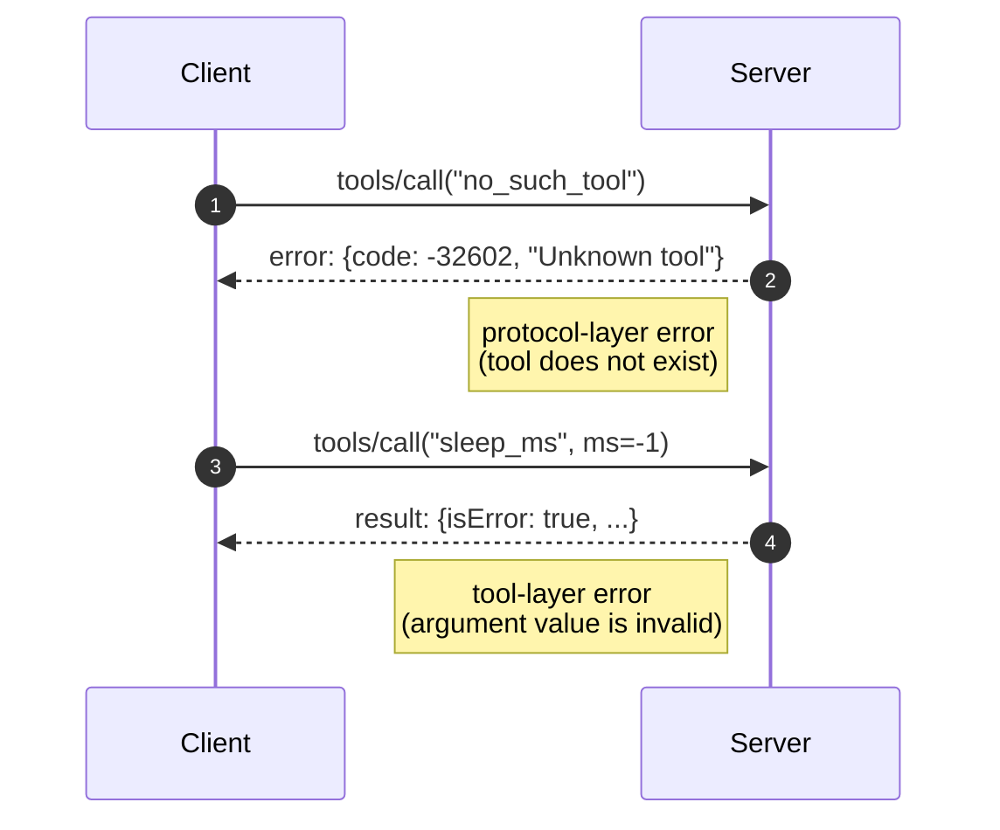
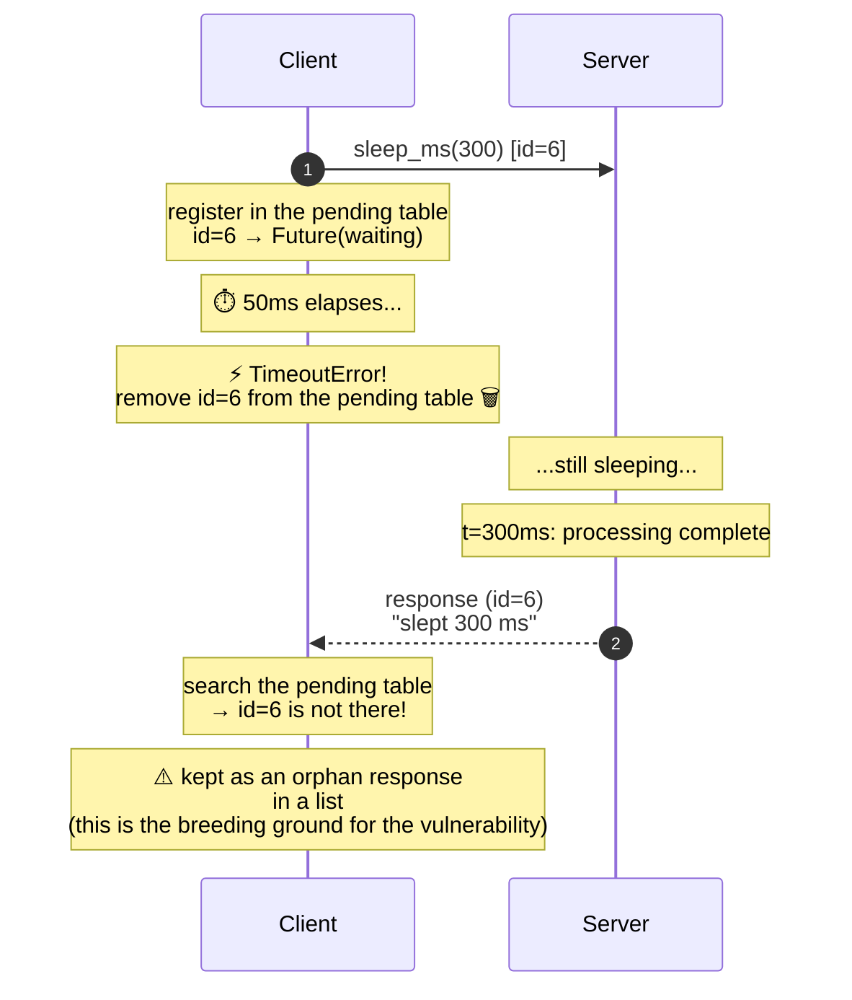
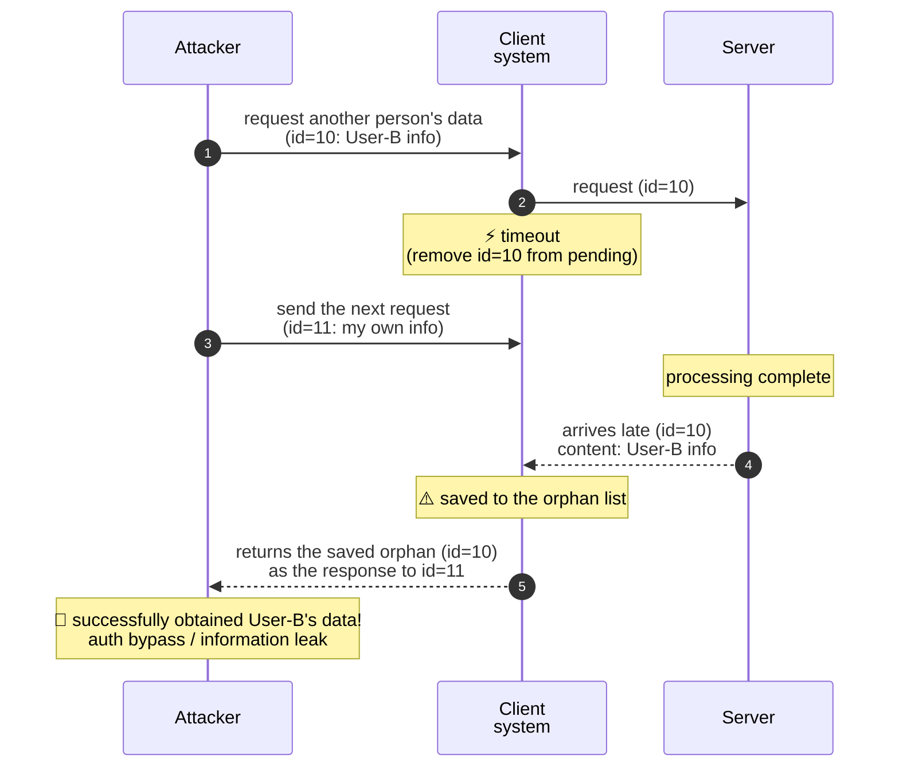
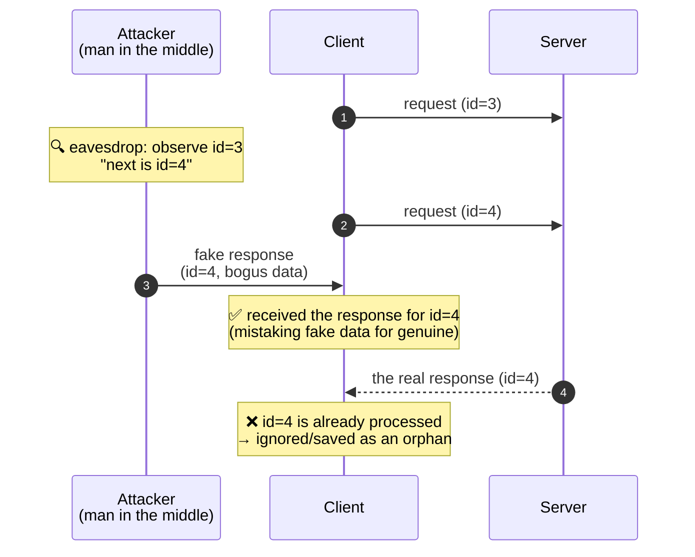
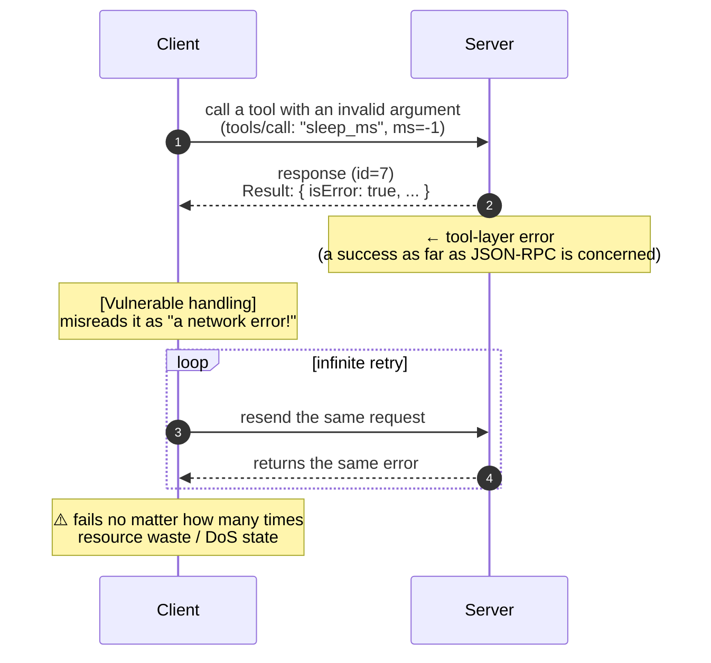

[日本語](../scenarios.md) | **English**

# Failure modes and attack scenarios

[← Back to README](../../README.en.md)

## Failure-mode reproduction test (main)

`mcp/scenarios_test.py` is a test MCP client that reproduces the failure cases.

```
$ ./venv/bin/python mcp/scenarios_test.py
[PASS] initialize
[PASS] ping
[PASS] request ID correlation
[PASS] results: 3, 42
[PASS] completed requests removed from pending
[PASS] unknown tool: protocol error -32602
[PASS] invalid tool value: result.isError
[PASS] late response arrived
[PASS] one timeout
[PASS] one orphan response
[PASS] orphan retained only for observation
[PASS] timed-out request removed from pending
STATS {'requests_sent': 7, 'responses_received': 6, 'orphans_observed': 1, 'orphans_discarded': 0, 'timeouts': 1, 'invalid_messages': 0}
```

The output is deliberately terse for verification, and each `[PASS]` line maps to a scenario explained below. Detailed visualization of ids and statistics is available in the Web UI. Note that `no_such_tool` returns a protocol-layer error (`-32602`) and an invalid argument to `sleep_ms` (`ms=-1`) returns a tool-layer error (`result.isError`); the two kinds of error are distinguished.

### Detailed explanation of each scenario

---

#### SCENARIO 1: Handshake (the MCP protocol initialization sequence)



**What is happening:**
1. `initialize`: the client starts the connection. The server returns `serverInfo` (name, version)
2. `notifications/initialized`: the client notifies that initialization is complete. **Because a notification has no `id`, the server does not respond**
3. `ping`: a liveness check. If an empty object `{}` comes back, the round trip works

**Learning points:**
- In JSON-RPC, a message with an `id` is a "request"; one without is a "notification"
- Returning a response to a notification risks becoming an "orphan response" on the client side

---

#### SCENARIO 2: Asynchronous demux (multiplexing and out-of-order responses)

In asynchronous communication, the request order and the response order do not necessarily match. If matching by id (demux) is not done correctly, a mix-up occurs.



**A real-world example of the vulnerable case (HTTP desync):**
When a reverse proxy reuses connections, responses get mixed in and another user's response is shown to a different user — this has actually happened (HTTP desync, response queue poisoning).

**What is happening:**
1. The client sends two requests back to back **without waiting** (fire-and-forget)
2. The server processes them in order and returns responses
3. The client **collects the results in reverse order (id=4 first, id=3 later)**
4. Because it still matches by `id`, it does not mix up the results

**The relevant test code:**
```python
# Deliberately wait in reverse order (the point is that out-of-order does not cause a mix-up)
resp2 = fut2.result(timeout=5)  # wait for id=4 first
resp1 = fut1.result(timeout=5)  # wait for id=3 later
```

**Learning points:**
- In asynchronous RPC the response order is not guaranteed (network delay, in-server parallelism, etc. can reorder it)
- **If demultiplexing by `id` is not implemented correctly, responses get mismatched**
- This test confirms that "a correct implementation does not mix them up"

---

#### SCENARIO 3: Distinguishing protocol-layer errors from tool-layer errors



**What is happening:**
1. Calling the nonexistent tool `no_such_tool` makes the server return a **JSON-RPC error field** (`code: -32602`). This is a protocol-layer error
2. Passing an invalid argument (`ms=-1`) to the existing tool `sleep_ms` makes the server return **`result.isError`**. This is a tool-layer (application-layer) error

**Response shapes:**

Nonexistent tool → protocol-layer error
```json
{"jsonrpc": "2.0", "id": 6, "error": {"code": -32602, "message": "Unknown tool"}}
```

Invalid argument value → tool-layer error
```json
{"jsonrpc": "2.0", "id": 7, "result": {"isError": true, "content": [{"type": "text", "text": "Invalid arguments"}]}}
```

**Learning points:**
- MCP distinguishes "protocol-layer errors" from "tool-layer errors"
- **Protocol-layer error** (JSON-RPC level): shape `{"error": {"code": ...}}`. In this tool, calling a nonexistent tool returns `-32602`
- **Tool-layer error** (MCP/application level): shape `{"result": {"isError": true, ...}}`. In this tool it is returned when the argument value is invalid
- Confusing the two breaks error handling (e.g., retrying forever because a tool-layer error is mistaken for a protocol-layer one)

---

#### SCENARIO 4: Timeout → observing the late (orphan) response

This is the **core scenario** of this simulator.



**Key point:**
- At `t=50ms` the client forgets the id, but at `t=300ms` the server's reply for that id arrives
- This is called an "orphan"
- **Vulnerable implementation:** if you keep the arriving orphan in a list instead of discarding it, it leads to an attack

**What is happening (step by step):**

1. **t=0ms**: the client sends `sleep_ms(300)`. It registers `id=6` in the pending table
2. **t=0–50ms**: the client waits for a response with `timeout=0.05s`
3. **t=50ms**: timeout. It raises `TimeoutError` and **removes id=6 from the pending table**
4. **t=50–300ms**: the server is still in `sleep(300ms)`. It does not know the client timed out
5. **t=300ms**: the server completes and returns a response with `id=6`
6. **t=300ms+α**: the client's reader thread receives the response, but `id=6` is not in the pending table
7. **Result**: this response is stored in the `orphan_responses` list as an **orphan response**

**The relevant test code:**
```python
# In the reader thread
if fut is None:
    # not in the table -> orphan (e.g. a late response after a timeout)
    self.orphan_responses.append(data)
```

**Why this can be a problem:**
- If you **reuse or cache** an orphan response, it may be mismatched with a later request
- Example: the orphan of id=6 is mistaken for the response to the next request, id=7
- This is a "design mistake"; a correct implementation **discards the orphan or logs it explicitly**

---

### This is not an anomaly

The orphan-response phenomenon above is **not a bug; it is something that can always occur by design in asynchronous RPC**.

- The server does not know the client's timeout setting
- Even if the client gives up, the server keeps processing (unless there is a cancellation mechanism)
- The delayed response will always come back

**What matters is whether the design anticipates this phenomenon.**

---

## 🔓 Visualizing attack scenarios

Here we show, with Mermaid diagrams, how the failure modes observed above can develop into actual attacks.

### Attack 1: Orphan Response Hijacking (response mix-up attack)

An attack scenario that arises when an orphan response is reused instead of being properly discarded. The attacker manipulates timing to obtain another person's data.



**Conditions for the attack:**
- The client saves orphan responses in a list instead of discarding them
- The attacker tunes timing so that another user's response becomes an "orphan"
- The saved orphan is mistakenly returned as the response to the next request

**Risk:** auth bypass, leakage of personal data, session hijacking

---

### Attack 2: Fake-response injection by id prediction

If you use sequential ids (1, 2, 3...) for request ids, an attacker can predict the next id and impersonate the server.



**Conditions for the attack:**
- Ids are generated by a simple increment such as `self._next_id += 1`
- The attacker can sniff packets on the network (man in the middle)
- The attacker's response reaches the client before the server's

**Countermeasure (robust implementation):** generate ids with a cryptographically secure random source such as `secrets.token_hex(16)` to make them unpredictable

---

### Attack 3: Confusing tool-layer and protocol-layer errors

A design mistake where mistaking the kind of error leads to retrying errors that should not be retried (or vice versa).



**Why the distinction matters:**
| Error kind | Shape | Should you retry? |
|-----------|------|-----------------|
| Protocol layer (JSON-RPC) | `{"error": {"code": -32601, ...}}` | Depends (OK if it is a transient failure) |
| Tool layer (MCP/app) | `{"result": {"isError": true, ...}}` | Generally no (a logic error) |

---

### Security implications

| Problem pattern | Risk | Countermeasure |
|-------------|--------|------|
| Reusing orphan responses | Response mix-up (possible auth bypass, etc.) | Discard orphans immediately, or log them strictly |
| Not ignoring unknown-id responses | An attacker can inject fake responses | Log a warning for unknown ids and discard |
| Confusing tool-layer and protocol-layer errors | Failure of appropriate retry/fallback handling | Separate error kinds clearly |
| Holding resources after a timeout | DoS (resource exhaustion) | Remove reliably from the table on timeout |

---

## 🛡️ Experiments with scenarios_test_secure.py

### Roles of the files

| File | Role |
|---------|------|
| `client.py` | The shared base (`StdioClient`). The `discard_orphans` flag switches id generation and orphan handling |
| `scenarios_test.py` | Scenario test with `discard_orphans=False` (retain/observe) |
| `secure_client.py` | A thin wrapper with `discard_orphans=True` (discard + random ids) (`SecureStdioMcpClient`). Adds a timeout-range warning |
| `scenarios_test_secure.py` | Scenario test using `SecureStdioMcpClient` |

The point is not that the vulnerable and robust versions are separate implementations, but that **the same `client.py` is switched by a flag**.

### Core of client.py (the parts switched by the flag)

```python
# Id generation: cryptographic random under the discard policy, sequential otherwise
def _issue_id(self):
    if self.discard_orphans:
        return secrets.token_hex(16)   # unpredictable
    self._next_id += 1
    return self._next_id               # 1, 2, 3... (predictable)

# On receipt: if there is no matching waiter, treat it as an orphan
def _accept(self, data):
    ...
    future = self._pending.pop(response_id, None)
    if future is None or future.done():
        self.stats["orphans_observed"] += 1
        if self.discard_orphans:
            self.stats["orphans_discarded"] += 1   # record the count only, discard
        else:
            self.orphan_responses.append(data)      # keep for observation (reusable and dangerous)
        self.orphan_event.set()
        return
    ...

# Synchronous request: validate the timeout and always remove from the table in finally (TOCTOU defense)
def request(self, method, params, timeout=5.0):
    if ...timeout is not finite and positive...:
        raise ValueError("Timeout must be finite and greater than zero")
    request_id, future = self.send_request(method, params)
    try:
        return future.result(timeout=timeout)
    finally:
        self._remove_pending(request_id, future)
```

**Three things the flag switches:**
1. **Id generation**: `secrets.token_hex(16)` (unpredictable) when `discard_orphans`, sequential otherwise
2. **Orphan handling**: record the count only and discard when `discard_orphans`, otherwise save to `orphan_responses` (reusable and dangerous)
3. **Table cleanup**: `request()` always calls `_remove_pending` in `finally`, so nothing is left dangling on a timeout

### Core of secure_client.py

```python
class SecureStdioMcpClient(StdioClient):
    def __init__(self, python_exe, server_script):
        super().__init__(python_exe, server_script, discard_orphans=True)

    def request(self, method, params, timeout=None):
        if timeout is None:
            timeout = DEFAULT_TIMEOUT
        # out of range -> warn only (does not force the value)
        if type(timeout) in (int, float) and (timeout < MIN_TIMEOUT or timeout > MAX_TIMEOUT):
            log_security("WARN", "Timeout is outside the recommended 0.1-30 s range; not clamped.")
        return super().request(method, params, timeout)
```

`secure_client.py` sets `discard_orphans=True` and is a thin wrapper that only warns when the timeout is outside the recommended range (0.1–30 s). The warning does not change the value.

### Core of scenarios_test_secure.py

It runs the same scenario functions as `scenarios_test.py` with `SecureStdioMcpClient`. In the timeout → orphan scenario, since the policy is discard, it confirms that `orphans_discarded` increases and nothing remains in `orphan_responses`.

```python
# The relevant assertions in scenarios_test.py (excerpt)
if client.discard_orphans:
    check(not client.orphan_responses and after["orphans_discarded"] == 1,
          "orphan payload discarded")
else:
    check(len(client.orphan_responses) == 1,
          "orphan retained only for observation")
```

**Difference by policy:**
- Retain/observe (`discard_orphans=False`): saved to `orphan_responses` → reusable and dangerous
- Discard (`discard_orphans=True`): only the count in `orphans_discarded` → not reusable

### How to run

With the MCP server `demo_server.py` running, run `scenarios_test_secure.py` with the command below. `secure_client.py` must also be in place.

```
$ ./venv/bin/python mcp/scenarios_test_secure.py
[WARN] Timeout is outside the recommended 0.1-30 s range; not clamped.
[PASS] initialize
[PASS] ping
[PASS] request ID correlation
[PASS] results: 3, 42
[PASS] completed requests removed from pending
[PASS] unknown tool: protocol error -32602
[PASS] invalid tool value: result.isError
[PASS] late response arrived
[PASS] one timeout
[PASS] one orphan response
[PASS] orphan payload discarded
[PASS] timed-out request removed from pending
STATS {'requests_sent': 7, 'responses_received': 6, 'orphans_observed': 1, 'orphans_discarded': 1, 'timeouts': 1, 'invalid_messages': 0}
Random IDs are not authentication. Timeout warnings do not prevent DoS.
```

The difference from the retain version is concentrated at the end. The retain version shows `orphan retained only for observation` (`orphans_discarded: 0`); the discard version shows `orphan payload discarded` (`orphans_discarded: 1`). An out-of-range timeout is `not clamped` — a warning only, with the value unchanged. As the final line states, random ids are not a substitute for authentication, and timeout warnings do not prevent DoS (a design lesson, not an actual mitigation). The contrast between the two is easiest to see visually in the Web UI.

### How the robust implementation relates to the CVEs / attack scenarios

This section explains how far `secure_client.py` works as a defense against the CVE cases introduced here. We separate what a client-side implementation can prevent (response mix-ups, id guessing) from what can only be mitigated server-side (resource-exhaustion DoS).

---

#### Relationship to CVE-2023-44487 (HTTP/2 Rapid Reset)

**Nature of the vulnerability**: even if the client cancels with RST_STREAM right after sending a request, the server keeps processing asynchronously and consuming resources. Repeating this at scale exhausts the server's resources — a server-side DoS.

What this simulator reproduces is only the client-side symptom. The asynchronous property "the server keeps working even after the client timed out" (SCENARIO 4) has the same structure, but the resource exhaustion itself happens on the server. Therefore the client-side timeout-range check is not a mitigation for this attack.

```python
# secure_client.py: out of range -> warn only (does not force the value)
if type(timeout) in (int, float) and (timeout < MIN_TIMEOUT or timeout > MAX_TIMEOUT):
    log_security("WARN", "Timeout is outside the recommended 0.1-30 s range; not clamped.")
```

| Category | Content |
|------|------|
| Similar design lesson | Extreme timeout values can be a sign of an operational anomaly, so make them noticeable with a warning log |
| What the implementation actually does | Does not clamp out-of-range values. It only warns and processing continues as is |
| Actual mitigation (server side) | Done with server-side resource management: limits on concurrent streams, rate-limiting RST_STREAM, aborting in-flight requests, etc. |

**Correspondence with the experiment:**
```
[WARN] Timeout is outside the recommended 0.1-30 s range; not clamped.
```
→ It warns on a timeout outside the recommended range (0.1–30 s). This is an operational marker to notice an abnormal value, not a feature that stops the Rapid Reset attack itself.

---

#### Countermeasure for response mix-ups (HTTP desync)

**Nature of the vulnerability**: when a reverse proxy or backend connection is reused, an error-handling or parsing slip breaks the request/response correspondence and the previous response bleeds into the next request. It leads to an information leak where another user's response is returned. This is a class of bug known as HTTP request/response smuggling (desync, response queue poisoning).

**Countermeasure in the robust implementation:**

```python
# client.py _accept: with discard_orphans=True, record the count only instead of saving
if future is None or future.done():
    self.stats["orphans_observed"] += 1
    if self.discard_orphans:
        self.stats["orphans_discarded"] += 1   # ← do not save (not reusable)
    else:
        self.orphan_responses.append(data)      # ← keep for observation (reusable and dangerous)
    self.orphan_event.set()
    return
```

| Countermeasure point | Effect |
|-------------|------|
| Do not save orphans | Fundamentally prevents the "previous response bleeds into the next request" situation |
| The `orphans_observed` / `orphans_discarded` stats | Lets you monitor whether orphans occur at an abnormal rate |
| Record the count only | No payload is kept, so it cannot be reused |

**Correspondence with the experiment:**
```
[PASS] orphan payload discarded
STATS {... 'orphans_discarded': 1 ...}
```
→ The count of orphans is kept in the stats, but nothing is stored in a reusable list. The "response bleed-through" that is the problem in desync cannot occur structurally.

---

#### Countermeasure for the CryptoNote Wallet JSON-RPC vulnerability

**Nature of the vulnerability**: a predictable request_id lets an attacker inject fake responses.

**Countermeasure in the robust implementation:**

```python
# client.py _issue_id: cryptographic random when discard_orphans, sequential otherwise
def _issue_id(self):
    if self.discard_orphans:
        return secrets.token_hex(16)  # 128-bit unpredictable id
    self._next_id += 1
    return self._next_id              # sequential (predictable)
```

| Countermeasure point | Effect |
|-------------|------|
| `secrets.token_hex(16)` | 128-bit (16-byte) cryptographic random, unpredictable |
| String-typed id | No worry about integer overflow |
| Collision probability 2^-128 | Id duplication/collision essentially never occurs |

→ With sequential ids, an attacker can guess "the next id is 7" and inject a fake response; cryptographic-random ids cannot be guessed. The CLI test output is terse and does not show id values, but the Web UI shows both side by side for visual comparison.

---

#### Countermeasure for the Juniper Junos RPC Race Condition (CVE-2016-1267)

**Nature of the vulnerability**: there is a timing gap between the permission check and the actual operation, and the state can be changed in between (a TOCTOU attack).

**Countermeasure in the robust implementation:**

```python
# client.py request: always remove from the table in finally, regardless of success/failure
def request(self, method, params, timeout=5.0):
    ...
    request_id, future = self.send_request(method, params)
    try:
        return future.result(timeout=timeout)
    finally:
        self._remove_pending(request_id, future)  # ← always remove from the table
```

| Countermeasure point | Effect |
|-------------|------|
| Reliable removal in `finally` | Removes from the table reliably even on exception/timeout |
| Use of a lock (`self._lock`) | Keeps consistency under concurrent access from multiple threads |
| Removal in the completed Future's callback too | Calls `_remove_pending` from `add_done_callback` to avoid misses |

**Resistance to TOCTOU attacks:**
- Under either policy (retain or discard), `request()` removes the id from the table on timeout → minimizing the window in which it is "dangling"

---

#### Countermeasure for Orange Tsai's Confusion Attacks

**Nature of the vulnerability**: components interpret semantics differently, which is abused for auth bypass.

**Countermeasure in the robust implementation:**

```python
# secure_client.py sends security logs to stderr so as not to pollute stdout
def log_security(level, message):
    print(f"[{level}] {message}", file=sys.stderr)
```

| Countermeasure point | Effect |
|-------------|------|
| Log to stderr | Does not pollute stdout (JSON only) |
| Level-tagged (`[WARN]`, etc.) | Lets you distinguish ordinary logs from security notices |
| Distinguish protocol- and tool-layer errors | As in SCENARIO 3, errors by layer are not confused |

**From the Confusion-Attacks-prevention angle:**
- Handling "what happened at which layer" distinctly avoids confusing semantics
- Example: nonexistent tool → protocol-layer error (`-32602`), invalid argument value → tool-layer error (`result.isError`)

---

#### Summary of countermeasure effects

| CVE/attack scenario | Problem in the vulnerable version | Countermeasure in the robust version | Confirmation in the experiment |
|-----------------|-------------------|-------------------|-------------|
| HTTP/2 Rapid Reset | No timeout limit | Out-of-range warning only (mitigation is server-side) | `[WARN] Timeout is outside the recommended 0.1-30 s range; not clamped.` |
| Response mix-up (HTTP desync) | Saves orphans to a list | Records the count only instead of saving | `orphans_discarded: 1` (`[PASS] orphan payload discarded`) |
| CryptoNote id prediction | Sequential ids (1,2,3...) | Cryptographic-random ids | `secrets.token_hex(16)` (visualized in the Web UI) |
| Juniper TOCTOU | Unreliable table removal | finally + lock | `[PASS] timed-out request removed from pending` |
| Confusion Attacks | Logs mixed into stdout | Level-tagged logs to stderr | The error-layer distinction in SCENARIO 3 |

---
