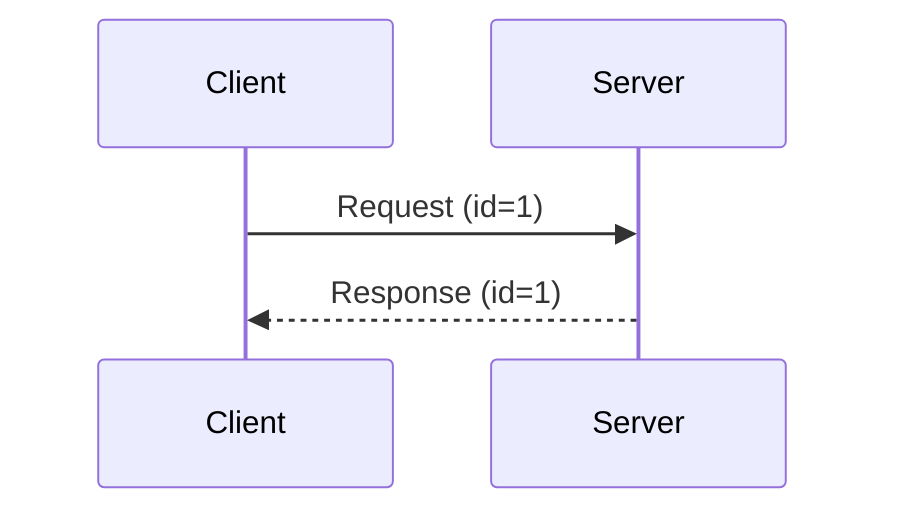
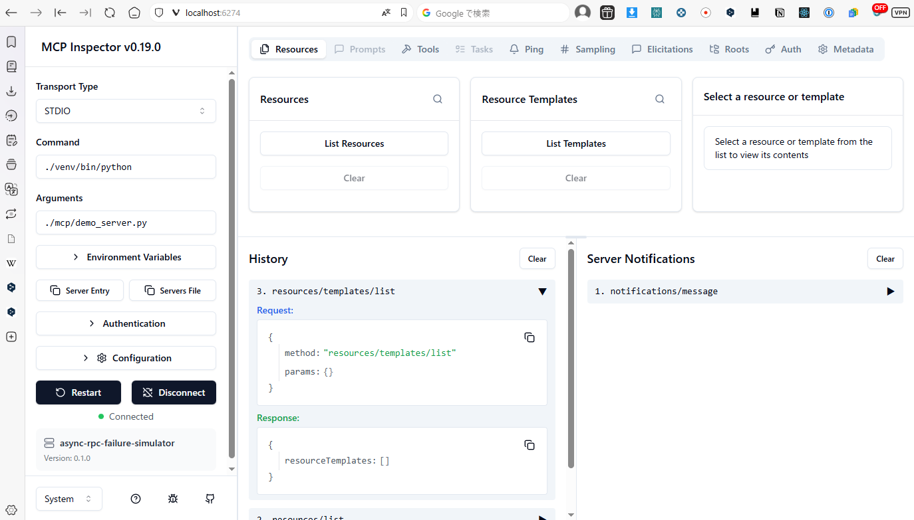
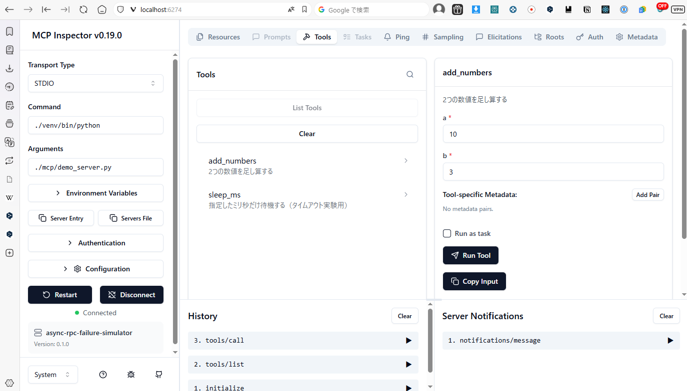

[日本語](../tutorial.md) | **English**

# Tutorial (learning guide, setup, tests)

[← Back to README](../../README.en.md)

## 📚 Learning guide for when you get stuck

If the tool or this README does not click, we recommend learning the following prerequisites in order.

### 1. Basics of asynchronous processing (most important)

The core of this tool is "asynchrony". Understand the following concepts.

| Concept | Description |
|------|------|
| Sync vs async | "Wait for the result before moving on" vs "move on without waiting" |
| Future/Promise | "An object representing a result that has not arrived yet" |
| Timeout | "Give up if the result does not arrive within a set time" |

**Learning resources:**
- Python docs: [concurrent.futures](https://docs.python.org/3/library/concurrent.futures.html)
- Keywords: "Python asynchronous programming introduction", "Python Future usage"

### 2. The client/server model

Understand the basic pattern of "send a request, receive a response".



**Key points:**
- Requests and responses are correlated by `id`
- If you send multiple requests at once, the order of responses is not guaranteed

**Learning resources:**
- Keywords: "how HTTP request/response works", "WebSocket introduction"

### 3. Basics of multithreading

In this tool the "main thread" and the "reader thread" run at the same time.

| Thread | Role |
|---------|------|
| Main thread | Sends requests and waits for results |
| Reader thread | Continuously watches for responses from the server and, on receipt, sets the result on the matching Future |

**Learning resources:**
- Python docs: [threading](https://docs.python.org/3/library/threading.html)
- Keywords: "Python threading introduction", "multithreading mutual exclusion"

### 4. JSON-RPC 2.0 (a light touch is enough)

This is the protocol MCP adopts. The following is all you need.

| Item | Description |
|------|------|
| `id` field | The identifier that ties a request to its response |
| Request | Has `id` → a response is required |
| Notification | No `id` → no response needed |

**Learning resources:**
- [JSON-RPC 2.0 specification](https://www.jsonrpc.org/specification) (in English, but short)

### 5. MCP (Model Context Protocol)

This is the protocol the tool is built around. It is drawing attention as a communication standard between AI agents and tools.

| Concept | Description |
|------|------|
| stdio transport | A communication style using standard input/output (stdin/stdout) |
| `initialize` | The handshake that starts a client/server connection |
| `tools/call` | The method that calls a tool the server provides |
| MCP Inspector | A GUI tool for testing MCP servers |

**Learning resources:**
- [MCP official documentation](https://modelcontextprotocol.io/)
- [MCP Transport specification (relationship to JSON-RPC)](https://modelcontextprotocol.io/specification/2025-11-25/basic/transports)
- Keywords: "MCP Model Context Protocol introduction", "Claude MCP"

### Learning order

```
1. Async  ─→  2. Client/Server  ─→  3. Multithreading  ─→  4. JSON-RPC  ─→  5. MCP
     ↓                ↓                      ↓                   ↓             ↓
 Future/timeout    match by id        reader thread       protocol base   this tool's subject
```

### Concepts you learn with this tool

Building on the prerequisites above, this tool lets you learn the following concepts hands-on.

| Term | Description |
|------|------|
| orphan response | A "nobody's" response that arrives after a timeout. Because it comes from the server after the client gave up waiting, no matching request is found |
| demux (demultiplexing) | Dispatching multiple responses to the correct request by id. The mechanism that keeps out-of-order responses from being mismatched |
| pending table | A dictionary that manages the ids and Futures of "sent, awaiting response" requests. Removing an entry on timeout is what produces an orphan |
| TOCTOU | Time Of Check to Time Of Use. A timing gap between the moment of checking and the moment of using |

Once you understand these, "why orphan responses occur" and "why predictable ids are dangerous" should become clear.

---

## Prerequisites

- Python 3.9 or later
- Standard library only (no extra libraries)
- Node.js / npx if you use MCP Inspector

---

## Setup (venv)

Here we use the venv's Python by absolute path, without activating the venv.

```
ipusiron@MHL:~/async-rpc-failure-simulator$ pwd
/home/ipusiron/async-rpc-failure-simulator
ipusiron@MHL:~/async-rpc-failure-simulator$ python3 -m venv venv
ipusiron@MHL:~/async-rpc-failure-simulator$ ls -l ./venv/bin/python
lrwxrwxrwx 1 ipusiron ipusiron 7 Jan 29 02:46 ./venv/bin/python -> python3
ipusiron@MHL:~/async-rpc-failure-simulator$ ./venv/bin/python --version
Python 3.10.12
```

---

## Setup (uv)

[uv](https://docs.astral.sh/uv/) is a fast Python package manager and virtual-environment tool. To use uv instead of venv, set up as follows.

### Installing uv

```bash
# macOS / Linux
curl -LsSf https://astral.sh/uv/install.sh | sh

# Windows (PowerShell)
powershell -ExecutionPolicy ByPass -c "irm https://astral.sh/uv/install.ps1 | iex"
```

### Creating and running the virtual environment

```
ipusiron@MHL:~/async-rpc-failure-simulator$ uv venv
Using CPython 3.10.12
Creating virtual environment at: .venv
Activate with: source .venv/bin/activate

ipusiron@MHL:~/async-rpc-failure-simulator$ uv run python --version
Python 3.10.12
```

### Running the tests

With uv, use `uv run python` instead of `./venv/bin/python`.

```bash
# Start the MCP server
uv run python ./mcp/demo_server.py

# Failure-mode reproduction test (retain/observe policy)
uv run python mcp/scenarios_test.py

# Discard-policy test
uv run python mcp/scenarios_test_secure.py

# Exploit integration test (vulnerable success / secure fail)
uv run python challenges/challenge1_orphan_hijack/integration_test.py

# Start the Web UI
uv run python web/server.py
```

> **Note**: This project uses the standard library only, so `uv pip install` to install dependencies is unnecessary.

> **Windows**: If Japanese output is garbled, set `set PYTHONIOENCODING=utf-8` (PowerShell: `$env:PYTHONIOENCODING="utf-8"`) before running. To make the console itself UTF-8, `chcp 65001` also helps.

> **venv vs uv**: Because this project is "standard library only", uv's main strength (fast dependency resolution) does not come into play. There is little practical difference either way, so if you are already used to uv, use `uv run python`; otherwise `venv` is enough.

---

## Unit-testing the MCP server

The MCP server is specified as follows.

- stdout: nothing is printed (JSON only)
- stderr: startup logs appear
- Stop with [Ctrl]+[C]

```
ipusiron@MHL:~/async-rpc-failure-simulator$ ./venv/bin/python ./mcp/demo_server.py
MCP demo server started (stdio transport)
```

When you run the MCP server, the startup log "MCP demo server started (stdio transport)" appears.

The question is whether this output goes to stderr rather than stdout. Under the stdio transport, "stdout is JSON only" is an absolute rule.

If this passes, you have cleared the first gate for Inspector compatibility.

### Test 1 — checking that stdout is not polluted

Redirect stdout to `/tmp/mcp_stdout.txt` as follows.

```
ipusiron@MHL:~/async-rpc-failure-simulator$ ./venv/bin/python ./mcp/demo_server.py > /tmp/mcp_stdout.txt
MCP demo server started (stdio transport)
^C
Traceback (most recent call last):
  File "/home/ipusiron/async-rpc-failure-simulator/./mcp/demo_server.py", line 236, in <module>
    main()
  File "/home/ipusiron/async-rpc-failure-simulator/./mcp/demo_server.py", line 218, in main
    for line in sys.stdin:
KeyboardInterrupt

ipusiron@MHL:~/async-rpc-failure-simulator$ ls -l /tmp/mcp_stdout.txt
-rw-r--r-- 1 ipusiron ipusiron 0 Jan 29 02:55 /tmp/mcp_stdout.txt
ipusiron@MHL:~/async-rpc-failure-simulator$ wc -c /tmp/mcp_stdout.txt
0 /tmp/mcp_stdout.txt
```

Stop the server (or from another terminal) and check the size of `/tmp/mcp_stdout.txt`. If it is 0 bytes, it is empty, so the startup log is indeed going to stderr.

### Test 2 — one manual round trip (ping)

Because stdio needs the input sent to the same process's stdin, the simplest way is to do it in one command.

Check stdout only.

```
ipusiron@MHL:~/async-rpc-failure-simulator$ printf '%s\n' '{"jsonrpc":"2.0","id":1,"method":"ping"}' | ./venv/bin/python mcp/demo_server.py 2>/dev/null
{"jsonrpc": "2.0", "id": 1, "result": {}}
```

Check stderr only.

```
ipusiron@MHL:~/async-rpc-failure-simulator$ printf '%s\n' '{"jsonrpc":"2.0","id":1,"method":"ping"}' | ./venv/bin/python mcp/demo_server.py 1>/dev/null
MCP demo server started (stdio transport)
```

---

## Connecting to the MCP server with Inspector

Connect to the MCP server from Inspector (a pseudo MCP client + UI) with the following command.

```
ipusiron@MHL:~/async-rpc-failure-simulator$ npx -y @modelcontextprotocol/inspector@0.19.0 --   ./venv/bin/python ./mcp/demo_server.py
```

Check Inspector's Resources/Tools tabs.

> 
>
> *Inspector Resources tab*

> 
>
> *Inspector Tools tab*

In Inspector you can confirm the following.

- initialize
- resources/list (empty array)
- resources/templates/list (empty array)
- tools/list
- tools/call(add_numbers)
- tools/call(sleep_ms)

---
