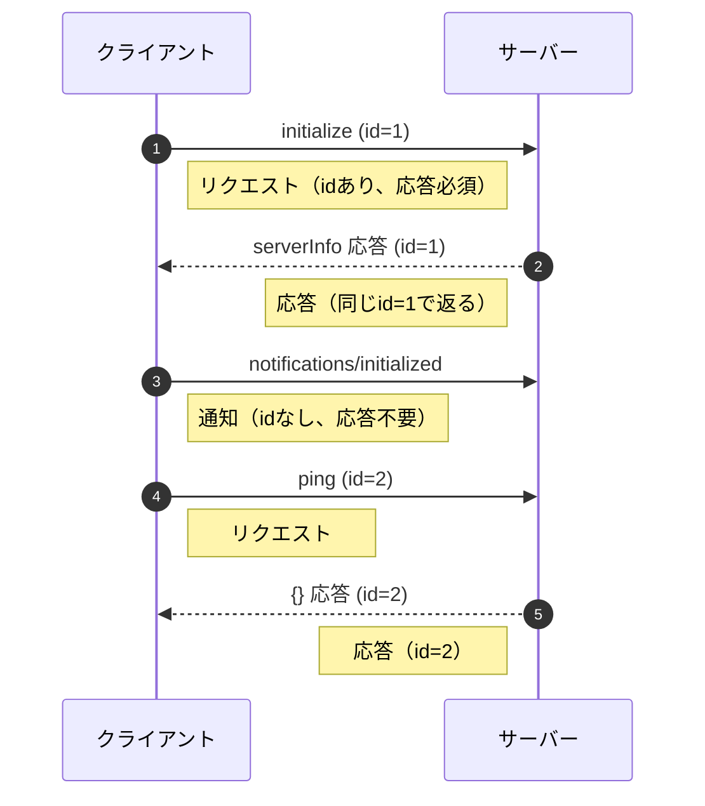
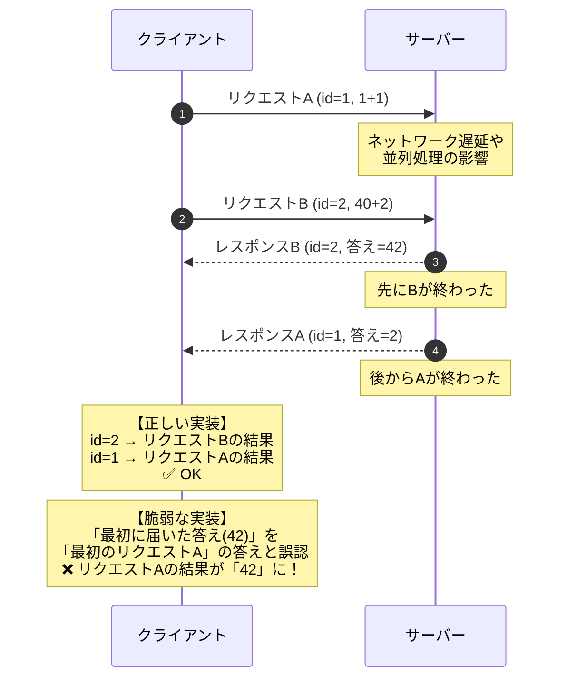
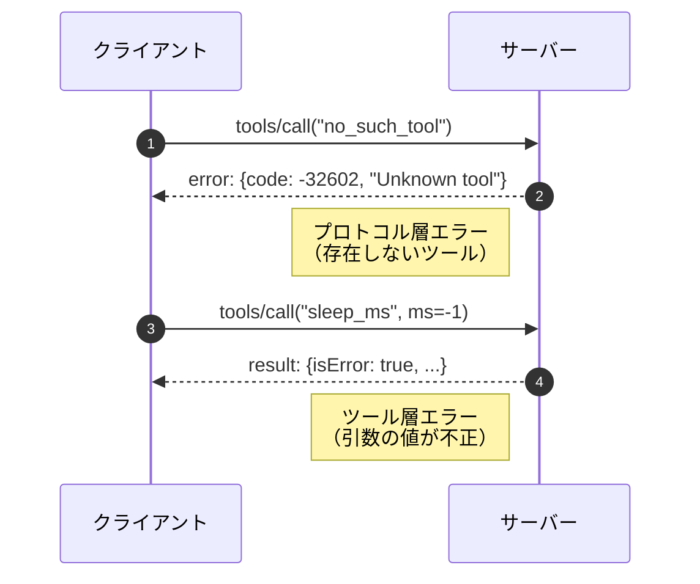
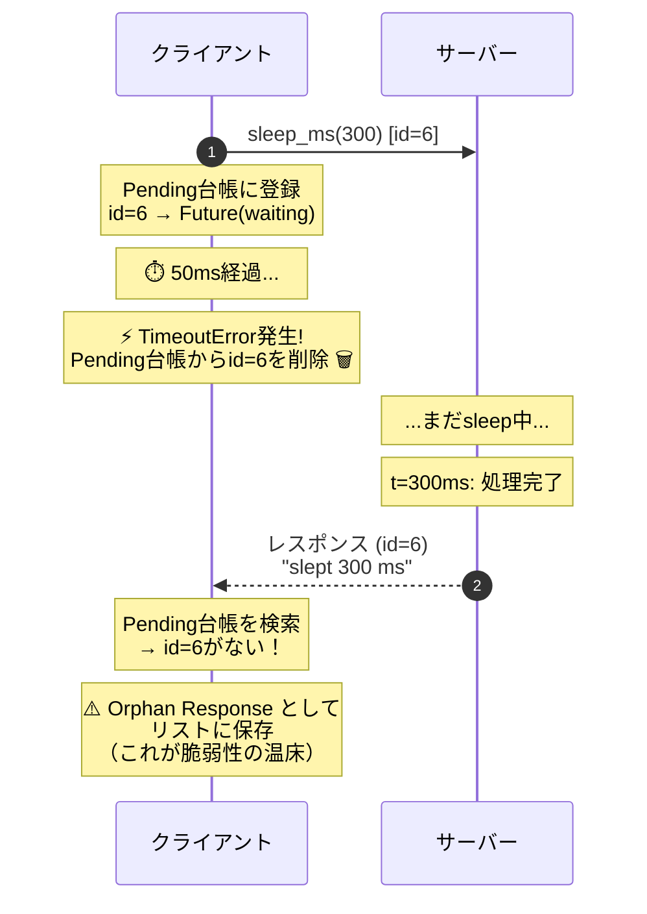
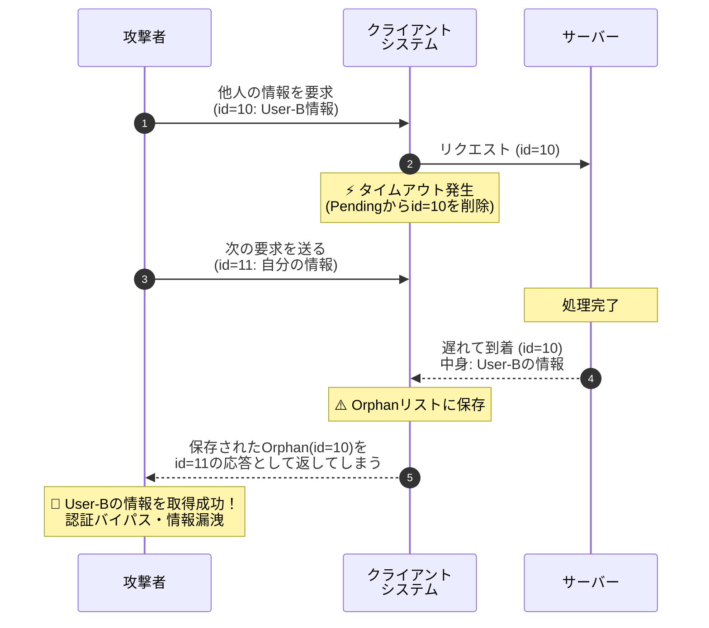
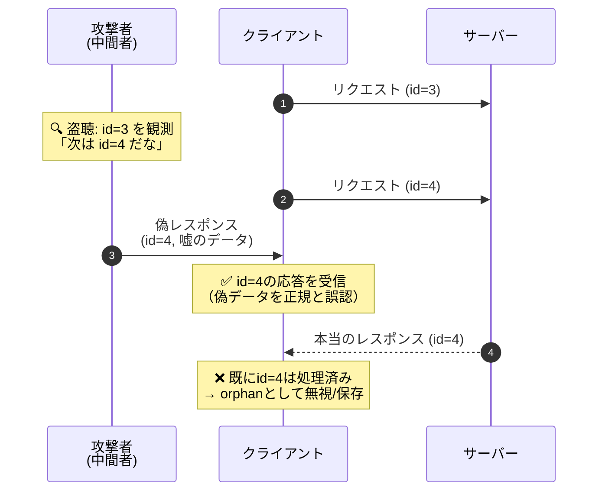
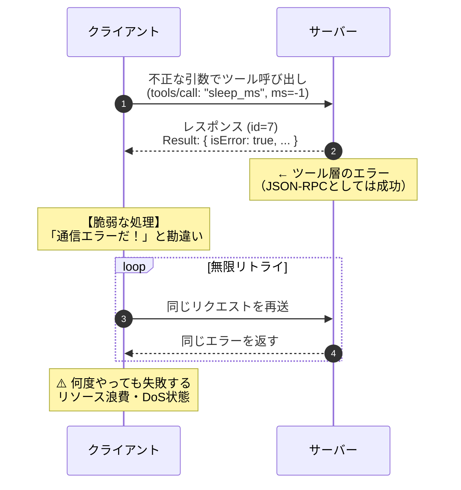

**日本語** | [English](en/scenarios.md)

# 失敗モードと攻撃シナリオ

[← READMEに戻る](../README.md)

## 失敗モード再現テスト（本体）

"mcp/scenarios_test.py"ファイルは、失敗ケースを再現するテスト用のMCPクライアントです。

```
$ ./venv/bin/python mcp/scenarios_test.py
[PASS] initialize
[PASS] ping
[PASS] request ID correlation
[PASS] results: 3, 42
[PASS] completed requests removed from pending
[PASS] unknown tool: protocol error -32602
[PASS] invalid tool value: result.isError
[PASS] late response arrived
[PASS] one timeout
[PASS] one orphan response
[PASS] orphan retained only for observation
[PASS] timed-out request removed from pending
STATS {'requests_sent': 7, 'responses_received': 6, 'orphans_observed': 1, 'orphans_discarded': 0, 'timeouts': 1, 'invalid_messages': 0}
```

出力は検証用に簡潔化してあり、各`[PASS]`行が下記のシナリオ解説に対応します。IDや統計の詳しい可視化はWeb UIで確認できます。なお`no_such_tool`はプロトコル層エラー（`-32602`）、`sleep_ms`への不正な引数（`ms=-1`）はツール層エラー（`result.isError`）として返り、2種類のエラーを区別します。

### 各シナリオの詳細解説

---

#### SCENARIO 1: Handshake（MCPプロトコルの初期化シーケンス）



**何が起きているか:**
1. `initialize`：クライアントがサーバーに接続を開始。サーバーは`serverInfo`（名前・バージョン）を返す
2. `notifications/initialized`：クライアントが初期化完了を通知。**通知には`id`がないため、サーバーは応答しない**
3. `ping`：生存確認。空オブジェクト`{}`が返れば疎通OK

**学習ポイント:**
- JSON-RPCでは`id`があるメッセージは「リクエスト」、ないメッセージは「通知」
- 通知に応答を返すと、クライアント側で「orphan response」になる危険がある

---

#### SCENARIO 2: 非同期demux（多重化と順不同応答）

非同期通信では、リクエスト順とレスポンス順が一致するとは限りません。IDによる突き合わせ（Demux）が正しく行われないと、テレコ（取り違え）が発生します。



**脆弱な実装の実例（HTTP desync）:**
リバースプロキシが接続を使い回す際にレスポンスが混入し、別のユーザーに他人のレスポンスが表示される事故が実際に起きています（HTTP desync、response queue poisoning）。

**何が起きているか:**
1. クライアントは2つのリクエストを**待たずに**連続送信（fire-and-forget）
2. サーバーは順番に処理して応答を返す
3. クライアントは**逆順（id=4を先に、id=3を後に）で結果を取得**
4. それでも`id`で突き合わせるので、結果を取り違えない

**テストコードの該当箇所:**
```python
# わざと逆順で待つ（順不同でも取り違えないことが本質）
resp2 = fut2.result(timeout=5)  # id=4 を先に待つ
resp1 = fut1.result(timeout=5)  # id=3 を後に待つ
```

**学習ポイント:**
- 非同期RPCでは応答順序は保証されない（ネットワーク遅延、サーバー内並列処理などで逆転しうる）
- **`id`による多重分離（demultiplex）が正しく実装されていないと、レスポンスの取り違え事故が起きる**
- このテストは「正しい実装なら取り違えない」ことを確認している

---

#### SCENARIO 3: プロトコル層エラーとツール層エラーの区別



**何が起きているか:**
1. 存在しないツール`no_such_tool`を呼ぶと、サーバーは**JSON-RPCのerrorフィールド**（`code: -32602`）で返す。これはプロトコル層のエラーである
2. 存在するツール`sleep_ms`に不正な引数（`ms=-1`）を渡すと、サーバーは**`result.isError`**で返す。これはツール層（アプリ層）のエラーである

**応答の形式:**

存在しないツール → プロトコル層エラー
```json
{"jsonrpc": "2.0", "id": 6, "error": {"code": -32602, "message": "Unknown tool"}}
```

不正な引数の値 → ツール層エラー
```json
{"jsonrpc": "2.0", "id": 7, "result": {"isError": true, "content": [{"type": "text", "text": "Invalid arguments"}]}}
```

**学習ポイント:**
- MCPでは「プロトコル層エラー」と「ツール層エラー」を区別する
- **プロトコル層エラー**（JSON-RPCレベル）: `{"error": {"code": ...}}`の形式。本ツールでは存在しないツールの呼び出しが`-32602`で返る
- **ツール層エラー**（MCP/アプリレベル）: `{"result": {"isError": true, ...}}`の形式。本ツールでは引数の値が不正なときに返る
- この区別を誤ると、エラーハンドリングが破綻する（例：ツール層エラーをプロトコル層エラーと誤認してリトライし続ける）

---

#### SCENARIO 4: タイムアウト → 遅延レスポンス（orphan）観測

これが本シミュレーターの**核心シナリオ**です。



**重要な点:**
- `t=50ms`でクライアントはIDを忘れますが、`t=300ms`でサーバーからそのIDの返事が届きます
- これを「Orphan（孤児）」と呼びます
- **脆弱な実装:** 届いたOrphanを捨てずにリストへ保存してしまうと、攻撃につながります

**何が起きているか（ステップバイステップ）:**

1. **t=0ms**: クライアントが`sleep_ms(300)`を送信。`id=6`でpending台帳に登録
2. **t=0〜50ms**: クライアントは`timeout=0.05s`で応答を待機
3. **t=50ms**: タイムアウト発生。`TimeoutError`を投げ、**pending台帳からid=6を削除**
4. **t=50〜300ms**: サーバーはまだ`sleep(300ms)`の最中。クライアントのタイムアウトを知らない
5. **t=300ms**: サーバーが処理完了。`id=6`で応答を返す
6. **t=300ms+α**: クライアントのreaderスレッドが応答を受信。しかしpending台帳に`id=6`がない
7. **結果**: この応答は**orphan（孤児）response**として`orphan_responses`リストに格納

**テストコードの該当箇所:**
```python
# readerスレッドでの処理
if fut is None:
    # 台帳にない -> orphan（タイムアウト後の遅延レスポンス等）
    self.orphan_responses.append(data)
```

**なぜこれが問題になりうるか:**
- orphan responseを**再利用・キャッシュ**すると、後続リクエストと取り違える可能性がある
- 例：id=6のorphanを、次に発行したid=7のリクエストの応答として誤認識してしまう
- これは「設計ミス」であり、正しい実装では**orphanは破棄するか、明示的にログに記録する**

---

### これは異常ではない

上記のorphan response現象は**バグではなく、非同期RPCでは設計上必ず起こり得る現象**です。

- サーバーはクライアントのタイムアウト設定を知らない
- クライアントが諦めても、サーバーは処理を続ける（キャンセル機構がない限り）
- 遅延したレスポンスは必ず返ってくる

**重要なのは、この現象を想定した設計になっているかどうか**です。

---

## 🔓 攻撃シナリオの可視化

ここまでで観測した失敗モードが、実際にどのような攻撃に発展するかをMermaid図解で示します。

### 攻撃1: Orphan Response Hijacking（レスポンス取り違え攻撃）

Orphan Responseを適切に破棄せず再利用してしまうことで発生する攻撃シナリオです。攻撃者がタイミングを操作し、別人の情報を取得します。



**攻撃の成立条件:**
- クライアントがorphan responseを破棄せずリストに保存している
- 攻撃者がタイミングを調整し、別ユーザーのレスポンスが「orphan」になるよう仕向ける
- 保存されたorphanが次のリクエストの応答として誤って返される

**リスク:** 認証バイパス、個人情報の漏洩、セッションハイジャック

---

### 攻撃2: ID予測による偽レスポンス注入

リクエストIDに連番（1, 2, 3...）を使っていると、攻撃者が次のIDを予測してサーバーになりすますことができます。



**攻撃の成立条件:**
- `self._next_id += 1` のように単純なインクリメントでIDを生成
- 攻撃者がネットワーク上でパケットを盗聴可能（中間者攻撃）
- 攻撃者のレスポンスがサーバーより先にクライアントに到達

**対策（堅牢な実装）:** `secrets.token_hex(16)` などを用いて暗号論的乱数でIDを生成し、予測不可能にする

---

### 攻撃3: ツール層エラーとプロトコル層エラーの混同

エラーの種類を取り違えることで、本来リトライすべきでないエラーをリトライしたり、その逆の対応をしてしまう設計ミスです。



**区別の重要性:**
| エラー種別 | 形式 | リトライすべきか |
|-----------|------|-----------------|
| プロトコル層（JSON-RPC）| `{"error": {"code": -32601, ...}}` | 状況による（一時的障害なら可） |
| ツール層（MCP/アプリ） | `{"result": {"isError": true, ...}}` | 基本的に不可（ロジックエラー） |

---

### セキュリティ的な示唆

| 問題パターン | リスク | 対策 |
|-------------|--------|------|
| orphan responseを再利用 | レスポンスの取り違え（認証バイパス等の可能性） | orphanは即座に破棄、または厳格なログ記録 |
| unknown-idの応答を無視しない | 攻撃者が偽のレスポンスを注入可能 | unknown-idは警告ログ＋破棄 |
| ツール層エラーをプロトコル層エラーと混同 | 適切なリトライ・フォールバック処理の失敗 | エラー種別を明確に分離 |
| タイムアウト後もリソースを保持 | DoS（リソース枯渇） | タイムアウト時に台帳から確実に削除 |

---

## 🛡️ "scenarios_test_secure.py"プログラムによる実験

### 使用ファイルの役割

| ファイル | 役割 |
|---------|------|
| `client.py` | 共有の土台（`StdioClient`）。`discard_orphans`フラグで、ID生成とorphanの扱いを切り替える |
| `scenarios_test.py` | `discard_orphans=False`（観測・保存）でのテストシナリオ |
| `secure_client.py` | `discard_orphans=True`（破棄＋乱数ID）の薄いラッパー（`SecureStdioMcpClient`）。タイムアウト範囲の警告を加える |
| `scenarios_test_secure.py` | `SecureStdioMcpClient`を使ったテストシナリオ |

脆弱版と堅牢版で実装を分けているわけではなく、**同じ`client.py`をフラグで切り替えている**のが要点です。

### client.py のコア処理（フラグで切り替わる部分）

```python
# ID生成：破棄ポリシーなら暗号論的乱数、そうでなければ連番
def _issue_id(self):
    if self.discard_orphans:
        return secrets.token_hex(16)   # 予測不可能
    self._next_id += 1
    return self._next_id               # 1, 2, 3...（予測可能）

# 応答受信：対応する待機要求がなければ orphan として扱う
def _accept(self, data):
    ...
    future = self._pending.pop(response_id, None)
    if future is None or future.done():
        self.stats["orphans_observed"] += 1
        if self.discard_orphans:
            self.stats["orphans_discarded"] += 1   # 件数だけ記録して破棄
        else:
            self.orphan_responses.append(data)      # 観測用に保存（再利用可能で危険）
        self.orphan_event.set()
        return
    ...

# 同期リクエスト：タイムアウトを検証し、finally で必ず台帳から削除（TOCTOU対策）
def request(self, method, params, timeout=5.0):
    if ...timeout が有限かつ正でなければ...:
        raise ValueError("Timeout must be finite and greater than zero")
    request_id, future = self.send_request(method, params)
    try:
        return future.result(timeout=timeout)
    finally:
        self._remove_pending(request_id, future)
```

**フラグで切り替わる3点**:
1. **ID生成**: `discard_orphans`なら`secrets.token_hex(16)`で予測不可能、そうでなければ連番
2. **orphanの扱い**: `discard_orphans`なら件数だけ記録して破棄、そうでなければ`orphan_responses`に保存（再利用可能で危険）
3. **台帳の後始末**: `request()`は`finally`で必ず`_remove_pending`を呼び、タイムアウト時に宙に浮いた状態を残さない

### secure_client.py のコア処理

```python
class SecureStdioMcpClient(StdioClient):
    def __init__(self, python_exe, server_script):
        super().__init__(python_exe, server_script, discard_orphans=True)

    def request(self, method, params, timeout=None):
        if timeout is None:
            timeout = DEFAULT_TIMEOUT
        # 範囲外は警告だけ（値は強制しない）
        if type(timeout) in (int, float) and (timeout < MIN_TIMEOUT or timeout > MAX_TIMEOUT):
            log_security("WARN", "Timeout is outside the recommended 0.1-30 s range; not clamped.")
        return super().request(method, params, timeout)
```

`secure_client.py`は`discard_orphans=True`を指定し、タイムアウトが推奨範囲（0.1〜30秒）の外なら警告を出すだけの薄いラッパーです。警告は値を変更しません。

### scenarios_test_secure.py のコア処理

`scenarios_test.py`と同じシナリオ関数を`SecureStdioMcpClient`で実行します。タイムアウト→orphanのシナリオでは、破棄ポリシーなので`orphans_discarded`が増え、`orphan_responses`には何も残らないことを確認します。

```python
# scenarios_test.py の該当アサーション（抜粋）
if client.discard_orphans:
    check(not client.orphan_responses and after["orphans_discarded"] == 1,
          "orphan payload discarded")
else:
    check(len(client.orphan_responses) == 1,
          "orphan retained only for observation")
```

**方針による違い**:
- 観測・保存（`discard_orphans=False`）: `orphan_responses`に保存 → 再利用可能で危険
- 破棄（`discard_orphans=True`）: `orphans_discarded`で件数のみ → 再利用不可

### 実行方法

MCPサーバーである"demo_server.py"を起動した状態で、"scenarios_test_secure.py"ファイルを以下のコマンドで実行します。
ただし、"secure_client.py"ファイルも配置しておかなければなりません。

```
$ ./venv/bin/python mcp/scenarios_test_secure.py
[WARN] Timeout is outside the recommended 0.1-30 s range; not clamped.
[PASS] initialize
[PASS] ping
[PASS] request ID correlation
[PASS] results: 3, 42
[PASS] completed requests removed from pending
[PASS] unknown tool: protocol error -32602
[PASS] invalid tool value: result.isError
[PASS] late response arrived
[PASS] one timeout
[PASS] one orphan response
[PASS] orphan payload discarded
[PASS] timed-out request removed from pending
STATS {'requests_sent': 7, 'responses_received': 6, 'orphans_observed': 1, 'orphans_discarded': 1, 'timeouts': 1, 'invalid_messages': 0}
Random IDs are not authentication. Timeout warnings do not prevent DoS.
```

脆弱版との違いは最後に凝縮されます。脆弱版は`orphan retained only for observation`（`orphans_discarded: 0`）、堅牢版は`orphan payload discarded`（`orphans_discarded: 1`）です。範囲外のタイムアウトは`not clamped`＝警告だけで値は強制しません。末尾の一文のとおり、ランダムIDは認証の代わりにならず、タイムアウト警告はDoSを防ぎません（設計上の教訓であって、実際の緩和策ではない）。脆弱版と堅牢版の対比はWeb UIで視覚的に確認できます。

### 堅牢な実装とCVE・攻撃シナリオの関係

本セクションで紹介したCVE事例に対し、`secure_client.py`の実装がどこまで防御として機能するかを解説します。クライアント側の実装で防げるもの（レスポンスの取り違え、ID推測）と、サーバー側でしか緩和できないもの（資源枯渇型のDoS）を分けて扱います。

---

#### CVE-2023-44487（HTTP/2 Rapid Reset）との関係

**脆弱性の本質**: クライアントがリクエスト送信後すぐにRST_STREAMでキャンセルしても、サーバー側では非同期処理が継続してリソースを消費し続ける。これを大量に繰り返すとサーバーの資源が枯渇する、サーバー側のDoSです。

このシミュレーターが再現するのはクライアント側の症状だけです。「タイムアウトしたのにサーバーは処理を続ける」という非同期の性質（SCENARIO 4）は同じ構造ですが、資源枯渇の本体はサーバー側で起きます。そのため、クライアント側のタイムアウト範囲チェックはこの攻撃の緩和策にはなりません。

```python
# secure_client.py：範囲外は警告だけ（値は強制しない）
if type(timeout) in (int, float) and (timeout < MIN_TIMEOUT or timeout > MAX_TIMEOUT):
    log_security("WARN", "Timeout is outside the recommended 0.1-30 s range; not clamped.")
```

| 区分 | 内容 |
|------|------|
| 類似する設計上の教訓 | 極端なタイムアウト値は運用上の異常の兆候になりうるので、警告ログで気づけるようにしておく |
| 実装の実際の動作 | 範囲外でも値は強制（クランプ）しない。警告を出すだけで処理はそのまま続行する |
| 実際の緩和策（サーバー側） | 同時ストリーム数の上限、RST_STREAMのレート制限、処理中リクエストの打ち切りなど、サーバー側の資源管理で行う |

**実験結果との対応**:
```
[WARN] Timeout is outside the recommended 0.1-30 s range; not clamped.
```
→ 推奨範囲（0.1〜30秒）の外のタイムアウトに対して警告を出力します。これは異常値に気づくための運用上の目印であって、Rapid Reset攻撃そのものを止める機能ではありません。

---

#### レスポンスの取り違え（HTTP desync）への対策

**脆弱性の本質**: リバースプロキシやバックエンド接続を使い回す際に、エラー処理やパースのずれで応答の対応関係が崩れ、次のリクエストに前のレスポンスが紛れ込む。別ユーザーに他人のレスポンスが返る情報漏洩につながります。HTTPリクエスト／レスポンススマグリング（desync、response queue poisoning）として知られるクラスの不具合です。

**堅牢な実装での対策**:

```python
# client.py の _accept：discard_orphans=True なら保存せず件数だけ記録
if future is None or future.done():
    self.stats["orphans_observed"] += 1
    if self.discard_orphans:
        self.stats["orphans_discarded"] += 1   # ← 保存しない（再利用不可）
    else:
        self.orphan_responses.append(data)      # ← 観測用に保存（再利用可能で危険）
    self.orphan_event.set()
    return
```

| 対策ポイント | 効果 |
|-------------|------|
| orphanを保存しない | 「前のレスポンスが次のリクエストに紛れ込む」状況を根本的に防止 |
| `orphans_observed` / `orphans_discarded` の統計 | 異常な頻度でorphanが発生していないか監視可能 |
| 件数のみ記録 | ペイロードを残さないので再利用できない |

**実験結果との対応**:
```
[PASS] orphan payload discarded
STATS {... 'orphans_discarded': 1 ...}
```
→ orphanが発生した件数は統計に残しつつ、再利用可能なリストには保存しません。desyncで問題となる「レスポンスの紛れ込み」が構造的に発生しません。

---

#### CryptoNote Wallet JSON-RPC 脆弱性への対策

**脆弱性の本質**: 予測可能なrequest_idにより、攻撃者が偽のレスポンスを注入可能。

**堅牢な実装での対策**:

```python
# client.py の _issue_id：discard_orphans なら暗号論的乱数、そうでなければ連番
def _issue_id(self):
    if self.discard_orphans:
        return secrets.token_hex(16)  # 128ビットの予測不可能なID
    self._next_id += 1
    return self._next_id              # 連番（予測可能）
```

| 対策ポイント | 効果 |
|-------------|------|
| `secrets.token_hex(16)` | 128ビット（16バイト）の暗号論的乱数で予測不可能 |
| 文字列型ID | 整数オーバーフローの心配がない |
| 衝突確率 2^-128 | 実質的にIDの重複・衝突は発生しない |

→ 連番だと攻撃者が「次のIDは7だろう」と推測して偽レスポンスを注入できますが、暗号論的乱数のIDは推測できません。CLIのテスト出力は簡潔化してID値を表示しませんが、Web UIでは両者のIDを並べて視覚的に比較できます。

---

#### Juniper Junos RPC Race Condition（CVE-2016-1267）への対策

**脆弱性の本質**: 権限チェックと実際の操作の間にタイミングギャップがあり、その間に状態を変更可能（TOCTOU攻撃）。

**堅牢な実装での対策**:

```python
# client.py の request：成否にかかわらず finally で必ず台帳から削除
def request(self, method, params, timeout=5.0):
    ...
    request_id, future = self.send_request(method, params)
    try:
        return future.result(timeout=timeout)
    finally:
        self._remove_pending(request_id, future)  # ← 必ず台帳から削除
```

| 対策ポイント | 効果 |
|-------------|------|
| `finally`での確実な削除 | 例外・タイムアウト時も台帳から確実に削除 |
| ロック（`self._lock`）の使用 | 複数スレッドからの同時アクセスでも整合性を維持 |
| 完了したFutureのコールバックでも削除 | `add_done_callback`で`_remove_pending`を呼び、取りこぼしを防ぐ |

**TOCTOU攻撃への耐性**:
- 保存ポリシーでも破棄ポリシーでも、`request()`はタイムアウト時に台帳からIDを削除する → 「宙に浮いた状態」の時間を最小化する

---

#### Orange Tsai's Confusion Attacks への対策

**脆弱性の本質**: コンポーネント間でセマンティクス（意味の解釈）が異なり、認証バイパスに悪用される。

**堅牢な実装での対策**:

```python
# secure_client.py のセキュリティログは stdout を汚さず stderr へ出す
def log_security(level, message):
    print(f"[{level}] {message}", file=sys.stderr)
```

| 対策ポイント | 効果 |
|-------------|------|
| ログをstderrへ出力 | stdout（JSON専用）を汚染しない |
| レベル付き（`[WARN]`など） | 通常ログとセキュリティ上の注意を区別できる |
| プロトコル層とツール層のエラーを区別 | SCENARIO 3のとおり、層ごとのエラーを取り違えない |

**Confusion Attacks防止の観点**:
- 「どの層で何が起きたか」を区別して扱うことで、セマンティクスの混同を避けられる
- 例: 存在しないツール → プロトコル層エラー（`-32602`）、引数の値が不正 → ツール層エラー（`result.isError`）

---

#### 対策効果のまとめ

| CVE/攻撃シナリオ | 脆弱な実装での問題 | 堅牢な実装での対策 | 実験での確認 |
|-----------------|-------------------|-------------------|-------------|
| HTTP/2 Rapid Reset | タイムアウト制限なし | 範囲外を警告のみ（緩和はサーバー側） | `[WARN] Timeout is outside the recommended 0.1-30 s range; not clamped.` |
| レスポンス取り違え（HTTP desync） | orphanをリストに保存 | orphanを保存せず件数のみ記録 | `orphans_discarded: 1`（`[PASS] orphan payload discarded`） |
| CryptoNote ID予測 | 連番ID（1,2,3...） | 暗号論的乱数ID | `secrets.token_hex(16)`（Web UIで可視化） |
| Juniper TOCTOU | 台帳削除が不確実 | finally + lock | `[PASS] timed-out request removed from pending` |
| Confusion Attacks | ログがstdoutに混在 | レベル付きログをstderrへ | SCENARIO 3のエラー層の区別 |

---
