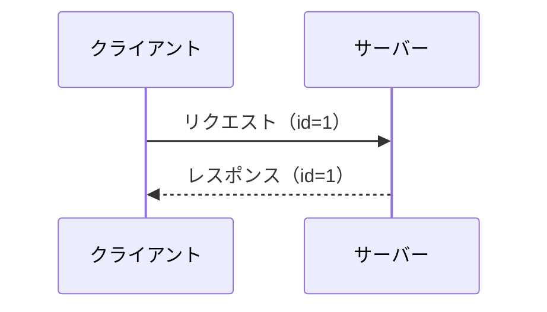

**日本語** | [English](en/tutorial.md)

# チュートリアル（学習ガイド・セットアップ・テスト）

[← READMEに戻る](../README.md)

## 📚 つまずいたときの学習ガイド

本ツールを使ったりREADMEを読んでもピンとこない場合、以下の前提知識を順番に学ぶことをおすすめします。

### 1. 非同期処理の基礎（最重要）

本ツールの核心は「非同期」です。以下の概念を理解しましょう。

| 概念 | 説明 |
|------|------|
| 同期 vs 非同期 | 「結果を待ってから次へ進む」vs「待たずに次へ進む」 |
| Future/Promise | 「まだ届いていない結果を表すオブジェクト」 |
| タイムアウト | 「一定時間待っても結果が来なければ諦める」 |

**学習リソース:**
- Python公式: [concurrent.futures](https://docs.python.org/ja/3/library/concurrent.futures.html)
- キーワード: 「Python 非同期処理 入門」「Python Future 使い方」

### 2. クライアント・サーバーモデル

「リクエストを送って、レスポンスを受け取る」という基本パターンを理解しましょう。



**ポイント:**
- リクエストとレスポンスは `id` で対応づける
- 複数のリクエストを同時に送ると、レスポンスの順番は保証されない

**学習リソース:**
- キーワード: 「HTTPリクエスト レスポンス 仕組み」「WebSocket 入門」

### 3. マルチスレッドの基礎

本ツールでは「メインスレッド」と「readerスレッド」が同時に動きます。

| スレッド | 役割 |
|---------|------|
| メインスレッド | リクエストを送信し、結果を待つ |
| readerスレッド | サーバーからの応答を常に監視し、受信したら対応するFutureに結果をセット |

**学習リソース:**
- Python公式: [threading](https://docs.python.org/ja/3/library/threading.html)
- キーワード: 「Python スレッド 入門」「マルチスレッド 排他制御」

### 4. JSON-RPC 2.0（軽めでOK）

MCPが採用しているプロトコルです。以下だけ押さえれば十分です。

| 項目 | 説明 |
|------|------|
| `id` フィールド | リクエストとレスポンスを紐づける識別子 |
| リクエスト | `id` あり → 応答が必要 |
| 通知（notification） | `id` なし → 応答不要 |

**学習リソース:**
- [JSON-RPC 2.0 仕様](https://www.jsonrpc.org/specification)（英語だが短い）

### 5. MCP（Model Context Protocol）

本ツールが題材としているプロトコルです。AIエージェントとツール間の通信規格として注目されています。

| 概念 | 説明 |
|------|------|
| stdio transport | 標準入出力（stdin/stdout）を使った通信方式 |
| `initialize` | クライアントとサーバーの接続開始ハンドシェイク |
| `tools/call` | サーバーが提供するツールを呼び出すメソッド |
| MCP Inspector | MCPサーバーをテストするためのGUIツール |

**学習リソース:**
- [MCP公式ドキュメント](https://modelcontextprotocol.io/)
- [MCP Transport仕様（JSON-RPCとの関係）](https://modelcontextprotocol.io/specification/2025-11-25/basic/transports)
- キーワード: 「MCP Model Context Protocol 入門」「Claude MCP」

### 学習の順番

```
1. 非同期処理 ─→ 2. クライアント・サーバー ─→ 3. マルチスレッド ─→ 4. JSON-RPC ─→ 5. MCP
     ↓                    ↓                        ↓                    ↓              ↓
  Future/timeout      id で突き合わせ         readerスレッド        プロトコル基盤    本ツールの題材
```

### 本ツールで学ぶ概念

上記の前提知識を踏まえた上で、本ツールでは以下の概念を体験的に学びます。

| 用語 | 説明 |
|------|------|
| orphan response | タイムアウト後に届いた「引き取り手のない」レスポンス。クライアントが待機を諦めた後にサーバーから届くため、対応するリクエストが見つからない |
| demux（多重分離） | 複数のレスポンスをIDで正しいリクエストに振り分ける処理。順不同で届くレスポンスを取り違えないための仕組み |
| pending台帳 | 「送信済み・応答待ち」のリクエストIDとFutureを管理する辞書。タイムアウト時にここから削除されることでorphanが発生する |
| TOCTOU | Time Of Check to Time Of Use。チェック時点と使用時点の間にタイミングギャップが生じる問題 |

これらを理解すると、「なぜorphan responseが発生するのか」「なぜIDの予測可能性が危険なのか」がクリアになるはずです。

---

## 前提条件

- Python 3.9以上
- 標準ライブラリのみ使用（追加ライブラリ不要）
- MCP Inspectorを使う場合はNode.js / npx

---

## セットアップ（venv）

今回はvenvを有効化せずに、絶対パスでvenvのPythonを使います。

```
ipusiron@MHL:~/async-rpc-failure-simulator$ pwd
/home/ipusiron/async-rpc-failure-simulator
ipusiron@MHL:~/async-rpc-failure-simulator$ python3 -m venv venv
ipusiron@MHL:~/async-rpc-failure-simulator$ ls -l ./venv/bin/python
lrwxrwxrwx 1 ipusiron ipusiron 7 Jan 29 02:46 ./venv/bin/python -> python3
ipusiron@MHL:~/async-rpc-failure-simulator$ ./venv/bin/python --version
Python 3.10.12
```

venvの環境構築ではまった場合は以下の記事を参考にしてください。

-[WSL2とvenvで分離するPython開発・実験環境設計【Windows編】](https://akademeia.info/?p=48605)

---

## セットアップ（uv）

[uv](https://docs.astral.sh/uv/)は高速なPythonパッケージマネージャー・仮想環境管理ツールです。venvの代わりにuvを使う場合は以下の手順で環境構築できます。

### uvのインストール

```bash
# macOS / Linux
curl -LsSf https://astral.sh/uv/install.sh | sh

# Windows (PowerShell)
powershell -ExecutionPolicy ByPass -c "irm https://astral.sh/uv/install.ps1 | iex"
```

### 仮想環境の作成と実行

```
ipusiron@MHL:~/async-rpc-failure-simulator$ uv venv
Using CPython 3.10.12
Creating virtual environment at: .venv
Activate with: source .venv/bin/activate

ipusiron@MHL:~/async-rpc-failure-simulator$ uv run python --version
Python 3.10.12
```

### テストの実行

uvを使う場合は、`./venv/bin/python`の代わりに`uv run python`を使用します。

```bash
# MCPサーバーの起動
uv run python ./mcp/demo_server.py

# 失敗モード再現テスト（脆弱な実装）
uv run python mcp/scenarios_test.py

# 堅牢な実装テスト
uv run python mcp/scenarios_test_secure.py

# 攻略コードの統合テスト（脆弱版success/安全版fail）
uv run python challenges/challenge1_orphan_hijack/integration_test.py

# Web UIの起動
uv run python web/server.py
```

> **Note**: 本プロジェクトは標準ライブラリのみを使用しているため、`uv pip install`による依存関係のインストールは不要です。

> **Windows**: 日本語の出力が文字化けする場合は、実行前に`set PYTHONIOENCODING=utf-8`（PowerShellは`$env:PYTHONIOENCODING="utf-8"`）を設定してください。コンソール自体をUTF-8にするには`chcp 65001`も有効です。

> **venv vs uv**: 本プロジェクトは「標準ライブラリのみ」という特殊な条件のため、uvの主な強み（高速な依存解決）が活きません。どちらを選んでも実用上の差はほとんどないため、既にuvを使い慣れているなら`uv run python`で統一し、そうでなければ`venv`で十分です。

---

## MCPサーバーの単体テスト

MCPサーバーは以下の仕様とします。

- stdout：何も出ない（JSON専用）
- stderr：起動ログが出る
- [Ctrl]＋[C]キーで停止

```
ipusiron@MHL:~/async-rpc-failure-simulator$ ./venv/bin/python ./mcp/demo_server.py
MCP デモサーバー起動（stdio transport）
```
MCPサーバーを実行すると起動ログ「MCP デモサーバー起動（stdio transport）」が出力します。

問題は、この出力がstdout（標準出力）ではなくstderr（標準エラー出力）に出ているかどうかでです。
stdio transportではstdoutはJSONのみが絶対ルールだからです。

これがクリアすれば、Inspector互換の第一関門クリアです。

### テスト1　＜stdoutが汚れていないかチェック＞

そこで、以下のようにstdoutを"/tmp/mcp_stdout.txt"ファイルに出力するようにします。

```
ipusiron@MHL:~/async-rpc-failure-simulator$ ./venv/bin/python ./mcp/demo_server.py > /tmp/mcp_stdout.txt
MCP デモサーバー起動（stdio transport）
^C
Traceback (most recent call last):
  File "/home/ipusiron/async-rpc-failure-simulator/./mcp/demo_server.py", line 236, in <module>
    main()
  File "/home/ipusiron/async-rpc-failure-simulator/./mcp/demo_server.py", line 218, in main
    for line in sys.stdin:
KeyboardInterrupt

ipusiron@MHL:~/async-rpc-failure-simulator$ ls -l /tmp/mcp_stdout.txt
-rw-r--r-- 1 ipusiron ipusiron 0 Jan 29 02:55 /tmp/mcp_stdout.txt
ipusiron@MHL:~/async-rpc-failure-simulator$ wc -c /tmp/mcp_stdout.txt
0 /tmp/mcp_stdout.txt
```

サーバーを止めて（あるいは別Terminalから）、"/tmp/mcp_stdout.txt"ファイルのファイル容量をチェックします。
0バイトであれば空なので、確かに起動ログは標準エラー出力に出ていると判断できます。

### テスト2　＜手動で1発疎通（ping）＞

stdioは同一プロセスのstdinに送る必要があるので、簡単にやるなら1コマンドでまとめてこうします。

stdoutだけ確認してみます。

```
ipusiron@MHL:~/async-rpc-failure-simulator$ printf '%s\n' '{"jsonrpc":"2.0","id":1,"method":"ping"}' | ./venv/bin/python mcp/demo_server.py 2>/dev/null
{"jsonrpc": "2.0", "id": 1, "result": {}}
```

stderrだけ確認してみます。

```
ipusiron@MHL:~/async-rpc-failure-simulator$ printf '%s\n' '{"jsonrpc":"2.0","id":1,"method":"ping"}' | ./venv/bin/python mcp/demo_server.py 1>/dev/null
MCP デモサーバー起動（stdio transport）
```

---

## InspectorでMCPサーバーに接続する

以下のコマンドでInspector（疑似MCPクライアント＋UI）からMCPサーバーに接続してみます。

```
ipusiron@MHL:~/async-rpc-failure-simulator$ npx -y @modelcontextprotocol/inspector@0.19.0 --   ./venv/bin/python ./mcp/demo_server.py
```

InspectorのResources/Toolsタブを確認します。

> 
>
> *InspectorのResourcesタブ*

> 
>
> *InspectorのToolsタブ*

Inspector上で以下が確認できます。

- initialize
- resources/list（空配列）
- resources/templates/list（空配列）
- tools/list
- tools/call(add_numbers)
- tools/call(sleep_ms)

Inspectorの環境構築ではまった場合は以下の記事を参考にしてください。

-[「ホストOS上のMCP Inspector操作UIページ」から「WSL上のMCPサーバー」にConnectできない問題を解決した記録](https://akademeia.info/?p=48678)

---
